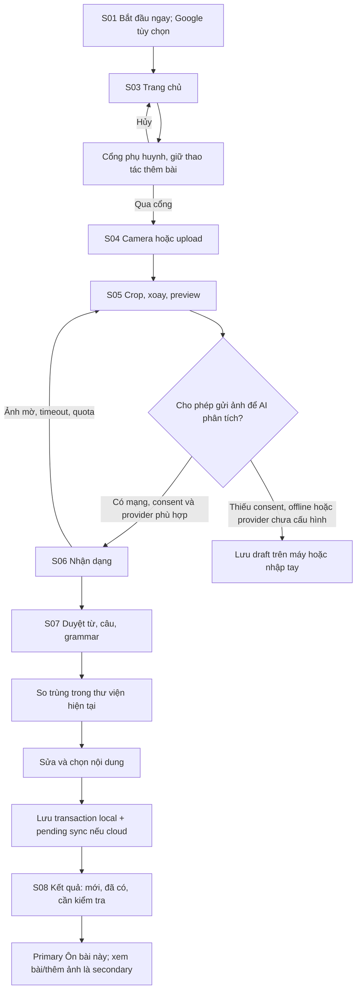
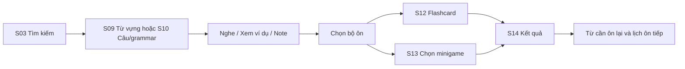

# Các luồng sử dụng

## Luồng hiện hành 10/10/2026 (ADR-030)

Phụ huynh → Cài đặt → AI riêng → Gemini/Google key/model → chọn nhớ localStorage nếu muốn. Thêm ảnh → cắt/xoay/bỏ thông tin riêng → Phân tích bằng AI → chọn listed/all + consent → gửi trực tiếp Gemini/Google → sửa/duyệt/lưu. Thiếu key có liên kết cài đặt; 401/quota/timeout/hủy giữ nháp. Không có nút OCR trên máy hoặc tải reader. Nhập tay vẫn dùng offline.

Thêm từ → gõ thiếu/sai → gợi ý Datamuse sau350ms → chọn từ → tự điền nghĩa song ngữ/POS/sense/IPA/ví dụ có nguồn và hình catalog/OpenMoji → chọn nghĩa/hình nếu cần → phụ huynh kiểm và lưu. Nguồn chưa đủ hiện thiếu dữ liệu, không bắt gõ lại mọi trường đã tra. Kết quả cũ không ghi đè khi query thay đổi. [Evidence](evaluations/parent-dictionary-byok-deploy.md).

## F01 — từ ảnh đến thư viện

Nhận dạng và enrich là hai bước logic: xem nội dung trích từ ảnh trước; nội dung bổ sung được làm cho các mục đã chọn. Nếu enrich lỗi, vẫn cho lưu nguồn cùng `contentStatus=needs_enrichment`; không chặn lưu từ đã duyệt. Mục chưa đủ nghĩa/ví dụ không vào bộ game cần các trường đó.

Kết quả trùng mặc định bỏ tạo entry, nhưng liên kết vào bài mới. Nếu phát hiện cùng từ khác nghĩa/POS: đề xuất thêm nghĩa vào entry hiện có; người dùng xác nhận. Nếu tất cả đã có, vẫn có thể lưu một bài với links, không tạo 0-content thành công giả.

## F02 — tìm lại và học

Deck là tập truy vấn có filters hoặc danh sách entry IDs; card theo sense. Khi xóa mục trong lúc có phiên học, snapshot bảo vệ phiên; bài học mới không tự làm biến đổi câu hỏi đang mở.

## F03 — guest chuyển Google/cloud

1. Khách đang có dữ liệu local bấm `Đồng bộ với Google`.
2. OAuth thành công chỉ xác nhận danh tính; chưa tự upload thư viện guest.
3. S15 hiển thị hai scope, số bản ghi mới/trùng/xung đột và `Sao lưu trước khi chuyển`.
4. Người dùng chọn `Gộp thư viện này lên tài khoản` hoặc `Giữ riêng trên máy`. Chọn giữ riêng thì Google account vẫn có cloud library độc lập.
5. Gộp theo import ID và batches; map local IDs→cloud IDs; xác minh count/checksum rồi mới đánh dấu thành công. Dữ liệu guest giữ đến khi người dùng chủ động xóa.
6. Mạng đứt: giữ transfer checkpoint và source guest; retry cùng ID. Không bắt nhập lại, không nhân đôi.
7. Logout: cancel requests, ngừng sync, tách cache theo account; nếu pending edits, cho đồng bộ hoặc xuất backup trước khi xóa cache. Có thể tiếp tục làm guest trong scope riêng.

## F04 — hoạt động offline

| Thao tác | Hành vi |
|---|---|
| Xem/tìm/note/flashcard dữ liệu đã lưu | Hoạt động local |
| Game có đủ asset đã cache | Hoạt động, lưu event local |
| Chụp ảnh | Lưu draft local sau khi kiểm tra quota storage |
| Phân tích AI từ xa | Hiển thị cần mạng; nút thử lại khi online, không tự gửi draft chưa consent |
| Nghe | Thử giọng local; nếu không có thì thông báo, audio cloud chỉ khi đã cache |
| Cloud sync | Outbox pending; sync foreground khi online, không phụ thuộc Background Sync API |

## F05 — lỗi và hủy

- Camera bị từ chối/không hỗ trợ: giữ màn S04, có `Chọn ảnh từ máy` và hướng dẫn cấp quyền.
- AI đọc không rõ: đánh dấu evidence và cho sửa; không tự đoán thành từ chắc chắn.
- Hủy phân tích: abort phía client, server cố gắng hủy provider; không hứa refund nếu provider đã chạy. Draft vẫn còn.
- Storage đầy: không báo lưu thành công; cho export, xóa draft cũ hoặc giảm ảnh; giữ nội dung đang duyệt trong memory cho tới khi người dùng rời trang.
- OAuth đóng popup/thất bại: trở lại scope hiện tại, thư viện không đổi.
- Xóa mục: soft-delete và Undo ngắn; đồng bộ tombstone, không tái sinh từ cache cũ.

Mỗi flow có acceptance scenarios trong `10-quality-and-acceptance.md`; không chỉ kiểm tra happy path.

## F07 — gõ tay, tra và thêm từ mới

1. Từ Hôm nay hoặc Từ của con, chọn `Thêm từ` qua parent gate, mở editor mới S09; không cần ảnh, quyền camera hoặc hoàn thành OCR.
2. Gõ từ/cụm từ tiếng Anh: autocomplete đưa gợi ý khớp chữ đang gõ và từ liên quan có dữ liệu; phân biệt `Đã có trong thư viện` với `Từ gợi ý để thêm`. Search thư viện và tra từ mới là hai thao tác khác nhau.
3. Chọn gợi ý hoặc tra nguyên văn input; xem nghĩa EN/VI, POS, IPA/cách đọc chữ Việt, audio và ví dụ khi nguồn có. Nếu nhiều nghĩa thì phụ huynh chọn nghĩa/POS cần học; nguồn từ điển và phần AI bổ sung được gắn nhãn riêng.
4. Sửa/duyệt nội dung → kiểm trùng xác định → lưu guest local hoặc cloud scope hiện tại. Từ/đúng nghĩa đã có thì mở/link mục hiện có; nghĩa/POS mới giữ riêng. Không auto lưu khi chỉ chọn gợi ý.
5. Không tìm thấy/offline/quota/lỗi tra: giữ input, cho thử lại hoặc nhập nghĩa thủ công/lưu bản chưa đầy đủ; không dựng kết quả tra giả. Chỉ nội dung đủ điều kiện và đã duyệt mới vào phần bé học. Hủy quay lại trang đã mở, không tạo entry; lỗi save giữ nháp.

Flow là yêu cầu T07, storage/dedup theo T03/06; hiện chưa có tra từ/autocomplete/provider thật. Graph nguồn của editor tại founder S09.

## F06 — phụ huynh chuẩn bị, bé học

Parent gate tại S03/S09/S10/S16 giữ intended action; trẻ nghe/chơi/xem nội dung approved, phụ huynh chụp/duyệt/đổi key/chọn hình/merge/delete. S09 Chọn hình→catalog trước→search nguồn mở→shortlist có nguồn/credit→parent approve→import→ready→hai game hình; từ vẫn lưu khi media pending/error. S16 danh sách ảnh chờ và AI config có eligibility, secret store và server auth gate. Flow/concurrency graph ở 14, founder tự chứa ở mục 15; không thêm màn thứ 17.
