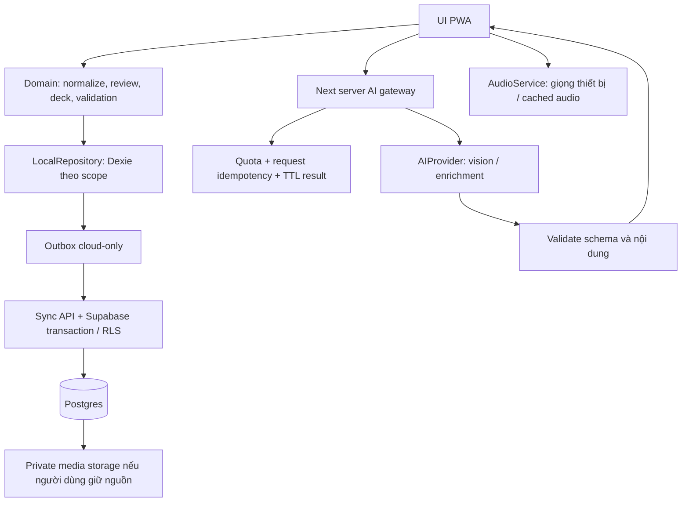

# Kiến trúc đề xuất

## Current override — ADR-040/041

Founder explicitly authorizes a public shared Gemini browser default. Private parent override and persistent AI-off/restore remain; private keys stay out of server/IDB/cloud/backup. Hosted Supabase initial migrations0001–0006 applied atomically; future CLI use must reconcile manual migration history. [Evidence](evaluations/ui-and-hosted-cloud-fixes.md).

## Quyết định hiện hành 10/10/2026 — ADR-030

Founder đã yêu cầu **Gemini thay OpenAI** trong BYOK, ưu tiên model free tier và đổi nhiều model. Browser gọi trực tiếp Google generateContent bằng header x-goog-api-key, ảnh inline JPEG, systemInstruction coi ảnh là data, structured responseFormat JSON/schema; parse STOP/non-thought/strict DTO/evidence, max50/90s/500KB/cancel/no retry/Web Locks. Không key/ảnh đi qua app server, không key trong URL/IDB/backup/sync/env. Session mặc định/localStorage opt-in/delete giữ theo ADR029. Cấu hình cũ OpenAI bỏ qua, không gửi key cũ sang Google. Bốn model3.5FlashLite(default)/3.1FlashLite/3.6Flash/3.8Flash và custom Gemini ID; không tự fallback model hoặc bật billing. AI_PROVIDER server vẫn none (gateway planned).

Google pricing/model/API docs kiểm10/10 xác nhận free tier có quota cho bốn lựa chọn; project paid có thể tính phí. Current API terms vẫn hạn chế under18-directed/likely-access clients; latest user request xác nhận code/config Gemini, không thành xác nhận Google eligibility. T00 account/retention/live benchmark còn pending, free tier dữ liệu có thể dùng cải thiện sản phẩm. CORS OPTIONS thật200, chưa key/inference/quality/quota thật. Không mang store:false/ZDR OpenAI sang Gemini.

Datamuse350ms/Wiktionary bilingual gloss/POS/IPA/Tatoeba sourced examples tự điền; catalog21→174licensed OpenMoji, parent sense/image review, thiếu dữ liệu báo rõ. Live handsom→handsome/đẹp trai đã kiểm. Native Vercel Git pushmain đã deploy READY app; Supabase optional/live pending. [Setup](../SETUP-PROJECT.md), [evidence](evaluations/parent-dictionary-byok-deploy.md). OCR/key/provider/OpenAI gateway mô tả cũ bên dưới là lịch sử/roadmap nếu xung đột ADR030.

## Runtime lịch sử — ADR-026, OCR superseded bởi ADR-029

Đã có pipeline thật không cần provider: catalog21/manual lookup → review → IndexedDB; Tesseract7 worker/WASM/model same-origin cho ảnh đã prepare, parent sửa/duyệt trước lưu. Native worker có owner, abort/60s timeout/cleanup cả initialization; không tải CDN hoặc gửi ảnh. Native service worker tự viết từ template hash build (không cài Serwist): navigation network-first, thất bại trả offline shell; chỉ precache asset public đã whitelist, không HTML/RSC/API/auth/private response. Không skipWaiting/refresh giữa bài. Offline đọc scope được chọn explicit, kiểm approval/revision, ghi SRS/game/session atomic vào cùng DB. Main app giữ 3 nav và route tools phụ huynh.

SQL migrations chạy Postgres15 thật local với forced owner RLS/composite FK/unique canonical/private bucket policies. `auth.uid`, auth users và storage metadata trong harness là fixture; app chưa nối OAuth/sync/storage API. Provider none, không public secret. [Evidence](evaluations/local-end-to-end.md).


## Stack

| Thành phần | Lựa chọn P1 | Lý do / ranh giới |
|---|---|---|
| Web | Next.js App Router + TypeScript | PWA UI và server API cùng repo; trang library là client-rendered từ DB local |
| UI | Tailwind + shadcn/ui + Lucide | Component primitives, accessibility; custom design theo tài liệu, không dùng theme mặc định nguyên khối |
| Motion | CSS + Motion for React | Animation tương tác và storyboard có state |
| Local database | IndexedDB qua Dexie | Transaction, schema version, compound index, blobs/outbox |
| State | Dexie live queries cho dữ liệu; React state/context cho UI | Không duy trì thêm một bản thư viện trong global store |
| Cloud | Supabase Postgres + Auth Google + private Storage | Unique constraints, RLS, quan hệ giữa bài/từ/sense/review |
| AI | OpenAI BYOK trực tiếp browser theo ADR-029; server gateway planned | Parent model/key, vision + strict output + review; live accuracy/retention account chưa nghiệm thu |
| Media | Catalog + adapter nguồn mở, parent review, asset import/credit | Không imagegen runtime P1; async bounded search/import/shared quota theo 14 |
| Audio | Web Speech API + feature detection | P1 chi phí thấp; optional server TTS P2 |
| PWA | Manifest + native service worker hash public assets (ADR-026) | Cache shell/assets có kiểm soát; không cache API/auth trả lời riêng tư |
| Test | Vitest + Testing Library + Playwright + SQL/RLS tests | Domain, UI, integration, E2E |

**Versions đã pin ở scaffold T01:** Node 24.14.1, pnpm 11.25.0, Next 16.4.0, React/React DOM 19.3.0, TypeScript 6.0.3, Tailwind/PostCSS 4.3.3, ESLint 9.39.5 + eslint-config-next 16.4.0, Vitest 5.0.3, Playwright 1.64.0. Direct dependencies và resolutions nằm trong package.json/pnpm-lock.yaml. shadcn CLI 4.21.4 thêm Radix primitives vào source; palette/Nunito/SVG kế thừa T18. TypeScript 7/ESLint 10 không khớp peer của lint plugins tại lần kiểm, nên giữ bộ peer-compatible trên; theo dõi nâng cấp lint toolchain ở quality gate, không bỏ qua peer errors. Serwist 9.5.13 có peer Next >=14/React >=18/TS >=5 và hướng dẫn Webpack/Turbopack riêng; đó là nghiên cứu scaffold lịch sử. Runtime hiện dùng native service worker theo ADR-026 và đã kiểm offline local; cloud scope và thiết bị thật còn cần nghiệm thu.

Không tự động dùng model `latest` trong production. **Provider chưa chọn:** child-first 5–8 và mục tiêu miễn phí yêu cầu kiểm tuổi/dữ liệu/quota trước benchmark. Gemini Developer API hiện không eligible cho child-directed app theo 07; không bật chỉ vì có key phụ huynh. OpenAI cũng chưa được xác minh điều kiện triển khai cho trẻ, không là default đã chốt. Scaffold chỉ chấp nhận `AI_PROVIDER=none`, demo không gọi AI; T05 mới thêm eligible adapter sau T00.

## Luồng dữ liệu

**T04 implemented/local verified, phone smoke pending:** logical schema v3 thêm `captureDrafts` typed và dùng `localMedia` blobs; không đổi review drafts/content cũ. Camera/preprocess chỉ tải ở capture routes; Today chỉ query metadata nháp theo scope. Ảnh đầu vào qua header/decode/EXIF/resize rồi chỉ lưu JPEG sạch metadata và bản chuẩn bị; bản gốc upload không persist. Consent local không tạo outbox hay network job. [Evidence T04](evaluations/t04-capture.md).

**T03 implemented/locally verified:** Dexie 4.4.6, dexie-react-hooks 4.4.0 và fake-indexeddb 6.2.5 (test-only), versions exact/peer check. Database `words-for-kids.local`, schema v1→v2 additive; metadata giữ UUID scope guest và demo riêng, không seed demo vào guest. Repository reads có snapshot transaction, writes/receipt/search cập nhật atomic; React live query nhận dữ liệu, chỉ giữ buffer nhập/nháp để UI đáp ứng. UI không render toàn bộ 5.000 mục: trang 50, overview 20, Today search 4. Account scope/outbox chỉ là seam dữ liệu, chưa auth/sync. Evidence [T03](evaluations/t03-local-repository.md).



**Thư viện luôn đọc/ghi local trước.** Guest chỉ có local scope, không có cloud outbox. Cloud scope lưu transaction local và event outbox, sau đó đồng bộ; mọi UI nhìn cùng trạng thái local đã reconcile. Không vừa ghi Supabase từ component vừa ghi Dexie độc lập.

Scope format `guest:<deviceLibraryId>` hoặc `account:<userId>:<libraryId>`. Repository và requests nhận scope bắt buộc; account transition tạo repository instance mới, hủy subscription/request cũ. `scopeEpoch` ngăn response tài khoản A cập nhật state sau khi chuyển B.

## Xử lý AI P1

P1 mỗi request đồng bộ có timeout đề xuất 45 giây; không cần queue worker lâu dài. `/api/analysis` dùng request ID, kết quả có thể lấy lại trong 15 phút. Khi timeout, UI giữ draft và retry có kiểm soát. T05 phải đo giới hạn hosting thực tế và chọn timeout nhỏ hơn giới hạn đó; không giả thiết serverless cho chạy vô hạn.

AI gateway không có quyền tự lưu thư viện. Chỉ trả candidate DTO. Nội dung người dùng đã chọn được lưu bởi repository sau review. Enrichment cho batch tối đa 20 mục/request, chỉ xử lý mục mới/thiếu nội dung, không gửi toàn bộ DB tới provider. Multi-page jobs/queue là P2.

Guest dùng cookie capability HttpOnly/Secure/SameSite và request token không đoán được; không tạo tài khoản Supabase ẩn để biến guest thành cloud user. Quota/idempotency phải có storage server dùng chung, không dựa vào Map của một serverless process. Chỉ metadata request và kết quả xử lý mã hóa TTL ở vùng private, tách khỏi library tables. Xem retention tại `09-api-and-operations.md`.

## Cấu trúc repo mục tiêu

```text
src/
  app/                    routes, API handlers, app shell
  components/             primitives, word cards, review UI
  features/
    capture/              camera, crop, draft, review
    library/              search, word/sentence/grammar detail
    practice/             decks, flashcards, games
    settings/             account, sync, backup
  domain/                 pure rules: canonical keys, SRS, answers
  data/
    local/                Dexie schema/migrations/repositories
    sync/                 outbox, mapping, conflict resolver
  server/
    ai/                   provider adapters, prompts, validators
    auth/                 session validation
    sync/                 authorized transaction endpoints
    limits/               quota/idempotency + shared provider limiter
    media/                search adapters, license records, approved import
  lib/                    audio, image processing, i18n, telemetry
supabase/migrations/      SQL versioned; chưa có trong lượt planning
tests/{unit,integration,e2e,fixtures}/
docs/                     đặc tả và context bàn giao
.agents/skills/           skills được pin theo project
```

`window`, camera, speech và IndexedDB chỉ chạy client; không import module Dexie tạo instance trong SSR. Domain không phụ thuộc Next, Supabase hoặc React. Contracts shared server/client; validation ở cả hai phía, server là authority cho quyền và quota.

## Lựa chọn đã cân nhắc

- Firebase: hợp Google login và có offline SDK, nhưng relational senses/links và unique key transaction dễ diễn đạt trong Postgres. Supabase được đề xuất; không trộn hai backend.
- localStorage: đủ cho theme/locale, không phù hợp thư viện/ảnh/transaction; chọn IndexedDB.
- OCR local đã bỏ theo founder ADR-029. Browser chỉ prepare ảnh; phân tích qua BYOK khi có mạng, nhập tay khi offline.
- Embedding/vector DB: chưa cần cho tìm kiếm 5.000 mục; T03 dùng normalized substring trên derived search rows có index scope/ordinal; index giữ nghĩa/tag/câu/bài, chỉ materialize trang 50. Tìm exact/prefix là trường hợp của substring; chưa inverted/full-text index. Lab 5.000 mục đạt search target nên giữ cách đơn giản này, đo lại trước khi cần inverted index. Fuzzy search có thể thêm khi đo được nhu cầu, không dùng để quyết định dedup.
- Native app: chưa cần trước khi kiểm chứng PWA camera/storage/audio trên iOS/Android.

## Privacy thực tế

`Lưu trên máy` mô tả nơi lưu thư viện, không đồng nghĩa toàn bộ xử lý offline. UI phải nói rõ AI từ xa, xử lý tạm thời và tùy chọn không gửi ảnh. Nhập và lưu thủ công dùng local; tra từ/autocomplete ngoài catalog đã lưu có thể cần mạng ở T07; OCR local đã loại bỏ theo ADR-029. Không tự upload ảnh gốc lên cloud khi đăng nhập: chỉ giữ nguồn cloud nếu người dùng bật lựa chọn đó.
