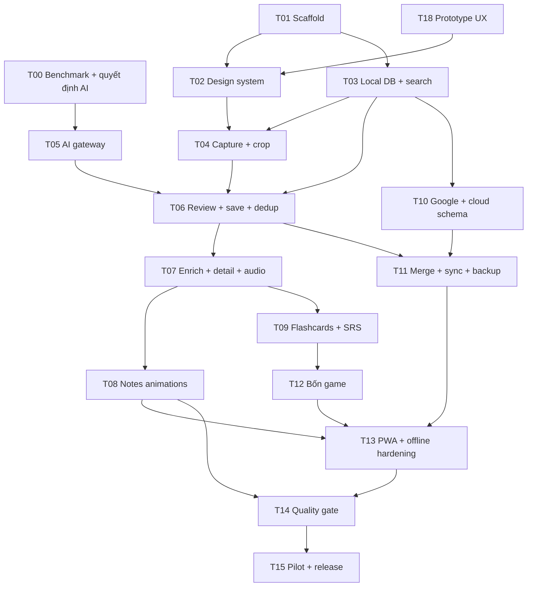

# Kế hoạch thực hiện theo giai đoạn

## Milestone hoàn thiện code độc lập — 10/10/2026

Theo yêu cầu founder, source-photo/account lifecycle, notes/sense conflict UI, optional Commons bounded licensed adapter/shared quota, catalog21 đủ2examples/contract1.1, S10 và prepared offline OCR/basic edit đã nối. [Setup](../SETUP-PROJECT.md) + Vercel/config/CI chuẩn bị; [evidence cuối](evaluations/completion-local.md) ghi tests và performance hiện hành. T00→T05 còn provider decision và gateway runtime; hosted/device/human/pilot chưa đạt, không đổi dependency hoặc gọi toàn plan done.


## Checkpoint continuous local — 10/10/2026

Theo steering founder/ADR025–026 đã nối các phần độc lập T06–T14 và kéo OCR local T16 lên fallback để test xuyên suốt. Không đổi dependency thành đã đạt; T00/T05/liveAI/Google/cloudsync/human/device/release chưa nghiệm thu. Runtime manual/autocomplete/IPA/localOCR/review/notes/SRS/decks/game/backup/offline cụ thể vàcommand evidence tại [local end-to-end](evaluations/local-end-to-end.md). TASKS giữ4done/2pending_external/10in_progress/3planned; P2 expansionT17 chưa được chọn.


## Thứ tự và critical path



Không cần nhiều agent để thực hiện kế hoạch. Có thể đổi thứ tự các việc độc lập khi có lý do, nhưng dependencies và acceptance vẫn được giữ; không tự spawn agent chỉ vì diagram có nhánh.

## P0 — nền tảng và kiểm chứng

**T18 — prototype UX trước khi nhân rộng UI, artifact đã hoàn tất.** Dùng product-design mode shape, frontend-design, Impeccable distill/layout/colorize/typeset, motion-design/ui-animation và ui-ux-pro-max targeted search; tham khảo Inspo theo 04/13/design research. Tạo prototype clickable 5 màn S03/S07/S09/S12/S13 ở `docs/design/prototype/`, sample data có nhãn, empty/error/reduced-motion và flow liên kết; screenshots/self-review có rationale/rule IDs; kịch bản QA25 sẵn. Acceptance: nav 3 mục, một CTA theo state, đọc/nghe/reveal/game hiểu được; self-review và coverage gaps rõ. Human study chưa có ghi pending, không ghi QA25 pass; T02 có thể tiếp tục, T15 bắt buộc thử người thật.

**T00 — chuẩn bị implemented, pending_external.**20 synthetic PNG/40 mode references, manifest/prompt/schema hashes, offline scorer15 tests vàCLI40/40 self_test PASS; [evidence](evaluations/ai-benchmark.md). Human ground truth/ảnh viết tay thật/account eligibility/credential/live quality-cost/model selection chưa đạt. Không tăng done hoặc gọi self-test là OCR. Next T10 phần độc lập.

**Phạm vi T00 — benchmark và ADR AI.** Tạo ảnh tổng hợp có ground truth theo 07/10, lọc provider phù hợp child-directed app/retention/quota trước, rồi so ứng viên bằng current official docs và credential khi có. Deliver `docs/evaluations/ai-benchmark.md` với model/prompt/schema versions, precision/recall, latency, cost và lựa chọn provider. Nếu chưa có key, hoàn tất fixtures/harness và ghi pending live benchmark; không block T01–T04.

**T01 — scaffold, đã hoàn tất.** Next/TS, package manager/lockfile, folder layout, lint/typecheck/test/build, env schema/example, mock flag và CI cơ bản. Next/React/Tailwind/shadcn đã build và browser smoke; Serwist mới kiểm docs/peer metadata, SW/cache integration thuộc T13. Acceptance dev/render/build pass; 14 unit + 7 browser tests, lệnh thực trong AGENTS/README, [evidence T01](evaluations/t01-scaffold.md). GitHub CI mới cấu hình, chưa chạy remote; T02 đã done UI/demo; T03 đã done local repository.

**T02 — design system và app shell, hoàn tất ở mức UI/demo.** Dựa T18, dùng frontend-design, motion-design/ui-animation, product-design và accessibility; tạo high-fidelity S03/S07/S09 và shared primitives (button/input/sheet/tabs/status/empty/audio control). VI/EN và preference modes; nav/CTA theo 03/13. Acceptance: 360/1.280 px, keyboard, reduced motion; screenshot hierarchy và production baseline budgets QA26; không suy lab INP thành field pass. Đã port S03/S07/S09, 22 unit + 27 browser tests, 15 cold loads + 50 input actions; [evidence UI](evaluations/t02-ui-shell.md) và [baseline](evaluations/ux-performance.md). Memory fixture không hoàn tất T03/T06/T07; device/human/field/5.000-entry gates còn pending.

## P1 — luồng sản phẩm hoàn chỉnh

**T03 — local repository, đã hoàn tất.** Dexie4.4.6/hooks4.4.0, schema v1→v2 lossless, guest/demo scope riêng, canonical v1 + compound unique, entries/senses/lessons/notes/events/receipts và derived search. Reload giữ sửa/nháp/kết quả, hai tab save một lần, stale edit/quota có recovery; đổi chữ EN là proposal, giữ bản approved cho bé. QA01/02/09/10 + rollback: 49 unit/integration, 42 browser tests; 5.000 mục/50 mixed inputs/CPU4× p95≈166 ms. [Evidence T03](evaluations/t03-local-repository.md). Cloud scope/outbox chỉ là seam, T10/T11 chưa kết nối; capture/enrichment/notes UI/SRS vẫn task riêng. T04/T10 ready.

**T04 — camera/upload, implemented local; pending_external.** S04–S05, feature detection, EXIF/crop/rotate/resize2200, JPEG/PNG/WebP ≤10 MB/20MP, versioned scoped draft/blob transaction, autosave/manual/reload/conflict/quota retry, consent UI không upload. Camera tracks cleanup và late-response guard; native Chromium test dùng mock acquisition/canvas MediaStream. `check`57 unit-integration/build và browser58 PASS, lab6 large-image runs269–335ms/CPU4×; [evidence](evaluations/t04-capture.md). Acceptance QA07 trên web đã kiểm phần local, smoke iPhone Safari/Android Chrome thật còn pending; không chuyển done trước evidence này. T00 phần dataset/harness đã chuẩn bị, live pending; next T10 phần độc lập.

**T05 — AI gateway.** Server adapter, current SDK/docs, schemas, validation, quota/lease/result TTL, extraction modes, timeout/cancel/refusal; mock explicit cho dev. Acceptance QA03–06/22, contract validation; live provider test chỉ ghi verified khi đã gọi thật. Không đẩy API key ra client. Provider eligibility, key secret store/operator-managed, media endpoint theo 09/14; node skill áp dụng bounded I/O + shared limiter, không mặc định native TS guidance thay toolchain Next. QA29 gồm 429/cancel/multi-instance, không chỉ mock một Promise.all.

**T06 — review/save/dedup.** S06–S08, evidence preview, tabs mới/trùng/cần sửa, proposed senses, selections, lesson transaction and receipts. Acceptance QA08, all duplicate/save retry/enrich incomplete; lưu link nguồn mới nhưng không overwrite sense người dùng sửa.

**T07 — library/detail/enrichment/audio.** Thêm từ trực tiếp từ S03/S09: gõ EN, autocomplete từ liên quan, tra nguồn phù hợp, chọn nghĩa/POS, parent review, transaction dedup/save; không phụ thuộc camera/OCR ở đường nhập tay. UI/nhập thủ công làm được độc lập, tra live chỉ verified sau tích hợp nguồn đủ điều kiện; QA08/09/10/11 kiểm retry/reload/query race/thiếu kết quả. S09–S10, EN–EN/EN–VI, examples, source/generated labels, sentence/pattern/grammar breakdown và audio service. Acceptance QA10/11/16, mỗi sense enriched ≥2 examples; dưới từ và từng câu có IPA xác minh (UK/US khi có) + cách đọc gần đúng bằng chữ Việt đã duyệt theo R07/R08. Version enrichment contract/fixtures, provenance/parent editor, thiếu dữ liệu và đổi text/accent phải xử lý; không verified IPA giả. Eligibility flags cho games; pipeline catalog/search/license/parent shortlist/import/credits và progressive media theo 14/QA28. Không chặn text vì thiếu hình; chuẩn bị catalog cartoon các từ pilot phổ biến.

**T08 — memory notes.** Text notes + 3 declarative templates, playback/pause/replay, static view, validated token refs. Acceptance QA11/12; no generated code execution; user notes persist qua enrich/sync.

**T09 — flashcards/SRS/progress.** Deck queries/custom list, session snapshot/resume, card direction, rating events/reducer v1, today due count và results. Acceptance QA13; fixed-clock calculations, double tap/reload events apply once, games chưa tự đổi lịch ôn.

**T10 — Google và cloud security.** Supabase setup instructions + SQL migrations, typed relations/unique keys/RLS/grants/private storage và auth callback. Acceptance QA18 với 2 accounts; Google staging smoke. Không ép guest lên cloud; login không tự merge.

**T11 — sync/merge/backup.** Scope switching, outbox push/pull, cursor, conflicts/tombstones, guest transfer preview/batch/checksum, export/import/delete. Acceptance QA17/19/20/21/24; lossless partial-transfer retry và verify. Cloud pending status truthful.

**T12 — 4 games.** Approved asset catalog có attribution, question builders, distractor eligibility, answer normalization/hints, snapshot/resume/results. Acceptance QA14/15/16 cho G01–G04; có nội dung thật chơi được, không chỉ disabled menu.

**T13 — PWA/offline.** Manifest/SW scope-safe cache, foreground sync, app update prompts, offline sessions/assets/drafts. Acceptance QA19/20/23 trên iOS/Android; không hứa browser closed vẫn sync.

**T14 — quality/hardening.** Chạy matrix 10, performance/search measurements theo 13, a11y/visual QA, motion interruption, AI human evaluation, request TTL/quota/cost caps; sửa lỗi trọng yếu. Acceptance evidence đủ R01–R21/R24–R25/N01–N09 phần technical; human usability QA25 chuyển pilot T15, issues còn lại rõ impact.

**T15 — pilot và release.** Hướng dẫn dev/staging/production, migration backup/rollback, ≥5 phụ huynh + ≥5 trẻ 5–8, ít nhất 2 chưa đọc nhãn, app voice cues được phép thử theo QA25/13, sửa flow khó hiểu và retest; cập nhật tình hình trong KE-HOACH-FOUNDER. Phát hành khi được yêu cầu. Deployment chỉ thực hiện theo scope được user cho ở lượt triển khai; tài liệu planning không phải một lần deploy đã hoàn tất.

## P2 — mở rộng đã tách rõ

**T16:** local OCR Tesseract.js worker, cache language/model assets, cancel, low-end mobile budget, consent-free local path, manual enrichment; chưa hứa offline full grammar generation.

**T17:** nhiều learner profiles với isolation, PDF/batch + durable queue, optional cloud TTS/image assets, advanced search/FSRS theo dữ liệu; mỗi hạng mục cần acceptance riêng. Không làm cả nhóm mặc định trong một task khổng lồ.

## Mẫu giao việc cho AI

```text
Đọc AGENTS.md, docs/ai/START-HERE.md và docs/ai/STATE.md.
Thực hiện task T04 theo docs/ai/TASKS.md và các đặc tả được routing.
Hoàn tất behavior và acceptance của task, không chỉ tạo UI mock.
Ghi bằng chứng kiểm tra, cập nhật TASKS/STATE/CHANGELOG và một bước tiếp theo.
Nếu thiếu credential, hoàn tất phần độc lập và ghi integration chưa verified.
```

Không đưa một prompt “làm hết app” thay cho các contract/checkpoint. Ước lượng thời gian nên lập sau T00–T03 vì độ khó ảnh thực, số thiết bị và chất lượng nội dung ảnh hưởng lớn; bản kế hoạch này không đưa deadline thiếu căn cứ.
