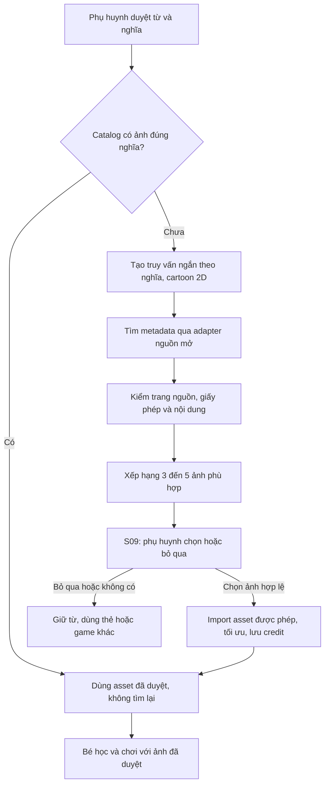
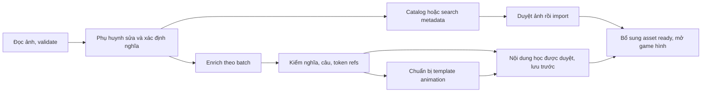

# Ảnh học, animation và xử lý song song — Words for Kids

## Quyết định hiện hành 10/10/2026 — ADR-029

Yêu cầu mới nhất của founder thay OCR trên máy bằng **OpenAI BYOK của phụ huynh**, gọi trực tiếp từ trình duyệt. Key ở bộ nhớ phiên; phụ huynh có thể chọn nhớ trong localStorage, xóa bất cứ lúc nào. Không ghi key vào IndexedDB, backup, cloud sync hoặc server app. Đây là ngoại lệ được người dùng xác nhận cho quy tắc key server-only cũ. `AI_PROVIDER=none` chỉ áp dụng gateway server chưa triển khai, không tắt BYOK.

Ảnh JPEG đã cắt thông tin riêng được gửi sau hành động và consent rõ ràng, endpoint cố định OpenAI Responses, `store:false`, schema strict, tối đa50 mục/90s/một request giữa các tab hỗ trợ Web Locks. Không tự retry; lỗi/quota/hủy giữ nháp. Chữ trích từ ảnh là evidence; nghĩa/ví dụ AI bổ sung cần phụ huynh duyệt. Không coi `store:false` là ZDR hoặc tests fixture là benchmark accuracy. Không gửi dữ liệu riêng trẻ dưới13 khi chưa có ZDR được duyệt. Không tích hợp Gemini. T00 account/retention/live benchmark còn pending.

Autocomplete dùng Datamuse sau350ms, hỗ trợ chính tả; chọn từ tải Wiktionary bilingual gloss/POS/IPA và ví dụ Wiktionary/Tatoeba. Không gọi AI mỗi phím. Tự điền dữ liệu có nguồn, chọn nghĩa riêng và ghép catalog/174 OpenMoji đã bundle với license/credit. Thiếu nguồn báo rõ, không bịa nội dung/hình. `handsom` → `handsome` → “đẹp trai” đã kiểm bằng API thật. Chỉ ảnh/từ đã duyệt mới đến phần học của bé.

Vercel project words-for-kids đã nối GitHub; push main tự deploy production. [Setup chi tiết](../SETUP-PROJECT.md) và [evidence hiện hành](evaluations/parent-dictionary-byok-deploy.md). Các mô tả OCR local/server secret store/provider chưa chọn bên dưới là quyết định/roadmap trước ADR-029 nếu xung đột.

## Adapter triển khai — 10/10/2026

Optional Wikimedia Commons thay adapter search chưa chọn: `/api/media/search` và `/api/media/import`, authenticated parent/same-origin/explicit consent; query public word+sense, không worksheet. Fixed-host allowlist commons.wikimedia.org + upload.wikimedia.org/thumb.wikimedia.org/no redirects/bounded bytes/timeout, shortlist5 metadata, CC0/Public domain/CC BY3/4, thumbnail raster; import recheck page SHA/license, JPEG512px/500KB, HMAC receipt cho source/hash/checkedAt. Shared Postgres leases0006: 2 operation/principal,8project,100/dayprincipal,1000/dayproject,30s lease; env chỉ giảm caps. Process LRU100/TTL5m/inflight8 bổ trợ, không thay distributed quota. Pending/restored ảnh cần parent review đúng revision; ready mới tới child, credit/source/license theo sync/backup và offline card. Assets khác scope/revision không lộ. Network fixtures đã kiểm; public live smoke trả4 candidates và import một raster JPEG400×512/23.863bytes, không ghi library/parent approve, không kiểm route hosted auth/quota. Key/flag và deployment tại [setup](../SETUP-PROJECT.md); [milestone](evaluations/completion-local.md).

Quyết định sản phẩm ngày 09/10/2026: trẻ 5–8 tuổi trước, phụ huynh chuẩn bị bài; Theme C tạm chốt. P1 ưu tiên **ảnh hoạt họa có sẵn** và **animation tái sử dụng**, không cần gọi API tạo ảnh/video khi học. R25, T05/T07/T08/T12/T14 triển khai tài liệu này. Đây là đặc tả; chưa có integration media trong app.

## Tách bốn việc

| Việc | Đầu vào → đầu ra | Cách làm P1 |
|---|---|---|
| Đọc bài học | Ảnh tờ A4 → từ/câu/grammar có bằng chứng | Vision của provider phù hợp app trẻ em, hoặc nhập tay; phụ huynh duyệt |
| Bổ sung nội dung | Từ + POS + nghĩa đã xác định → EN–EN/EN–VI, ví dụ, phân tích | Enrichment được validate và phụ huynh xem; không gọi lại cho nội dung đã đủ |
| Chọn ảnh học | Nghĩa cụ thể → hình minh họa đúng nghĩa | Catalog đã duyệt → tìm nguồn mở khi thiếu → shortlist → phụ huynh chọn |
| Animation | Nội dung đã duyệt + asset ID → storyboard | Renderer CSS/Motion/SVG của app, ba template 04; AI chỉ đề xuất dữ liệu |

Thay tạo ảnh bằng tìm ảnh chỉ thay bước thứ ba. Nó không làm vision/enrichment tự miễn phí, không thay điều khoản provider.

## Pipeline tìm ảnh

Ưu tiên: asset riêng của dự án/catalog dùng lại → thư viện mở được chọn trước như OpenMoji cho một số vật cụ thể → Openverse/Wikimedia Commons để tìm thêm. OpenMoji là CC BY-SA 4.0, cần credit và xử lý đúng giấy phép bản sửa; không đổi nhãn thành CC0. Openverse là máy tìm kiếm metadata, không cấp phép thay tác giả. Với Commons phải đọc trang từng file. P1 nguồn tìm mở tự động chỉ nhận CC0/public-domain có bằng chứng và CC BY phù hợp; CC BY-SA chỉ dùng từ bộ curated có quy trình giữ license. Không mặc định nhận NC/ND/không rõ nguồn.

Các nguồn là **ứng viên**; T07 kiểm API và điều kiện lưu lại/phân phối của từng nguồn trước khi enable adapter. Không scrape Google/Pinterest, không lấy thumbnail làm bằng chứng cấp phép, không hotlink tùy ý. Nếu adapter yêu cầu hotlink thay rehost thì không phù hợp đường offline P1 và chưa bật. Trẻ không được mở trang search ngoài app. Credit bắt buộc vẫn reachable ở chi tiết hình; trang nguồn mở qua khu phụ huynh.

AI có thể gợi query và chấm semantic match khi provider đủ điều kiện; bản đầu dùng mapping/query theo taxonomy và phụ huynh chọn cũng được. Query chỉ gồm từ/POS/nghĩa/chủ đề công khai, không tên bé, ảnh giấy, câu riêng tư hoặc toàn thư viện. Không cần AI đọc mọi ảnh kết quả để tiêu nhiều vision calls.

### Điều kiện trước khi xếp hạng

Loại kết quả sai nghĩa, không phù hợp trẻ, có watermark/chữ đáp án, thương hiệu/nhân vật bản quyền không được phép dùng, nguồn/license không xác minh, độ phân giải không đủ hoặc câu hỏi nhập nhằng. `bank` tài chính không nhận bờ sông; `orange` màu không dùng ảnh quả cam để kiểm một nghĩa khác. Từ trừu tượng không ép vào câu hỏi hình.

Sau điều kiện bắt buộc, score đề xuất: đúng nghĩa 50%, dễ nhận ra 30%, illustration đơn giản/nền sạch 15%, hợp bộ hình 5%. Style không được bù cho vật khó nhận diện. Ba query variants tối đa, shortlist 3–5 ảnh; giới hạn này là budget dự án, không quota vendor. Ví dụ `apple fruit flat illustration`, `red apple isolated clipart`, `school backpack simple vector`, `school bag illustration`, `book colored icon`.

**Chỉnh theo founder:** không đặt kawaii/mascot/object-face làm điều kiện tìm ảnh. Đồ vật/trái cây không có mắt/miệng/má hồng/tay chân. Cặp học phải nhận ra từ silhouette, quai/khóa/ngăn; hình cặp/book/ruler phải phân biệt được ở 80–120 px. Cho phép khác một chút về nét/màu giữa các nguồn miễn rõ cùng mức; card frame, nền và scale tạo tính đồng bộ. Ưu tiên một bộ curated có sẵn trước, không bắt internet cung cấp cả một bộ hoạt họa độc quyền. Ảnh game cần đủ dấu hiệu nhận diện, không cắt mất bộ phận quan trọng. Không thêm mặt hoặc tự style-transfer media đã tải; sửa vector chỉ khi cần và license cho phép. Mascot cáo là asset UI riêng, không là chuẩn bắt buộc cho mọi từ.

Ảnh G01 không có chữ đáp án; G02 distractors phải khác rõ và cùng mức nhìn, tránh đáp án đúng nổi bật duy nhất vì khác style. Beginner mặc định 2–3 lựa chọn đủ phân biệt; không tạo bốn đáp án bằng cách lặp ảnh. Trẻ chưa đọc ưu tiên nghe→chọn hình. Giữ đủ bốn game cho trẻ có khả năng đọc/gõ và cho phụ huynh chọn mức phù hợp.

### Hồ sơ asset và trạng thái

Theo entity `media_assets` trong 06: lưu provider, providerAssetId, sourcePageUrl, creator, licenseCode/version/url, attributionText, retrievedAt/verifiedAt, permittedUses, derivativeLicense khi có, contentHash/dimensions/MIME, style, senseId, reviewer và approvalVersion. Credit là text escape, không lưu HTML provider để render trực tiếp.

`missing → searching → candidates → awaiting_parent_review → approved → downloading → ready`; lỗi search/asset/rejected/revoked có mã riêng. `approved` nội dung không đồng nghĩa `ready` đã tải; game hình chỉ dùng khi cả hai đúng. Asset bị revoke không được thêm vào câu hỏi mới; xử lý asset trong phiên dang dở bằng skip không chấm sai. Bản sao offline ghi version, ngừng dùng khi nhận được revocation ở lần online tiếp theo; không hứa thu hồi máy offline ngay.

Chỉ import ảnh phụ huynh chọn. Server fetch từ host/path của adapter allowlist, kiểm DNS/private IP/redirect để chống SSRF; giới hạn byte/dimensions/decoder, sanitize/rasterize SVG không tin cậy, strip metadata, WebP/AVIF có fallback. Không inline remote SVG/script trong child UI. Guest tải asset về scope local nếu được phép; library/key/ảnh riêng không đưa vào catalog public tự động. Catalog global chỉ chứa tài nguyên công khai đã duyệt và hợp quyền phân phối.

## Animation từ nội dung đã nhận dạng

`analysis → reviewed sense/examples → validated mnemonic → renderer`. Không chạy script/SVG do AI tạo. Ba template hiện có áp dụng cụ thể:

| Template | Ví dụ | Asset cần |
|---|---|---|
| Word association | `apple` → táo xuất hiện → nghe từ → `I eat an apple.` | Một ảnh tĩnh đã duyệt; mascot riêng tách lớp nếu cần vẫy tay |
| Sentence chunks | `I / am reading / a book.` sáng từng cụm, có giải thích VI | Text/token IDs; không bắt có ảnh |
| Grammar transformation | `She likes apples.` so với `They like apples.`, đánh dấu phần đổi | Text/chunks đã kiểm; quy tắc không suy từ hình |

PNG/JPG có thể được di chuyển, phóng nhẹ, reveal/zoom và ghép với thẻ chữ. Không tự có chuyển động tay/chân từ một ảnh phẳng. Chuyển động bộ phận cần SVG/layers/sprite do đội phát triển chuẩn bị một lần; vector mở chỉ sửa khi giấy phép cho phép. Video AI không thuộc P1. Play/Pause/Replay, tối đa ba scene, bản tĩnh đầy đủ; không lặp mascot liên tục gây mất tập trung. Audio do bé bấm, không chờ hết animation mới được học tiếp.

## Song song có phụ thuộc và giới hạn

Không thể chạy nghĩa cuối cùng trước khi sửa từ OCR sai. Sau khi phụ huynh xác nhận từ/POS/nghĩa, tra catalog và bổ sung nội dung có thể chạy cùng lúc. Nếu nghĩa chưa rõ, chỉ tra metadata sơ bộ; final query/ranking đợi sense đã chọn. Template sentence/grammar đợi ví dụ/token validation. Text đủ thì hiển thị/lưu ngay; search ảnh không chặn thư viện hoặc thẻ text. Nội dung gợi ý mới chưa duyệt không tự đưa vào phần bé học.

| Tài nguyên | Giới hạn khởi điểm để benchmark | Kiểm soát |
|---|---|---|
| AI | 1 call/principal; cùng principal extract xong mới enrich; batch ≤20 mục | Global model/project limiter theo quota thật; không tăng mặc định lên 20 calls |
| Search metadata | 2 requests/principal đồng thời | Global provider budget + TTL cache theo điều kiện nguồn |
| Import asset đã duyệt | 2 đồng thời | Byte/time/size cap, cancellation; không tải mọi candidate |
| Preprocess ảnh/OCR local | 1 Web Worker hoạt động/thiết bị khi cần | UI thread giữ tương tác, transferable buffer; feature detection/fallback |
| Storyboard | Tính nhẹ local sau validate | Không dùng worker/AI chỉ để chọn một animation template |

Đây là giá trị cấu hình đề xuất, không bảo đảm tốc độ. I/O dùng async concurrency (`Promise.allSettled` cho nhánh media tùy chọn) + bounded scheduler; CPU nặng mới dùng worker. Một `p-limit` trong instance không kiểm quota nhiều server: T05 dùng shared atomic limiter/ledger theo provider project và principal. Chọn `async-cache-dedupe` cho in-flight lookup trùng trong một process và bounded `lru-cache` cho lookup nóng nếu cần; request ledger/atomic constraint vẫn là authority nhiều instance, không cache private content chung chỉ theo word. Không bắt cài thư viện hoặc stream pipeline cho một A4 nhỏ; dùng sau khi phù hợp runtime ở T01/T05.

Cache key gồm canonical word + POS + sense + locale/level + provider + schema/style/version + scope nếu private. Failed promise không cache như success; user edit tăng contentVersion, response cũ không overwrite. AI quota/spend cap reserve trước call; 429 tôn trọng Retry-After hoặc exponential backoff có jitter trong budget, không dùng thêm key để né quota. Gemini quota tính theo project, không theo key.

P1 handler timeout theo 09; việc bị dừng cần retry/resume rõ, không hứa background job tiếp tục sau serverless termination. Durable queue mới thêm khi T01 xác định hosting hoặc P2 batch cần nó. UI gồm status text `Đã lưu từ · Đang tìm hình`, nút thử lại phần lỗi; không percent giả và không rollback từ đã lưu vì thiếu ảnh.

## API key và mục tiêu miễn phí

Học nội dung đã lưu, catalog bundle, renderer animation và giọng thiết bị khi có không cần key AI mỗi lượt. Search API có auth/quota riêng; xác minh adapter chứ không hứa mọi web search miễn phí không giới hạn. Vision/enrichment vẫn cần dịch vụ đủ điều kiện hoặc quy trình local/nhập tay. Gemini Developer API hiện không được dùng trong app hướng tới/dễ được under-18 truy cập; key phụ huynh không đổi điều khoản. Chưa chọn provider phù hợp, không tự chuyển sang paid.

S16 hiện có cấu hình OpenAI BYOK bộ nhớ phiên/localStorage opt-in theo ADR-029; không cần login/cloud. Key không vào IndexedDB/export/client bundle/log/server app. Operator-managed gateway/secret store vẫn là roadmap riêng, không gọi đó là runtime BYOK. Parent gate tránh bấm nhầm, không phải bảo vệ bí mật trước người dùng chung trình duyệt. Không yêu cầu gửi key trong chat.

Nếu zero API spend là yêu cầu cứng, cần ADR riêng cho OCR local + catalog nội dung song ngữ do phụ huynh biên soạn. Không âm thầm chuyển R02/R07–R09 sang nhập tay rồi coi đã hoàn thành nhận dạng/AI.

## Acceptance và bằng chứng

QA28: 30 sense phổ biến + `bank` hai nghĩa, `book` noun/verb, `orange` màu/quả và từ trừu tượng; đúng nghĩa, cartoon ưu tiên, ảnh có chữ/thiếu nguồn không approved, credits/backup giữ đủ, lỗi ảnh có mode khác. QA29: multi-principal/multi-instance fake provider, 429/timeouts/cancel, một search lỗi không mất text, trùng lookup không tăng provider call, response cũ không đổi user edit; peak concurrency không vượt cấu hình, ghi p50/p95/cost/cache hit và total latency với cùng cohort.

Đã cài upstream `node` pin commit tại skills-lock; đã đọc async/caching/performance và chạy demo scheduler có **độ trễ giả lập** tại `scripts/demo_media_concurrency.mjs`. Không phải benchmark Gemini hoặc app. Openverse curl metadata probe đã trả JSON cho query `apple illustration`, ba candidate CC0 theo metadata; chưa duyệt hình/trang nguồn, chưa tải hoặc chọn làm asset cho trẻ. Browser/web fetch endpoint bị 403 nhưng curl normal TLS thành công; không tắt TLS. Research log ở `docs/design/media-search-probe.json`. Skill stock/photo đã khảo sát không cài vì mặc định photo/landing và có lời khuyên giấy phép quá rộng; contract này dùng nguồn chính thức.

Nguồn kiểm ngày 09/10/2026: [Openverse auth/throttling](https://docs.openverse.org/api/reference/authentication_and_throttling.html), [Commons reuse](https://commons.wikimedia.org/wiki/Commons:Reusing_content_outside_Wikimedia), [OpenMoji FAQ](https://github.com/hfg-gmuend/openmoji/blob/master/FAQ.md), [CC BY 4.0](https://creativecommons.org/licenses/by/4.0/), [Node worker threads](https://nodejs.org/api/worker_threads.html), [MDN Web Workers](https://developer.mozilla.org/en-US/docs/Web/API/Web_Workers_API/Using_web_workers), [Gemini terms](https://ai.google.dev/gemini-api/terms), [Gemini quota](https://ai.google.dev/gemini-api/docs/rate-limits), [Gemini pricing](https://ai.google.dev/gemini-api/docs/pricing).

Live smoke phát hiện thumbnail đổi host năm2026, đã bổ sung exact thumb.wikimedia.org và tests reject suffix-host giả. [Wikimedia Thumbor](https://wikitech.wikimedia.org/wiki/Thumbor), [migration T439443](https://phabricator.wikimedia.org/T439443); [raw smoke](evaluations/commons-live-smoke.json). Reproduce `node scripts/smoke-commons.mjs --live` khi muốn gọi mạng public; dùng adapter thật ngoài Next, không upload worksheet/key, không ghi asset vào library.
