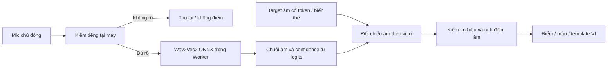

# Speaking — đặc tả cho AI, hướng chạy tại thiết bị và không phát sinh phí

**Hiện hành12/10 — ADR064/065, supersedes UI/no-score checkpoints11/10:** luyện nói tích hợp trong chi tiết từ, giữ IPA/nghĩa/ví dụ và nghe cả câu. Sau thu: tự kết thúc bằng khoảng lặng, nhận âm thật tại máy, hiện phần trăm và màu nhóm chữ; chạm từ mở bottom sheet. Founder trực tiếp yêu cầu bỏ nhãn “điểm tham khảo” và copy kỹ thuật/thử nghiệm trong màn tập nói. Chỉ hiện số như `88%`, không thêm nhãn cảnh báo vào game/word detail. Nói cùng Cáo là game riêng tại Chơi & học, không là trang từng từ. Tải/xóa chỉ Cài đặt; chưa có bộ thì link Cài đặt, có rồi ẩn link. [Bằng chứng](evaluations/speaking-refresh-and-automatic-sync.md).


**Latest11/10:** founder yêu cầu fix thư viện/nhóm/trùng ảnh và làm Speaking, cho phép browser test. App local có `/speaking` (Nói cùng Cáo), thu/nghe lại, download/progress/cache/delete/cancel, Worker local PCM/CTC/alignment và Gemini coaching gesture/fallback. Đây là nhận xét thử nghiệm chưa có numerical pronunciation score/calibrator/child/mobile validation; màu là quan sát máy có thể sai, không khẳng định bé sai. [Evidence hiện hành](evaluations/speaking-app-and-library-fixes.md). SP1 memory/device envelope và SP3/SP4 quality gates còn mở; không claim scoring hoàn tất. Các checkpoint cũ bên dưới là lịch sử.

Cập nhật 11/10/2026: founder yêu cầu **100% miễn phí, tuyệt đối không phát sinh chi phí**, sau đó nói **“tiếp tục”**. Bắt đầu SP1 local theo [kế hoạch founder mục17](KE-HOACH-FOUNDER.md#speaking-review); không cần xin lại quyền cho code/fixture local. Đã có dependency, manifest, CTC decoder và browser/Worker inference thật; chưa có mic, điểm/màu hay game Speaking trong app. [Evidence SP1](evaluations/speaking-local-feasibility.md). Sửa lỗi TTS được kiểm riêng ở [evidence](evaluations/groups-grammar-and-audio.md).

## 1. Quyết định hiện tại và boundary

Chọn **in-browser Wav2Vec2 phoneme recognition qua Transformers.js/ONNX Runtime Web**, đối chiếu âm xác định và calibrator local; coaching VI bằng Gemini Free Tier tùy chọn, template có căn cứ làm fallback. Nhận âm/điểm không gọi Gemini/AI API, SpeechRecognition cloud, OpenPronounce HTTP hay server scoring. Steering mới cho phép Gemini Free Tier viết coaching VI riêng từ kết quả local; founder xác nhận key/project không billing. Ngoại lệ chỉ ở lời khuyên tùy chọn, không engine/điểm. Không thuê hạ tầng, bật billing, mua quota, thêm card/trial trả tiền, thuê người chấm hay mua thiết bị. Không fallback sang dịch vụ có thể phát sinh phí. Dùng fixtures/thiết bị sẵn có và mẫu/người đánh giá tự nguyện được phép.

Ràng buộc 0đ và quyền tiếp tục code/kiểm local đã được xác nhận. Stack do agent chọn để đáp ứng steering; “tiếp tục” không phải bằng chứng chất lượng hay quyền dùng mic/browser/dữ liệu thật, gọi provider API, push/deploy hoặc sửa billing. Bản đề xuất cũ so OpenPronounce/Kaldi/GOPT, server riêng hoặc Gemini-only được supersede. Research sources là tham khảo, không là danh sách founder phải chọn.

Phạm vi: từ đã duyệt → câu ngắn có target hợp lệ → game “Nói cùng Cáo” 5 từ dùng chung recorder/engine. Nghe mẫu, thu chủ động, nghe lại, **Xem nhận xét** tại máy, điểm/màu khi đủ bằng chứng, VI chỉ đúng chỗ cần tập. Không copy ELSA hay claim chất lượng tương đương. Không thay SRS/reviewEvents/nội dung đã lưu, không tự verified IPA; trò chơi thưởng sự cố gắng, luôn có Bỏ qua/Thử lại/Rời buổi học.

## 2. Stack được chọn

| Phần | Lựa chọn triển khai | Giới hạn/cách dùng |
|---|---|---|
| UI/game | Next.js/React, Theme C/catalog/Cáo hiện có | Lazy-load Speaking; không thêm nav chính, không đưa model vào bundle trang đầu |
| Thu/playback | getUserMedia + MediaRecorder + Web Audio | Gesture only, chọn MIME hỗ trợ; mono PCM16kHz cho model, không giả nhãn WAV |
| Browser ML | `@huggingface/transformers` **3.8.1**, ONNX Runtime Web đi kèm | [Docs stable](https://huggingface.co/docs/transformers.js/v3.8.1/index), [ORT Web](https://onnxruntime.ai/docs/tutorials/web/); đã pin package/lock, không bật native postinstall |
| Model duy nhất cho bước tiếp | [robg/speako-phoneme-recognizer](https://huggingface.co/robg/speako-phoneme-recognizer), Apache-2.0, Wav2Vec2 chuyên tiếng Anh | **q8 `model_quantized.onnx`, 355.216.594 bytes**, revision `ad0f63cd58fc1bb1e9c261a3b4135997a31c2e58`; CPU/WASM một thread trong Web Worker. [Manifest nguồn](../src/lib/speaking/model.ts) pin size/SHA-256/blank ID41; chỉ tải bản này trong flow app dự kiến |
| Target âm | Pronunciations đúng text/version/accent đã được duyệt; [CMUdict](https://github.com/cmusphinx/cmudict) có license/tham khảo như repo hiện có | Per-token phones/accepted variants; thiếu/đa nghĩa không đoán. CMUdict không chứng minh connected speech; không dùng IPA headword cho cả câu |
| Feedback | Local alignment/quality/phone score + Gemini Free Tier coaching theo key được founder xác nhận; template VI fallback | AI không thay score/màu/diagnosis; kết quả không rõ thì abstain, không bịa lỗi. Đã nối app; coaching kiểm bằng fixture, chưa gọi AI thật |

Model xuất **nhãn âm TIMIT-derived tiếng Anh**, không phải transcript từ/câu hay bộ chấm phát âm trẻ đã hiệu chuẩn. Dùng `AutoProcessor` + `Wav2Vec2ForCTC` + vocab/logits trực tiếp; không phụ thuộc tokenizer phone chưa được runtime này hỗ trợ. Các nhãn `|`, space, `[UNK]`, `[PAD]` không là âm học. [Model upstream](https://huggingface.co/vitouphy/wav2vec2-xls-r-300m-timit-phoneme). q8/WASM tránh yêu cầu WebGPU; tăng tốc cùng engine chỉ sau evidence. Không lấy confidence/posterior làm xác suất bé đọc đúng.

SP1 đã thử model espeak318MB theo plan trước: sai nhiều âm trong fixture TTS; full-precision control cũng nhận lệch cùng từ `cat`. Agent chọn bản chuyên tiếng Anh trong cùng stack 0đ và ghi ADR059/evidence. Bản mới nhận `cat → k æ t`, `book → b ʊ k`, `cup → k ə p` từ các clip công khai; `apple → æ p l` vẫn cần xử lý biến thể/âm tiết. Đây là sanity test từ một giọng người lớn, không là validation scoring/giọng trẻ. Hai reports TTS vẫn được giữ để không chỉ chọn kết quả đẹp.

**Feasibility-first:** bước chạy thật đã đạt trên desktop Chromium local, Worker CPU/WASM, fixture TTS/public và silence. Browser network bị chặn ngoài loopback, chỉ có GET asset/fixture; không API inference/upload. Load2,37s, các public word clips xử lý1,1–1,3s ở lần đo đồng thời có lint/typecheck (không phải benchmark p95 hoặc cold network download). Physical mobile, peak memory, browser download/cache/cancel, responsiveness/performance envelope và calibration còn chưa đạt; SP1 chưa done toàn bộ. Không claim355MB file size là355MB RAM hoặc mọi điện thoại chạy được.

### Tải và giới hạn chi phí

- Tải **chủ động**, báo khoảng355MB weights +22MB runtime/config trước, khuyên Wi-Fi sẵn có, progress thật/cancel/retry. Không tải model khi vào Today/Library hoặc tự tải khi mạng trở lại. Có Xóa bộ nhận âm. Đây là flow kế tiếp chưa có trong app; CLI spike yêu cầu `--download` rõ ràng và kiểm weight hash/size trước dùng.
- Pin model revision đầy đủ, file manifest/hash/size, tokenizer/config/runtime version và license trong bước SP1. Anonymous public **file download** trực tiếp nguồn miễn phí; không dùng hosted inference/HF Endpoint/Space/Gemini, API token hay app-server proxy model/audio. Nếu nguồn không tải được thì giữ thu/nghe lại, không mua quota hoặc tìm trả phí.
- Cache model/runtime có version trong browser cache, kiểm quota/partial download/integrity. Không dùng localStorage cho weights. Không pre-cache355MB vào SW install hay đưa weights vào Next build/Vercel deployment. Cache bị xóa thì cần chủ động tải lại. Offline inference chỉ khi đủ runtime/config/model còn trong cache và engine chạy được; test thực tế, không suy từ marketing “offline”. Local spike dùng cache file tạm ngoài repo, chưa kiểm browser cache persistence/offline.
- Không thêm billing infrastructure hoặc tự sửa hosting/account hiện hữu. Không claim đã audit chi phí tài khoản thật. Nếu một phương án phân phối yêu cầu trả tiền thì không triển khai phương án đó trong scope này.
- Không gửi audio/PCM sang mạng/log/analytics/backup/cloud. Target và kết quả âm/từ chỉ gửi cho Gemini khi người dùng chủ động chọn nhận xét AI và điều kiện Free Tier được xác nhận; không email/owner/library/name/media/token trong payload hoặc URL/log. Network ở bước tải chỉ GET các asset đã cho phép. Sau khi cache ready, kiểm xử lý clip không có inference/upload requests. Existing Gemini/image flow không thay đổi trong task Speaking.

## 3. Nhận âm, alignment, điểm và màu

Pipeline đã chọn:



1. Decode/resample16kHz mono, đo duration/RMS/clipping/speech. VAD không chẩn đoán phát âm. Im lặng/tiếng nhỏ/nhiễu → `insufficient-audio`, score null, không tô cả bài đỏ.
2. Inference **không nhận câu mục tiêu làm prompt**. Decode CTC logits/vocab, collapse blanks/repeats đúng quy tắc, giữ token/frame evidence; lấy logit/posterior trực tiếp, không suy confidence từ text. Có fixture chứng minh phone tokenizer giữ đúng label đa ký tự/IPA. ASR pipeline tên `automatic-speech-recognition` ở model card vẫn output phones; không gắn output đó thành “Máy nghe từ…”.
3. Target giữ original token index/offsets, text/revision/accent, phone ranges và các biến thể đã xét. Normalize xác định, không mất apostrophe/contractions/từ lặp. CMUdict fallback giữ nhãn tham khảo; từ đa cách đọc/không đủ data hoặc sentence thiếu per-token/connected-speech variants đáng tin → `unsupported-target` hoặc uncertain, chưa chấm lỗi. Không sửa dữ liệu học để ép cho engine chạy.
4. Phone alignment Levenshtein có substitution/deletion/insertion, confidence theo frame và vị trí target; tham khảo phonetic-cost/downweight boundary từ [OpenPronounce](https://github.com/Halleck45/OpenPronounce), MIT. Không port server, gTTS/Kokoro/Piper/DTW hoặc hai-model ASR của repo. **Bản local này không kế thừa score/benchmark của OpenPronounce**. Engine phone có false alarms; edit distance đơn thuần chưa đủ làm điểm pronunciation hoặc chắc bé sai.
5. Với câu ngắn, thiếu một **word** cần evidence toàn phone-span, neighbor alignment/timing/quality và uncertainty thấp. Không biến thiếu âm cuối thành thiếu từ; không forced-align mọi từ rồi kết luận chúng đều đã nói. Từ ngắn/function words, lặp từ, nối âm/homophones có thể không xác định được: abstain. Không có word-ASR độc lập nên không bịa từ khác được nghe; chỉ báo “Con thử nói lại từ này” nếu chứng cứ phone đủ.
6. Điểm hiện hành là phép đối chiếu âm trong `pronunciationScore`: âm khớp =1, âm thay thế thuộc cặp gần trong allowlist =0,5, khác/thiếu =0; mẫu số=max(số âm mẫu,số âm nhận) nên âm thêm không được100. Làm tròn0–100. Ghi âm không rõ/target không hỗ trợ thì null. Không lấy acoustic confidence làm phần trăm đúng. Đây là công thức đang chạy, chưa có calibrator hoặc benchmark giọng trẻ; ghi giới hạn tại tài liệu kiểm chứng, không thêm nhãn “tham khảo” vào UI sau khi founder bác nhãn đó. Không claim đạt độ chính xác/benchmark của ELSA.
7. Chữ–âm: DP với correspondence xác định, chỉ tách khi phủ đúng toàn bộ spelling/reference. `apple`: a=/æ/, pp=/p/, le=/ə l/; e vẫn hiện trong le, không bịa âm /e/. Từ chưa có correspondence đầy đủ giữ toàn chữ và toàn phản hồi, không đoán điểm từng chữ. Xanh khớp, cam gần, đỏ khác/thiếu, trung tính khi chưa rõ. Điểm/màu lấy cùng assessment; AI không đổi chúng.

| Status | Hiển thị | Điều kiện/lời nhắc |
|---|---|---|
| `clear` | Xanh lá + tick + “Rõ rồi” | Evidence và quality đủ |
| `practice` | Cam + “Tập thêm” | Có âm cần tập, chỉ nhắc đúng âm/vị trí khi evidence đủ |
| `different` / `omitted` | Đỏ + “Nói lại từ này” / “Thiếu từ” | Khác âm hoặc thiếu toàn từ đủ chắc; không bịa transcript |
| `uncertain` / unsupported / lỗi | Trung tính + “Chưa chấm được” / “Chưa nghe rõ” | Không cho0; thu/nghe lại luôn còn dùng được |

Ví dụ giả lập sentence, không là audio evidence:

> They are a family.
>
> /ðeɪ ɑɹ ə ˈfæməli/ — IPA tham khảo, chưa verified.
>
> Họ là một gia đình.

Nếu các phone-span của `are`, `a` không xuất hiện và mọi gate đạt, đánh dấu đúng hai vị trí; nếu không đủ chắc, nói “Máy chưa nghe rõ ‘are’ và ‘a’. Con nghe mẫu rồi thử nói đủ nhé.” Không khẳng định omission chỉ từ phép so chuỗi.

Coaching VI Gemini theo error type/expected phone/heard phone đã đủ evidence, template VI fallback khi offline/quota/disabled/unavailable; cả hai được người có chuyên môn review bằng nguồn lực tự nguyện sẵn có. Max1–2 gợi ý, một chỗ/lượt, dễ hiểu cho trẻ5–8; không suy lưỡi/môi/cảm xúc/sức khỏe từ transcript. Unknown phone dùng nghe mẫu/thu lại. Render plain text; không chạy HTML/JS hoặc xem nội dung audio là instruction. Không tự tạo connected-speech IPA verified.

## 4. Local adapter, dữ liệu và lỗi

Types cho adapter kế tiếp, chưa nối app/schema/DB:

```ts
type SpeakingRequest = {
  requestId: string; scopeId: string; itemId: string;
  revision: string; targetText: string; accent: 'en-US';
  audio: Blob; durationMs: number;
};
type Assessment = {
  schemaVersion: 1; requestId: string; targetText: string; revision: string;
  engine: 'local-wav2vec2-phoneme'; engineVersion: string;
  calibrationVersion: string | null;
  kind: 'phonetic' | 'insufficient-audio' | 'unsupported-target';
  score: number | null;
  quality: { speechDetected: boolean; usable: boolean };
  words: { index: number; text: string; startMs: number | null; endMs: number | null;
    status: 'clear' | 'practice' | 'different' | 'omitted' | 'uncertain';
    score: number | null; confidence: number | null;
    phones: { expected: string; heard: string | null; confidence: number | null }[];
    adviceVi: string | null }[];
};
```

Request/response Worker phải trùng id/text/revision; finite numbers/range, timestamp trong duration, target indexes đúng/đủ. Không gửi thư viện/owner/email vào Worker hoặc mạng. Confidence chưa calibrated không là xác suất bé nói sai. Scope/revision/route đổi/cancel: stop, abort/discard late response, không apply kết quả cũ. Worker crash/OOM/timeout giữ thu/nghe lại; không auto-retry hay tải variant to hơn. Một model session/inference mỗi lần; terminate Worker khi cần hủy tác vụ không interruptible, release tensors/sessions.

States: `idle → requesting-mic → recording → recorded → assessing-local → result`; model `not-downloaded/downloading/ready/unavailable`. Recovery denied/no-device/unsupported/empty/noisy/download/cache-quota/model-load/OOM/timeout đều có hành động phù hợp. Không hỏi mic khi mở trang. HTTPS/localhost, gesture only, late permission guard; dừng TTS trước recording, dừng mic trước playback. Không chạy mic và giọng mẫu đồng thời.

Giới hạn đề xuất: clip word≤10s/câu≤20s, ≤5MB, một lượt xử lý, timeout60s; bản thử quyết định supported envelope/latency. Clip/PCM/assessment trong RAM, không IDB/localStorage/backup/cloud/log/analytics. Thu lại/rời route/unmount/logout/scope change: stop tracks, revoke object URL, clear Blob/PCM/results, cancel Worker response. Tab hidden dừng thu, giữ recorded để bé quyết định, không tự chấm/gửi. Cache model là asset, không phải bản ghi giọng; có điều khiển xóa riêng. Lịch sử điểm/giọng không nằm trong scope.

## 5. UI và game

Tập nói cạnh Nghe: hình đúng sense, word và IPA đã lưu, nghĩa VI ngắn; câu đặt IPA cả câu ngay dưới English trước VI theo ADR047/048. Mic lớn, timer thật/Dừng. Recorded có Nghe lại/Thu lại/**Xem nhận xét**, copy ngắn “Giọng của con được xử lý trên máy này”. Chưa model thì hướng dẫn tải rõ dung lượng; không khiến trẻ tự bấm tải lớn mà không hiểu.

Chi tiết từ giữ IPA/nghĩa/ví dụ, Nghe/Nói/icon giọng của con và Nghe chậm. Kết quả có phần trăm, màu nhóm chữ, lời sửa âm tiếng Việt; chạm từ mở bảng Âm mẫu/Máy nghe được với score và hai nút nghe. Touch≥44px, không tràn360px, focus/accessible order/reduced-motion; không waveform giả hay leaderboard. Không đủ máy/target thì nói rõ “Máy này chưa chấm được”, không cáo buộc bé sai. Không queue upload hoặc paid/cloud fallback.

Chơi & học có ô “Nói cùng Cáo” → `/practice/speaking`, tối đa5 từ đã duyệt trong thư viện, vòng chơi lại chuyển sang5 từ kế tiếp; chung recorder/engine, có Bỏ qua/Tạm dừng/Thoát, không ép điểm mới được tiếp. Mic và TTS không tự bật. Dùng Cáo/art đã có. Sentence practice nằm trong kế hoạch sau word gate; chỉ hỗ trợ target đã đủ âm/biến thể. UI mock luôn có nhãn trong local QA, không phát hành mock thành scoring thật. Standalone offline fallback nếu được mở Speaking phải nạp đúng cache/runtime và kiểm riêng; không suy legacy offline UI tự có engine mới.

## 6. Task thực hiện và trạng thái

| Bước | Deliverable | Dependency/quyền |
|---|---|---|
| SP0 | Một plan founder dễ đọc + spec local/0đ này | Hoàn tất; founder “tiếp tục” cho bước local |
| SP1 | **Feasibility spike trước:** pinned q8/Worker/real local inference, download/cache/cancel; memory/latency/phone fidelity | **in_progress**: model/decoder, app browser download/cache/delete/inference done local; peak RAM/physical-device envelope còn lại. Không global install/provider API/account/deploy |
| SP2 | Mic/playback và adapter/alignment/quality/calibrator local; Gemini coaching tùy chọn + template VI fallback (mock); UI có fixture labelled | Mic/playback/adapter/quality/VI/coaching mock implemented locally; calibrator and physical-device envelope remain open |
| SP3 | Word scoring/colors/game thật; câu ngắn khi target/omission gate đạt | Calibration/quality evidence; build một bản cuối sau dependency/PWA thay đổi |
| SP4 | Mẫu giọng trẻ Việt được phép, điện thoại sẵn có và người nghe tự nguyện; chốt supported devices/quality | Founder cho phép từng mẫu/thiết bị thật theo ADR049; không agent tự truy cập browser/account/data; không phát sinh thuê/mua |

Nếu SP1 không chạy đủ tốt: ghi bằng chứng và giới hạn, tiếp tục tối ưu local miễn phí; **không tự đổi sang server/API**. SP3 hiện có phần trăm theo công thức trên; SP4 đánh giá chất lượng bằng giọng trẻ/điện thoại thật vẫn chưa làm. Không dùng tình trạng SP4 để tự ẩn số hoặc thêm nhãn UI trái steering mới. Không báo feature scoring hoàn tất bằng bản mock hoặc kết quả model card.

Benchmark proposal: sanity clips được phép cho đúng/sai âm/thiếu/im lặng/nhiễu; validation mục tiêu≥120clips/≥12trẻ Việt5–8, dev/held-out theo speaker, hai người có chuyên môn tự nguyện chấm độc lập khi có nguồn lực. Không mua/thu dữ liệu trong lượt docs. Minimal pairs/âm cuối/từ ngắn/function words/từ lặp/accent/noise/điện thoại khác nhau; dataset công khai không chứng minh giọng trẻ Việt. Thiếu mẫu/người đánh giá thì ghi chưa đủ evidence, không thuê người vượt0đ.

Mục tiêu kiểm chất lượng đã đề xuất, chưa phải kết quả hay điều kiện UI do founder chốt: precision đỏ≥90%, false-red trên từ người nghe đánh giá đúng≤5%, omission recall riêng, score MAE≤15/100, kèm coverage/abstention/CI và breakdown. Những con số là mục tiêu chưa đo, không điều kiện đã đạt. Latency mục tiêu p95≤8s/clip10s trên supported envelope; cold download/peak RAM báo riêng. Không hứa mọi mobile chạy được. Giảm phạm vi thiết bị/target phải được ghi rõ và review, không âm thầm thu nhỏ yêu cầu để báo done.

Tests liên quan: tokenizer CTC/frame confidence/phone normalization, token-alignment lặp/contractions/biến thể, no-score silence/unsupported, uncertainty no-red, stale scope/revision/Worker responses, schema/timestamp, advice đúng evidence. Recorder denied/late/hide/unmount/duration; download cancel/partial/quota/integrity/cache deletion; Worker error/OOM/timeout; spy network chứng minh không audio upload/API/paid fallback. Lint/types/scoped unit + vài mobile/desktop theo ADR050; dependency/PWA thay đổi mới build. Human/physical/performance evidence khác browser mocked mic.

## 7. Research giữ lại để AI hiểu giới hạn

[OpenPronounce](https://github.com/Halleck45/OpenPronounce) dùng Wav2Vec2 để nhận phone, báo sai/thiếu theo alignment; repo cảnh báo trẻ/giọng lạ/nhiễu/từ ngắn gây false alarms. Tham khảo thuật toán MIT; không chọn HTTP/Python/Docker stack hoặc kế thừa calibration/benchmark cho bản local khác này.

[Kaldi GOP](https://github.com/kaldi-asr/kaldi/blob/master/egs/gop_speechocean762/s5/run.sh), [GOPT](https://github.com/YuanGongND/gopt) và [MFA](https://github.com/MontrealCorpusTools/Montreal-Forced-Aligner) là research background, không là các engine đang chờ founder lựa chọn hoặc dependencies phải cài. [SpeechOcean762](https://github.com/jimbozhang/speechocean762) có nhãn nhiều cấp nhưng người học Mandarin; dataset/model licenses cần kiểm trước dùng, không thay evaluation trẻ Việt.

[Gemini audio](https://ai.google.dev/gemini-api/docs/audio) cung cấp audio understanding, không contract pronunciation score trẻ đã hiệu chuẩn; free tier/quota/key sẵn không bảo đảm0đ và [terms](https://ai.google.dev/gemini-api/terms) có age-client restriction đã được repo ghi nhận. **Theo steering mới, Gemini chỉ là coaching tùy chọn** sau kết quả local, không scoring/audio understanding engine. Founder xác nhận Free Tier không billing; không claim đã kiểm billing/eligibility. API Client under-18 restriction của terms vẫn unresolved trước phát hành/live validation. Không tạo/install skill từ GitHub chỉ vì tên hoặc stars; skills hiện hữu dùng cho nội dung/UI khi implementation được duyệt.

## 8. Handoff

ADR062 latest: package/lock, manifest/decoder, real local app browser download/cache/delete/inference, mic/replay/target adapter, tentative color evidence/VI tips and optional mocked Gemini coaching implemented. Calibrator/numerical score/physical-mobile peak RAM/child validation remain open. No live provider call, child audio, cloud transfer, push/deploy/account/billing change. Next: actual device envelope and permitted scoring calibration. Founder does not need to select another engine. Browser permission is specific to diagnosis/tests; publishing remains ADR049.

## 9. Clarification11/10 — model storage/deletion and optional AI coaching

Model/runtime assets sẽ lưu bằng CacheStorage riêng theo origin/version, ví dụ `wfk-speaking-model-<revision>`; không IndexedDB thư viện, localStorage, cloud, Downloads hoặc SW install precache. Chỉ user gesture tải; kiểm quota/progress/hash/partial/cancel. [CacheStorage](https://developer.mozilla.org/en-US/docs/Web/API/CacheStorage), [eviction](https://developer.mozilla.org/en-US/docs/Web/API/Storage_API/Storage_quotas_and_eviction_criteria). Không hứa permanent cache, PWA/browser storage sharing trên mọi OS hoặc offline trước test. Xóa bộ nhận âm phải cancel download/inference/terminate Worker trước, chỉ xóa cache thuộc Speaking và RAM/session; không chạm IDB/library/key/auth/SRS/backup/main shell cache. Thiếu/xóa/cache eviction → unavailable assessment, giữ thu/nghe lại/giọng mẫu nếu thiết bị hỗ trợ. Không có acoustic result thì không nhờ Gemini tự đoán lỗi.

Founder trực tiếp chọn AI nhận xét theo từng word, xác nhận project Free Tier không billing. Chốt Gemini coaching **optional/user gesture**, dùng settings key/off/restore semantics hiện có; không tự bật AI/key/default. Gửi target text/version/accent + các word indexes/expected-heard phones/quality/status đã đủ evidence, không bản thu/PCM/PII/full library. Không có evidence đáng tin → neutral coaching hoặc fallback, không giả lỗi. Prompt chỉ đưa1–2 lời khuyên tiếng Việt theo đúng word/error IDs được gửi; dùng chỉ dẫn tập âm có căn cứ, không suy tư thế miệng thực tế, sức khỏe hay tuổi từ clip. Structured response strict allowlist indexes/error IDs/VI length/plain text; không score/transcript/HTML/links/tools. AI không thay local score/colors/uncertainty; response sai index/target/revision phải discard.

Một bounded call/lượt khi bấm, có AbortController/timeout, no auto retry/model/key rotation/paid fallback/grounding/search/Files API. Disabled/offline/missing key/429/4xx/5xx/schema/refusal/late scope result → template fallback và retry chủ động, không mua quota/nâng billing. Không lưu coaching/target/error payload vào cloud/backup/analytics/history trong scope này. UI phải báo trước khi gửi text/kết quả tới AI; không fake parent gate. Key không vào payload/URL/log/backup, giữ BYOK header/settings rules. Free Tier là điều kiện bên ngoài do founder xác nhận, client không tự chứng minh billing thực tế hoặc thay đổi tương lai; điều kiện provider cho app trẻ vẫn chưa xác minh. Không gọi live AI hay sửa account trong lượt này. Stage SP2 thêm coaching adapter mocked sau local assessment contract; Kiểm chất lượng/thiết bị vẫn ghi riêng; UI/score theo ADR064/065.


## 10. Runtime local và giới hạn chất lượng hiện tại

Nguồn code hiện hành: `/library/words/[entryId]` và `/practice/speaking` (`/speaking?word=id` redirect về chi tiết từ), `features/speaking.tsx`, `lib/speaking/client.ts`, `assessment.ts`, `coaching.ts`, `public/speaking-worker.js`, target route. Recorder MIME negotiation/10s/stop/late permission/PCM16kHz, target-revision cancel; browser cache pin/hash/marker; incremental stream hash bằng @noble/hashes2.4.0 MIT, không arrayBuffer355MB khi tải. Runtime/model vẫn lazy, không cloud audio. Cache partial có nút Xóa phần đã tải. Same-origin CMUdict US reference; unknown/heteronyms abstain. Global edit-distance acoustic alignment + variants + quality abstention là machine-observation prototype, **không calibrator/điểm xác suất**; màu đỏ hiển thị thiếu evidence của máy, không clinical/child error certainty. Phần trăm đã hiện theo công thức tại mục3; calibration/ELSA parity chưa được chứng minh.

Coaching adapter đã có gesture/schema/index/cancel/timeout/no-retry/fallback, kiểm fixture; no live AI call hoặc policy eligibility claim. Không upload audio. Offline runtime assets được dedicated cache trả qua SW khi shell đang được control; app route/CMU target vẫn cần mở online, offline full Speaking/reload chưa chứng minh, không hứa sau một lần model download mọi flow offline hoạt động. Model/runtime file size không là peak RAM; streaming sửa duplicate download buffers, inference/device envelope vẫn cần đo.


ADR062 implementation detail: Chrome rejected a single355MB Cache.put and buffered fixtures exhausted memory. Download now hashes incrementally and stores16MiB ONNX parts plus bounded manifest/complete marker; retrieval streams parts to the runtime. SHA/byte validation precedes ready. Cancelling leaves only non-ready partial assets, removable with Xóa phần đã tải. Runtime assets are generated from pinned installed packages, lazy-loaded, not install-time precached. Replay converts decoded mono16kHz PCM to a finite WAV header so mobile/desktop audio controls show real duration rather than WebM0:00/infinite duration. Full offline Speaking route/reference and physical-mobile peak RAM remain unverified.


## 11. UI và vòng đời hiện hành12/10

`WordSpeaking` dùng chung cho chi tiết từ và game, lazy import tại WordDetail. Audio replay là icon người và audio element không native controls. EndOfSpeech nhận ≥180ms tiếng đủ lớn rồi kết thúc khi yên900ms; im lặng6s/cap10s. Track/context/Worker/Blob URL được dọn khi rời trang, đổi scope/revision, tab ẩn hoặc hủy. Không tự bật mic/TTS. Game có tiến độ, Tiếp theo sau một lượt, Bỏ qua, kết thúc và Chơi lại; score tổng chỉ trung bình các lượt có số, không đổi lịch SRS, không lưu bản thu/điểm vào cloud. Kết quả Speaking đang giữ trong phiên trang.

Pack khoảng377MB nằm trong **Cache Storage của browser/domain trên thiết bị đó**, key `wfk-speaking-model-<revision>`. Không là file Downloads/localStorage/cloud; không chia sẻ giữa Chrome/Safari/hai điện thoại. Không có/xóa pack vẫn nghe mẫu/thu/replay; đánh giá cần tải lại trong Cài đặt. Xóa pack không xóa bài. Bật lời khuyên AI trong Cài đặt → tự gọi tối đa một lần sau đánh giá bằng target/evidence; không gửi audio, không retry quota và không fallback dịch vụ trả phí. Hết quota giữ lời sửa âm local.
