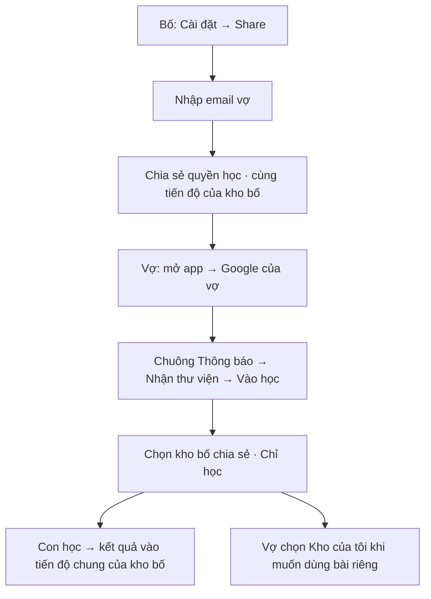
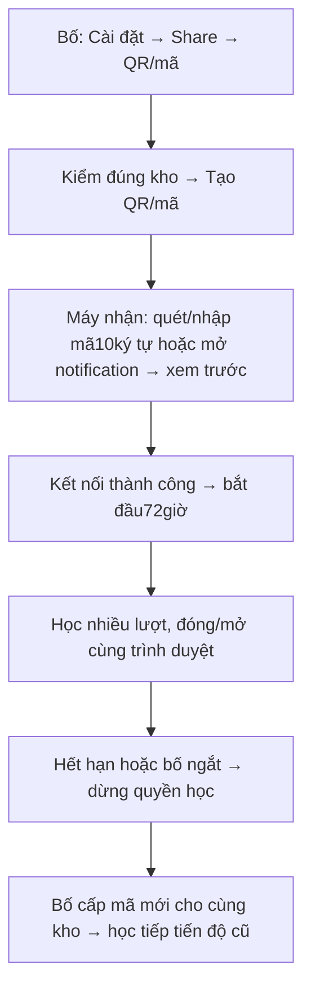

# Share thư viện — màn hình và thao tác để founder duyệt

## Lưu kho đang nhận thành nội dung của mình — 15/10/2026

Cài đặt → **Sao lưu & dữ liệu** luôn hiện khi nhận share:

1. **Tải nội dung kho đang nhận** tải file bài học, từ, ngữ pháp, nhóm, ghi chú và ảnh được chia sẻ; không có lịch sử học/lịch ôn của kho gốc.
2. **Thêm vào kho riêng** mở xem trước: tên kho nhận, số nghĩa từ mới/đã có và số bài câu/ngữ pháp mới/bỏ qua. Đăng nhập thì kho nhận là tài khoản của người nhận; chưa đăng nhập thì là kho riêng trên trình duyệt này.
3. **Xác nhận thêm nội dung** mới lưu. Kho đang nhận vẫn được chọn để học; chọn **Chọn thư viện** khi muốn chuyển sang kho riêng.
4. Muốn dùng file trên máy khác: mở Cài đặt → Sao lưu & dữ liệu → **Nhập file nội dung**, chọn file rồi xem trước/xác nhận. Nội dung mới từ file cần duyệt trước khi học.

Từ trùng chữ chuẩn hóa + cách phân biệt hoa/thường + loại từ + nhãn nghĩa dùng lại nghĩa trong kho riêng. Khác loại từ hoặc nghĩa giữ riêng. Nếu lời giải thích cùng nghĩa khác nhau, giữ kho riêng và báo trong xem trước; ghi chú/ngữ pháp gắn với nghĩa mâu thuẫn được bỏ qua. Ngữ pháp so toàn bộ nội dung giảng dạy, ví dụ/dịch, điều kiện, giải thích, lỗi/sửa lỗi và các dạng đi kèm; khác ID/IPA không tạo thêm bản trùng. Không gộp nghĩa bằng AI. Nhập lại bản cũ không tăng từ/ngữ pháp; nhập bản sau chỉ thêm phần mới.

**Tiến độ kho riêng giữ riêng:** không mang SRS/lịch sử/lượt học/điểm kho gốc; không ghi đè tiến độ sẵn có. Bản sao độc lập, không tự nhận sửa đổi sau này từ kho gốc. Kho gốc vẫn chỉ đọc. Sao lưu/khôi phục đầy đủ kho riêng vẫn dùng sau khi chọn kho riêng; khôi phục archive đầy đủ vẫn cần kho trống.

Ngày: **15/10/2026**. Bản chi tiết cho **A: chia sẻ qua email Google** và **B: chia sẻ bằng QR/mã**.

**Đã làm theo lệnh15/10, có trên bản online để manual test.** [Checklist và kết quả kiểm thử](evaluations/library-sharing.md). Mặc định A tới khi thu hồi; B mã chưa nhận15phút, phiên học3ngày; cần mạng khi mở lại kho shared.

Bản [so sánh các phương án](DE-XUAT-CHIA-SE-THU-VIEN.md) giữ để tham khảo. Codex có [hướng dẫn triển khai riêng](ai/LIBRARY-SHARING-IMPLEMENTATION-PLAN.md); founder chỉ cần đọc tài liệu này để duyệt trải nghiệm.

## Cập nhật theo manual test15/10

Màn học không còn bảng trạng thái lớn ở đầu trang. Khi đang nhận kho, header có icon liên kết; bấm vào mở **Cài đặt → Thư viện và chia sẻ → Thư viện đang nhận**, xem tên kho, quyền chỉ học, thời hạn, đồng bộ/pending và các nút Cập nhật / Đổi thư viện / Kết thúc trên máy này. Icon có dấu nhắc nếu kết nối hoặc kết quả cần xử lý.

Cài đặt gom theo chức năng: Thư viện và chia sẻ; Hiển thị & âm thanh; Công cụ thêm bài (AI/tìm hình, form đóng khi chưa mở); Sao lưu & dữ liệu cho kho mình; Về ứng dụng thu gọn. Giữ toàn bộ thiết lập và nút dữ liệu đã có.

## 1. Sau khi làm xong, gia đình sẽ dùng thế nào?

Mày vẫn soạn từ và ngữ pháp trong kho hiện tại. Trong **Cài đặt → Share — Chia sẻ thư viện**, mày có thể nhập email Google đã đăng ký app của một hoặc nhiều người, hoặc tạo QR/mã để một máy khác vào học. Lời mời hiện trong chuông Thông báo sẵn có của người nhận; không gửi thư qua Gmail.

Người nhận chỉ được xem bài, nghe, ôn và chơi. Họ không sửa/xóa từ, ngữ pháp, ảnh, nhóm/bài và không chia sẻ kho của mày tiếp cho người khác. Mày vẫn là người quản lý kho và người được thay nội dung.

Nếu vợ đã có kho riêng, app giữ nguyên kho đó. Vợ có hai lựa chọn riêng: **Thư viện của tôi** và **Thư viện được bố chia sẻ — Chỉ học**. Không trộn hai kho.

**Bài mới tự cập nhật:** khi mày thêm từ/ngữ pháp, lưu hợp lệ và đồng bộ lên cloud, các bên nhận đang còn quyền tự nhận bản mới qua mạng; không cần share lại, nhập lại email hoặc tạo QR mới. Máy mất mạng sẽ cập nhật khi nối lại. App kiểm bài mới mỗi15giây khi đang mở, và khi quay lại/nối mạng.

QR/mã cấp kết nối cho một máy. Sau khi nhận thành công, máy đó được học nhiều lần trong **3 ngày**, có thể đóng app rồi mở lại bằng cùng trình duyệt. Mày có thể ngắt máy sớm hơn.

## 2. Những điểm đã chốt và những điểm đang đề xuất

| Nội dung | Trạng thái |
|---|---|
| Share đặt trong Cài đặt | Theo góp ý của founder |
| Nhập một hoặc nhiều email đã đăng ký app để chia sẻ | Theo góp ý mới nhất của founder |
| Mã nhập tay10ký tự chữ/số, có nút Nhập mã cho TV/máy không camera | Theo góp ý mới nhất của founder |
| Lời mời A và QR/mã B hiện ở chuông Thông báo; B có ô email nhận thông báo | Theo góp ý mới nhất của founder |
| Có thêm QR/mã trong màn Share | Theo góp ý của founder |
| Người nhận chỉ học, không sửa kho gốc | Theo góp ý của founder |
| Phiên máy nhận QR dài khoảng3ngày | Theo góp ý; bản này lấy **72giờ từ lúc kết nối thành công** |
| Mỗi người vẫn giữ kho riêng, chọn kho để học | Hướng xử lý đã giải thích trong plan trước |
| Email giữ quyền đến khi mày thu hồi | Đề xuất để duyệt |
| QR/mã chưa ai dùng chỉ có hiệu lực15phút | Đề xuất để duyệt; khác với phiên học3ngày |
| Mỗi account Google một kho/tiến độ; người nhận học tiếp tiến độ kho được share | Theo yêu cầu mới nhất; bỏ lựa chọn tạo/chọn nhiều bé |
| Từ/ngữ pháp mới tự cập nhật sang bên nhận còn quyền | Theo yêu cầu mới nhất |
| Bên nhận QR/mã không cần đăng nhập, vẫn lưu được tiến độ chung | Founder đã xác nhận |
| Cần mạng khi nhận quyền và khi mở lại kho được chia sẻ | Đề xuất cho bản đầu; đang học mất mạng vẫn giữ kết quả chờ gửi |

A và B đều không cần app gửi email reset mật khẩu. A dùng Google riêng của người nhận; B không bắt người nhận đăng nhập Google.

## 3. Một account, một tiến độ — bỏ chọn Bé An/Bé Na

Phần chọn nhiều bé ở bản trước là đề xuất mở rộng của tao. **Bản này bỏ hoàn toàn tạo/chọn nhiều hồ sơ học.** Mỗi tài khoản Google vẫn có một kho riêng và tiến độ của kho đó, như app hiện tại.

Khi mày share kho cho máy vợ/TV/máy ông bà, họ học tiếp **tiến độ của kho mày share**. Ví dụ con đã học20từ trên máy mày, mở kho đó trên máy vợ thì thấy kết quả đã lưu và phần còn cần ôn. Kết quả học mới trên máy vợ được đồng bộ lại để máy mày tiếp tục đúng chỗ.

“Chỉ học” nghĩa là không sửa/xóa nội dung bài gốc. Người nhận vẫn được ghi kết quả đúng/sai, lượt đang dở và lịch ôn vào tiến độ chung của kho được share. **Nếu nhiều người học thử trên kho này, kết quả của họ cũng thay đổi tiến độ chung**; bản này không tách riêng từng người nhận.

Nếu vợ có kho50từ của vợ và nhận kho200từ của mày:

| Kho đang chọn | Tiến độ nào được dùng? |
|---|---|
| **Thư viện của tôi** | Tiến độ riêng hiện có của vợ |
| **Bài tiếng Anh của con — Được bố chia sẻ** | Tiến độ của kho bố share; các máy được cấp cùng học tiếp ở đây |

Không gộp hai kho hoặc ghi kết quả học kho bố sang kho riêng của vợ. Màn Share không còn ô chọn bé, chọn hồ sơ hoặc lựa chọn tiến độ riêng/cùng bé. Màn học chỉ cần nhãn **“Dùng tiến độ của thư viện này”**.

**Người nhận không đăng nhập vẫn dùng được:** TV/máy mượn nhập mã hoặc quét QR, nhận phiên3ngày rồi đọc/học/lưu kết quả vào tiến độ chung. Không phải tạo Google/account học mới. Email chỉ cần khi mày muốn gửi lời mời vào notification của người đã đăng ký app; nhận trực tiếp bằng mã/QR không cần email.

Chủ kho vẫn đăng nhập để tạo và quản lý chia sẻ cloud. Người nhận không được share tiếp hoặc biến phiên chỉ học thành quyền quản lý. Founder đã xác nhận “không đăng nhập” ở đây là **bên nhận**.

## 4. Danh sách màn hình dự kiến

Không thêm tab chính mới. Các màn mở từ Cài đặt, Hồ sơ hoặc nút chọn kho; giữ font, màu và cách dùng hiện tại.

| Màn | Ai dùng? | Nội dung chính |
|---|---|---|
| **Cài đặt** | Cả hai bên | Nút Share, nút Nhập mã kết nối, thông tin kho đang chọn |
| **Share — Chia sẻ thư viện** | Chủ kho | Tên kho, chia sẻ qua email, QR/mã, danh sách người/máy đã được cấp |
| **Thông báo** | Người nhận đã đăng ký | Chuông/badge sẵn có, lời mời A và QR/mã B; click mở đúng chi tiết |
| **Nhận thư viện** | Người nhận email | Các lời mời dành cho Google đang đăng nhập, nút Nhận quyền học |
| **Chọn thư viện** | Người có nhiều kho | Kho của tôi, kho được chia sẻ; tên chủ, quyền và tiến độ của kho |
| **Kết nối thư viện** | Máy nhận QR/mã | Nhập/dán mã hoặc mở từ QR, xem trước rồi Kết nối để học |
| **Kho đang học** | Người nhận | Các màn học hiện tại; thêm tên kho, Chỉ học, nhãn tiến độ chung và hạn phiên nếu có |
| **Thông báo hết hạn/đã ngắt** | Người nhận | Lý do, nhận mã mới hoặc quay về kho riêng; kết quả chưa gửi nếu có |

## 5. Bên share — từ Cài đặt tới chia sẻ email A

### 5.1. Màn Cài đặt

Có mục **Chia sẻ và kết nối** với hai nút:

- **Share — Chia sẻ thư viện:** dùng để cấp quyền vào kho của mình.
- **Nhập mã kết nối:** mở ô nhập/dán mã10ký tự, dùng cho TV/máy không camera hoặc khi nhận mã từ người khác. Nút **Nhập mã** dễ thấy tại màn kết nối; không cần đăng nhập Google để nhập mã thủ công.

Ngay trên khu vực này hiện tên kho đang học. Nếu đang học kho được chia sẻ, bấm Share sẽ giải thích **“Bạn chỉ có quyền học kho này”** và cho chọn kho của mình để chia sẻ. Không cấp lại quyền từ kho của người khác.

Nếu chưa đăng nhập hoặc kho mới chỉ nằm trên máy, app hướng dẫn đăng nhập Google và đồng bộ kho muốn chia sẻ trước. Không tự lấy bài trên máy đưa lên cloud khi chỉ bấm Share. Các thao tác chuyển bài hiện tại vẫn cần mày kiểm và xác nhận.

### 5.2. Màn Share

Đầu màn luôn hiện:

> **Share — Chia sẻ thư viện**  
> Thư viện: Bài tiếng Anh của con  
> Người nhận chỉ được học. Bạn vẫn quản lý và sửa bài.

Bên dưới có hai phần **Qua email Google** và **Bằng QR/mã**, rồi danh sách **Người được chia sẻ** và **Máy đã kết nối**. Có nút Quay lại Cài đặt.

Phần email có:

- Ô có nhãn **Email người nhận đã đăng ký app**, cho nhập từng địa chỉ hoặc dán danh sách.
- Danh sách địa chỉ đã nhập, mỗi địa chỉ có thể bỏ riêng trước khi gửi.
- Dòng giải thích **Người nhận học tiếp tiến độ của thư viện này**, không có chọn bé/hồ sơ.
- Nút chính **Chia sẻ quyền học**.

Đề xuất tối đa20email trong một lần bấm. Nếu nhiều hơn, app báo chia thành đợt; không tự bỏ phần vượt giới hạn.

### 5.3. Ví dụ chia sẻ cho vợ và ông bà

1. Mày mở Cài đặt → Share.
2. Kiểm tên kho là **Bài tiếng Anh của con**.
3. Nhập email Google của vợ và ông bà.
4. App ghi **Cùng dùng tiến độ của Bài tiếng Anh của con**; không cần chọn bé.
5. App hiện hai email và câu giải thích kết quả học sẽ cập nhật vào tiến độ chung của kho được share.
6. Mày bấm **Chia sẻ quyền học**. Nút hiện Đang chia sẻ; dữ liệu không được báo thành công trước khi lưu xong.
7. Danh sách hiện hai người ở trạng thái **Đang chờ nhận**, cùng trạng thái **Đã tạo thông báo trong app**. Họ thấy badge trên chuông, click lời mời để nhận. Mày vẫn có thể copy link nhắc họ bằng cách tự gửi.

Dòng thành công là **“Đã tạo lời mời và thông báo trong app cho 2 người.”** Không có email tự động được gửi trong bước này. Tạo thông báo chưa có nghĩa người nhận đã đọc/nhận quyền; danh sách vẫn ghi Đang chờ nhận cho tới khi họ xác nhận.

### 5.4. Sai email, email lặp hoặc một người chưa được cấp

Email thiếu dấu `@`/định dạng sai hiện lỗi ngay dưới ô, giữ nguyên các email còn lại để sửa. Email giống hệt nhau chỉ giữ một lần. App không tự đoán địa chỉ đúng hoặc đổi dấu chấm/phần địa chỉ.

Nếu một email đã có quyền, hiện **Đã được chia sẻ**, không tạo bản trùng hoặc đổi tiến độ của họ. Nếu lỗi mạng chỉ khiến một phần chưa lưu, mỗi email có kết quả riêng; nút **Thử lại phần chưa thành công** không gửi lại những người đã được cấp.

**Theo góp ý mới, email nhận thông báo phải đã đăng ký app.** Nếu chưa có tài khoản, dòng đó báo **“Email này chưa đăng ký app. Người nhận cần đăng nhập Google trong app trước.”** Không tạo lời mời chờ vô thời hạn cho email đó; những email hợp lệ còn lại vẫn xử lý bình thường. Sau khi người đó đăng ký, mày thử lại đúng dòng. Nếu nhập nhầm địa chỉ đã đăng ký, có thể thu hồi lời mời ngay.

### 5.5. Quản lý và thu hồi email

Mỗi dòng trong **Người được chia sẻ** hiện email, tiến độ chung của kho và trạng thái **Đang chờ nhận/Đã nhận**. Có nút **Thu hồi**.

Khi bấm, app hỏi rõ **“Ngừng cho [email] học thư viện này?”**, có Hủy và Thu hồi. Thành công thì dòng đổi thành **Đã thu hồi**; bài gốc và kết quả đã lưu vẫn còn.

Đây là thu hồi email cụ thể. Các máy nhận QR là những kết nối riêng, có nút Ngắt ở danh sách máy; thu hồi email của vợ không tự ngắt mọi QR mày từng cấp.

## 6. Bên nhận — Google riêng và lời mời A

### 6.1. Người nhận chưa đăng nhập

Người nhận mở app → **chuông Thông báo**, hoặc mở link mày gửi/Hồ sơ → **Được chia sẻ với tôi**. App hiện **“Đăng nhập Google của bạn để nhận thư viện được chia sẻ.”**

Họ dùng Google của chính họ. Sau đăng nhập, app trở lại màn Nhận thư viện. Nếu hủy login hoặc lỗi mạng thì vẫn có Quay lại/Thử lại; không tự mở kho của mày.

### 6.2. Mở lời mời từ chuông Thông báo

Chuông sẵn có có badge chưa đọc. Có hai loại lời mời hiển thị rõ:

| Dòng thông báo | Click sẽ mở gì? |
|---|---|
| **Bố đã chia sẻ Bài tiếng Anh của con — Chỉ học** | Chi tiết A, có nút Nhận quyền học rồi Vào học |
| **Bố gửi kết nối3ngày tới Bài tiếng Anh của con** | Chi tiết B, có nút Kết nối trên máy này hoặc xem/copy mã10ký tự cho TV |

Mở hoặc đánh dấu đã đọc không tự nhận quyền A, không dùng mất mã B và không bắt đầu3ngày. Bấm nút nhận/kết nối thành công mới thực hiện. Lời mời chưa xử lý vẫn tìm được từ màn nhận thư viện; xóa thông báo chỉ ẩn lời nhắc, không tự thu hồi quyền hoặc hủy mã. Thông báo bị hủy/hết hạn hiện đúng trạng thái khi mở, không cho vào bằng link cũ.

Thông báo thuộc đúng tài khoản Google người nhận và vẫn thấy khi họ đang học kho riêng hoặc kho được chia sẻ. Đổi Google không hiện thông báo của tài khoản trước. Đây là thông báo **bên trong app**, không cam kết push khi app đóng và không cần email SMTP.

### 6.3. Màn Nhận thư viện

Mỗi lời mời hiện:

> **Bài tiếng Anh của con**  
> Được chia sẻ bởi Bố  
> Quyền: Chỉ học  
> Tiến độ: Dùng tiến độ của thư viện này  
> **Nhận quyền học**

Nhận thành công thì có nút **Vào học**; việc nhận không copy/gộp bài vào kho riêng. Nếu có nhiều kho được mời, mỗi kho là một dòng riêng để nhận.

Nếu đang dùng sai Google, màn không hiện lời mời thuộc email khác. Có **Đổi tài khoản Google** và lời nhắc dùng tài khoản đã được chủ kho cấp. Link gửi tay không cho phép một người bất kỳ vào kho.

Nếu mày đã thu hồi trước khi họ bấm nhận, app hiện **“Quyền học này không còn khả dụng”** và cho Quay lại, không mở bài đã mất quyền.

### 6.4. Nếu vợ đang có kho riêng

Màn Chọn thư viện hiển thị, ví dụ:

| Kho | Vợ được làm gì? |
|---|---|
| **Thư viện của tôi — 50 từ** | Thêm/sửa/học kho của vợ như trước |
| **Bài tiếng Anh của con — Được bố chia sẻ — Chỉ học** | Học bài của bố với tiến độ đã được cấp |

Vợ bấm dòng nào thì vào dòng đó. Nút **Đổi thư viện** luôn tìm được từ Hồ sơ và tên kho đang học. App nhớ lựa chọn gần nhất để mở lại thuận tiện, nhưng phải kiểm quyền trước khi hiện kho được chia sẻ.

Từ/search, nhóm/bài, từ/ngữ pháp và câu hỏi game thuộc đúng kho đang chọn. Đổi kho không gộp kết quả học hay làm mất lượt đang dở của kho trước. App dừng âm thanh/mic/lượt đang thao tác trước khi chuyển để không ghi kết quả sang nhầm kho.

### 6.5. Khi vào học

Phần đầu các màn học hiển thị gọn:

> **Bài tiếng Anh của con · Chỉ học**  
> Tiến độ: Dùng tiến độ của thư viện này

Các nút Nghe, Ôn bài, Flashcard, trò chơi, luyện nói và đọc ngữ pháp vẫn dùng như hiện tại nếu bài đủ điều kiện. Các nút sửa/thêm/xóa bài, đổi ảnh và tạo lại nội dung AI không xuất hiện trong kho này.

Nếu mở một link sửa cũ, app hiện **“Kho này chỉ cho học”**, có Về kho đang học hoặc Chuyển sang kho của tôi. Không tạo bản sửa ở nơi khác mà không báo.

Ngôn ngữ, giọng đọc và giảm chuyển động có thể chỉnh cho trải nghiệm trên máy người nhận; không đổi cài đặt kho của mày. Lịch sử chỉ hiển thị tiến độ của kho đang học, không các kho riêng khác.

### 6.6. Bố sửa bài hoặc thu hồi quyền

**Có tự cập nhật cả từ mới lẫn ngữ pháp mới:** bố lưu bài đủ điều kiện học, cloud nhận thay đổi thì app bên nhận tự tải cập nhật khi đang mở/có mạng, hoặc khi quay lại app. Không cần bố share lại. Nếu máy bố mới lưu local chưa đồng bộ, app không nói bên nhận đã có bản mới. Kho gốc được cập nhật thì các nhóm/bài đã lưu cũng cập nhật theo liên kết hợp lệ. Nếu một từ/ảnh không còn hợp lệ trong lượt đang học, app dừng hoặc yêu cầu chọn lượt mới rõ ràng, không cho học đáp án đã sai phiên bản.

Nếu quyền email bị thu hồi, lần kiểm tra tiếp theo app dừng truy cập kho đó và hiện **“Chủ thư viện đã ngừng chia sẻ.”** Có **Chọn thư viện khác**. Kho riêng của vợ vẫn dùng được; dữ liệu mày đã soạn không bị xóa.

## 7. Bên share — tạo QR/mã B ngay trong Settings

### 7.1. Phần Bằng QR/mã

Trong Cài đặt → Share, mày mở **Bằng QR/mã**. Phần này có:

- Tên kho muốn cấp, luôn nhìn thấy.
- Dòng **Dùng tiến độ của thư viện này**; không có chọn hoặc tạo bé khác.
- Nhãn **Chỉ học**.
- **Phiên học: 3 ngày**.
- Ô **Email nhận thông báo trong app — không bắt buộc**, có thể nhập một hoặc nhiều email đã đăng ký. Bỏ trống thì chỉ tạo QR/mã để đưa trực tiếp cho TV/máy nhận.
- Nút **Tạo QR/mã** khi bỏ trống email; **Tạo và gửi thông báo trong app** khi đã nhập email.

Sau khi bấm tạo thành công, màn hiện QR, **mã đúng10ký tự chữ in hoa và số**, cùng thời gian còn lại để nhận mã. Ví dụ minh họa **K7M3P-9R2TX**:5ký tự mỗi nhóm, dấu gạch chỉ giúp đọc và không tính trong10ký tự. Chọn bộ chữ/số không có ký tự dễ nhầm như O/0 hoặc I/1; gõ chữ thường vẫn nhận. Có thể nhập liền10ký tự, không cần gõ dấu gạch.

Có nút **Sao chép mã**, **Sao chép link kết nối**, **Hủy mã**. Mày có thể đưa QR cho máy bên cạnh quét, gõ mã trên TV hoặc gửi thông báo trong app bằng ô email nêu trên. Không gửi thư Gmail/SMS tự động.

Nếu nhập3email đã đăng ký, app tạo **3lời mời kết nối với3QR/mã riêng**, mỗi người thấy lời mời của mình trong chuông. Các mã cùng vào tiến độ của kho được share, nhưng một người dùng mã không làm mất mã của người khác. Dòng lỗi/email chưa đăng ký báo riêng, không tạo thông báo thành công giả. Mã và notification dùng chung trạng thái: người nhận nhận bằng click, QR hoặc nhập mã thì chỉ cấp một phiên máy cho lời mời đó.

### 7.2. QR15phút và phiên3ngày

Đây là hai khoảng thời gian khác nhau:

1. QR/mã mới tạo chờ máy nhận kết nối. Đề xuất sau15phút chưa ai nhận thì mã hết hạn, mày bấm Tạo mã mới.
2. Khi một máy kết nối thành công, máy đó bắt đầu có72giờ để học. Ví dụ nhận09:00 ngày15/10, hết phiên09:00 ngày18/10.

Trong72giờ, máy được học bao nhiêu lượt cũng được. Đóng/mở app không bắt quét lại nếu vẫn dùng cùng trình duyệt và còn phiên. Học thêm hôm sau không tự cộng thêm ngày; hết3ngày thì mày cấp mã mới.

**Nhận được notification chưa bắt đầu3ngày.** Nếu người nhận mở app sau khi mã đã quá15phút, thông báo ghi Mã đã hết hạn, họ cần xin mã mới; không tự gia hạn vì có email thông báo.

Một mã đã cấp cho máy vợ không cấp tiếp cho máy ông bà. Muốn hai máy thì tạo hai mã, các máy cùng học tiếp tiến độ của kho được share. Quét để xem trước chưa làm mất mã; chỉ khi bấm Kết nối và nhận thành công thì mã đổi thành Đã dùng.

### 7.3. Sau khi máy nhận thành công

QR cũ đổi trạng thái **Đã kết nối**, có thông tin máy và nút **Tạo mã cho máy khác**. Máy đó xuất hiện trong danh sách Máy đã kết nối.

Mỗi dòng máy hiện:

> **Máy của vợ**  
> Tiến độ: Dùng tiến độ của thư viện này · Chỉ học  
> Kết nối:09:00,15/10 · Hết hạn:09:00,18/10  
> **Ngắt kết nối**

Tên máy do người nhận đặt để mày dễ nhận ra; app không khẳng định tự nhận diện chính xác phần cứng. Phiên thực tế nằm trong trình duyệt đã nhận mã.

Ngắt một máy không ngắt máy khác hoặc Google của vợ. Mã chưa dùng có thể Hủy; đã dùng thì ngắt máy tương ứng. Kết quả đã lên cloud vẫn giữ; khi cấp mã mới cho đúng kho đó thì con không phải học lại từ đầu.

## 8. Bên nhận — quét QR/nhập mã và học3ngày

### 8.1. Mở kết nối

Cách1: dùng Camera của điện thoại quét QR mày đang hiển thị, bấm mở link Words for Kids.

Cách2: mở app → Cài đặt → **Nhập mã kết nối** → ô **Mã kết nối10ký tự** → bấm **Nhập mã** để kiểm và xem trước. Dùng bàn phím TV/điều khiển hoặc bàn phím máy tính, gõ liền10ký tự như `K7M3P9R2TX`; không phải mở camera. Nút/ô có focus rõ để đi bằng phím hoặc remote.

Cách3: người đã đăng ký app mở chuông **Thông báo** → lời mời kết nối3ngày. Có thể **Kết nối trên máy này**, hoặc mở phần **Mã/QR để dùng trên máy khác**, copy/đọc mã10ký tự rồi nhập vào TV. Chỉ xem mã trên điện thoại chưa chiếm phiên; TV bấm kết nối thành công mới bắt đầu72giờ. Lời mời của người khác không mở được bằng cách đoán link thông báo.

TV cần có trình duyệt mở được app; luồng nhập mã không đòi camera. Điều khiển và lưu phiên trên TV thật cần kiểm khi triển khai, không hứa mọi TV đều hỗ trợ toàn bộ game/âm thanh.

Nếu máy đã có kho riêng hoặc Google đang đăng nhập, chúng vẫn được giữ. App chỉ thêm lựa chọn kho đã được kết nối, không logout Google để nhận QR.

### 8.2. Xem trước rồi nhận

Nhập mã đúng10ký tự/QR hợp lệ hoặc mở lời mời B từ notification, app hiện:

> **Kết nối để học**  
> Thư viện: Bài tiếng Anh của con  
> Tiến độ: Dùng tiến độ của thư viện này  
> Quyền: Chỉ học  
> Thời gian: 3 ngày từ khi kết nối thành công  
> Tên máy: [Máy của vợ]  
> **Kết nối để học** · Quay lại

Chưa nhận thì chỉ xem thông tin trên, chưa đọc toàn bộ bài hoặc lịch sử. Người nhận kiểm đúng kho rồi bấm Kết nối để học. Màn hiển thị đang kết nối; nhận thành công thì nút **Vào học** và mốc hết hạn xuất hiện.

Nếu trình duyệt đã có một kết nối QR khác, app hỏi có thay kết nối hiện tại không, kèm thông tin kết quả chưa gửi nếu có. Không lặng lẽ đổi sang một kho khác. Kho Google riêng vẫn không bị thay.

Nếu mã hết hạn/đã được máy khác nhận/bị mày hủy, màn báo lý do và cho Nhập mã khác. Mất mạng/lỗi lúc kết nối thì cho Thử lại và kiểm trạng thái, không tự tạo thêm một phiên hoặc báo mã đã dùng mà không cho máy thắng nhận lại kết nối.

### 8.3. Trong3ngày

Khi học, đầu màn có tên kho, **Chỉ học**, tiến độ và thời hạn, ví dụ **“Dùng đến09:00 ngày18/10”**. Không hiển thị Google hay dữ liệu riêng của mày trên máy nhận.

Đóng app rồi mở lại bằng cùng trình duyệt thì học tiếp khi phiên còn hạn và app kiểm được quyền qua mạng. Trình duyệt khác, chế độ riêng tư mới hoặc xóa dữ liệu trình duyệt có thể phải nhận mã mới. Nhận lại tiến độ của đúng kho đã được cấp thì các kết quả đã đồng bộ vẫn còn.

Người nhận có **Kết thúc trên máy này** để ngừng dùng sớm. Nút này kết thúc phiên học QR của máy đó; Google và kho riêng của họ giữ nguyên.

### 8.4. Hết hạn hoặc bị ngắt sớm

Đến hạn, app dừng mở lượt/câu mới và hiện:

> **Phiên học đã hết hạn**  
> Bạn đã dùng kết nối này trong3ngày. Xin chủ thư viện QR/mã mới để học tiếp.  
> **Nhập mã mới** · **Chọn kho khác**

Nếu mày ngắt sớm thì thay lý do bằng **“Chủ thư viện đã ngắt kết nối máy này.”** Người nhận không tự bấm gia hạn để có thêm3ngày.

Mày tạo mã mới, vẫn share đúng kho cũ; máy nhận kết nối lại và tiếp tục tiến độ đã đồng bộ. Không tạo tài khoản hoặc tiến độ mới mỗi lần quét.

## 9. Mất mạng và kết quả chưa gửi

Bản đầu đề xuất cần mạng để nhận chia sẻ/kết nối và để mở lại kho được chia sẻ. Nếu đang học rồi mất mạng, bài đang có trên máy có thể tiếp tục trong điều kiện quyền/phiên còn hợp lệ; kết quả hiện **Đã lưu trên máy — Chờ đồng bộ**. Không báo Đã đồng bộ khi chưa gửi xong.

Khi có mạng và còn quyền, app gửi lại đúng tiến độ, không cộng hai lần nếu thử gửi lại. Nếu đã hết hạn/bị thu hồi, app không tự dùng quyền kho khác để gửi kết quả.

Nếu đang có kết quả chưa gửi khi kết thúc/hết phiên:

> **Có2kết quả chưa đồng bộ**  
> Kết nối lại đúng kho để gửi tiếp; kết quả chưa gửi được giữ trên máy.  
> **Giữ kết quả và kết thúc** · **Tiếp tục kết nối**

Kết quả đã gửi trước đó không bị mất. Phần chưa gửi được giữ riêng trên máy khi chọn Giữ; không trộn sang kho khác. Nhận lại đúng kho và tiến độ thì app cho thử đồng bộ lại. Bản hiện tại luôn giữ pending khi kết thúc; không có nút bỏ kết quả. Xung đột có lựa chọn giữ riêng và tải lại, cùng nút tải bản kết quả về máy.

Thu hồi/hết hạn ngăn máy truy cập bài mới và cloud. Nó không bảo đảm thu lại ngay bài/ảnh người nhận đã xem, tải xuống hoặc giữ bản sao khi máy đang offline. App dọn/hide dữ liệu của phiên khi nhận được trạng thái ngắt hoặc khi kết thúc; không gọi đây là xóa từ xa tức thì.

## 10. Hai flow hoàn chỉnh để hình dung

### A — Vợ dùng Google riêng, con học tiếp

### B — Máy mượn không login Google của bố

## 11. Các trường hợp cần nhìn rõ trên màn hình

| Tình huống | App phải thể hiện |
|---|---|
| Owner chưa login/kho chưa đồng bộ | Đăng nhập/kiểm đồng bộ trước; không tự upload bài khách |
| Đang ở kho người khác chia sẻ mà muốn Share | Chỉ học kho này; chọn kho của mình nếu muốn chia sẻ |
| Share nhiều email, một dòng lỗi | Thành công/lỗi từng dòng; thử lại phần lỗi, giữ phần đã xong |
| Người nhận dùng sai Google | Không thấy lời mời/notification người khác; có Đổi tài khoản |
| Email chưa đăng ký app | Báo riêng email đó; đăng ký trước rồi thử lại, không tạo thông báo giả |
| Nhập mã bằng TV | Mã10chữ/số, ô/nút Nhập mã rõ; không cần camera |
| Click/xóa thông báo B | Chỉ mở/ẩn lời nhắc; không tiêu thụ mã, không khởi động72giờ |
| Gửi B tới nhiều email | Mỗi người một mã; không tranh chung một mã |
| Người nhận đã có kho | Hai kho tách biệt, không mất từ hoặc tiến độ cũ |
| Hai máy cùng học kho được share | Kết quả cùng tiến độ kho; nếu cùng làm một lượt đang dở thì báo có bản mới, cho tải lại hoặc bắt đầu lượt khác |
| Bố thêm từ/ngữ pháp mới | Tự nhận khi đã lưu cloud và bên nhận có mạng/còn quyền; không share lại |
| Người nhận không login | Nhập mã/quét QR, dùng phiên3ngày, lưu kết quả vào tiến độ chung |
| QR chỉ xem trước | Mã còn chưa dùng, chưa bắt đầu tính3ngày |
| Hai máy nhận cùng một mã | Một máy kết nối; máy còn lại xin mã khác |
| Owner tạo mã nhưng mạng lỗi | Chưa có mã thì không hiện QR giả; có Thử lại |
| Đổi kho trong lúc game/mic đang chạy | Dừng thao tác cũ trước; không ghi sang kho mới |
| Từ/ảnh gốc đổi hoặc không đủ điều kiện | Cập nhật hoặc yêu cầu lượt mới, không học từ/ảnh cũ bị sai |
| Phiên hết hạn/quyền bị thu hồi | Lý do rõ, xin mã mới/chọn kho khác; không mất kết quả đã gửi |

Mọi lỗi lưu/quyền xuất hiện cạnh ô nhập hoặc nút đang thao tác; không chỉ hiện thông báo thoáng qua. Email dài vẫn đọc được trên điện thoại, QR có mã thay thế để copy và các nút dễ chạm.

## 12. Phạm vi lần làm đầu tiên

**Làm A trước:** Share email, nhận quyền, chọn kho, chỉ học, tiến độ chung của kho được share, thu hồi. Sau đó **làm B:** QR/mã, nhận phiên3ngày, đóng/mở, ngắt và hết hạn.

Lần đầu share toàn bộ nội dung đủ điều kiện học trong kho được chọn, không phải chọn từng bài. Ảnh minh họa và nguồn/giấy phép trong bài được giữ. Nháp ảnh gốc, key AI, thông tin tài khoản và lịch sử không được cấp không đưa sang máy nhận.

Chưa làm đăng ký username/password, email tự động, cùng soạn hoặc quyền quản lý cho người nhận. Các nội dung này vẫn là phương án tham khảo trong tài liệu cũ, không nằm trong A/B hiện tại.

## 13. Founder duyệt bằng các ví dụ này

1. Vợ có50từ riêng, nhận kho bố200từ/ngữ pháp; chuyển qua lại mà cả hai vẫn nguyên vẹn.
2. Con học kho bố trên máy bố/máy vợ/TV không login; các máy thấy cùng tiến độ đã đồng bộ. Kho riêng của vợ không đổi. Không có màn chọn nhiều bé.
3. Bố thêm từ mới và ngữ pháp mới, đồng bộ xong thì các máy được share tự nhận mà không share lại.
4. Người nhận xem/nghe/ôn/đọc ngữ pháp/luyện nói được; không sửa/xóa bài hoặc chia sẻ tiếp được.
5. Owner share nhiều email đã đăng ký, thấy từng kết quả; lời mời A/B hiện ở chuông của đúng người. Không có mail tự động hay phí gửi mail cho luồng này.
6. Người nhận gõ mã10chữ/số trên TV không camera; lấy mã từ owner hoặc xem trong notification của mình, không cần Google trên TV.
7. QR nhận thành công một máy; máy đó dùng nhiều lượt trong3ngày, mở lại được; máy khác cần mã khác.
8. Owner ngắt đúng một máy/email; các kết nối khác và kho riêng người nhận vẫn dùng được.
9. Mất mạng giữ kết quả chờ đồng bộ, có trạng thái thật; hết hạn không gửi nhầm hoặc silently mất kết quả.

**Mặc định đang dùng để mày test:** quyền email tới khi thu hồi; mã chưa nhận15phút; mỗi trình duyệt một kết nối QR đang dùng; cần mạng để mở lại kho được chia sẻ ở bản đầu. Các màn và flow còn lại đã bám góp ý trước đó.

Founder đã giao làm tiếp; docs và code đã được đồng bộ. Test thực tế trước khi chốt trải nghiệm cuối.
