# Words for Kids — kế hoạch sản phẩm dành cho founder

**13/10 — Game Tìm ký tự thiếu:** bé chỉ điền1–3chữ vào ô ngay trong từ bằng gõ hoặc chạm chữ gợi ý, có nghĩa/hình/nghe. Game riêng bên cạnh Gõ cả từ, random toàn kho phù hợp, tạm dừng/mở lại giữ ô thiếu; điểm không đổi lịch ôn. Có bản offline; cloud đã mở loại phiên mới bằng SQL0009. Code local và [bằng chứng](evaluations/missing-letters-game.md), chưa deploy giao diện.

**13/10 — Chơi toàn kho và từ tổng/nhóm:** lượt mới random từ toàn bộ từ/ngữ pháp đủ điều kiện, vẫn giữ vòng ngắn; tên bộ custom có thể bỏ trống. Chỉ kho tổng loại trùng, cùng từ ở nhiều nhóm/bài vẫn giữ và hiển thị các nhóm/bài chứa từ. Cloud đã gắn liên kết tổng cho31nhóm được bạn duyệt:158bản nguồn →124mục nghĩa tổng (123headwords), giữ toàn bộ nội dung/liên kết/lịch sử. Code local và kiểm UI theo [bằng chứng](evaluations/game-pools-and-global-words.md); chưa deploy giao diện mới.

**Cập nhật tìm hình 12/10:** chỉ dùng Noto, Twemoji và Fluent; bỏ hai nguồn cuối trả ảnh sai. Thiếu hình thì mở Google để tự copy rồi dán/chọn ảnh. Đã chốt không cần tích hợp API có phí. Áp dụng cả thêm từ, từ đọc từ ảnh, bổ sung và đổi hình; kiểm hình rồi lưu chung với nội dung. Ảnh đã lưu giữ nguyên. [Chi tiết](14-media-and-concurrency.md).


**12/10 — Đã làm cả4đợt UX/UI và sửa hai lỗi nhóm theo duyệt.** Tìm từ/học và Save dễ tìm hơn; nhập chi tiết mở khi cần; review ảnh thấy nghĩa/chọn ngay hàng; tiếng trò chơi tách giọng đọc. Nhóm chỉ chọn/bỏ chọn mục mới, mục đã thêm khóa/giữ nguyên; một tên từ mỗi hàng, nghĩa/POS vẫn riêng.46test dữ liệu/logic+66caUI production/lint/types/build PASS,74ảnh;2test tìm ảnh thật để riêng. Bạn refresh bản local để kiểm; chưa deploy hoặc đánh giá trẻ/điện thoại thật. [Bản dễ đọc](DE-XUAT-UX-UI.md), [bằng chứng sau sửa](evaluations/ux-ui-implementation.md).

**12/10 — ADR084, thiếu hình thì mở rộng tìm web:** ưu tiên Google Noto/Twemoji/Microsoft Fluent, giữ OpenMoji, Commons tìm cartoon rồi ảnh chụp; hết kết quả/lỗi thì mở ngay Google và dán/upload ảnh user chọn. Có nút Tìm ảnh trên web luôn hiện dù catalog có kết quả; bấm mở Google theo từ và phần dán/upload, giữ hình cũ (addition8devUI/lint/types PASS). Ảnh user không phải thuộc catalog, nguồn tùy chọn; metadata giữ nguồn thật/User supplied. Code dự kiến MIT không đổi license ảnh bên thứ ba.23unit+integration/12productionUI/lint/types/build PASS; chưa live web/device/deploy. [Bằng chứng](evaluations/web-picture-fallback.md).


**12/10 — Đã triển khai [tối ưu flow coding AI, mục 21](#workflow-review).** Đường đọc đã gọn, runner kiểm đúng source và phạm vi; không đổi tính năng app.

**12/10 — ADR082, nhiều ảnh thành một bài chung:** supersede review/save riêng từng ảnh. Toàn bộ preview ở trên, Phân tích ở dưới danh sách. Compact vision đọc tất cả ảnh trước, gom headwords/context rồi enrich4từ/lượt và grammar1400chars; một danh sách word/grammar duyệt và một lần Save tạo một lesson. Source/meaning/grammar checkpoints CAS được ghi xong từng phần trước khi đi tiếp; quota/stop/reload Continue, không auto AI. Exact word/POS/sense và declared grammar family/form dedup, giữ nghĩa/POS khác và câu nguồn. Snapshot ảnh/model/mode đổi chặn Save; transaction kiểm source revisions và idempotency; max10ảnh/500raw/100ktext/200learning, per-image caps và source-limit khôngsilentlydrop. Legacy per-photo drafts/lessons giữ. [Bằng chứng](evaluations/merged-photo-lesson.md). **Hoàn tất local:**61focused tests +14caUI mobile/desktop PASS (gồm regression mộtảnh); lint/typecheck/build/docs PASS. Chưa liveAI/physical-phone/hostedsync/deploy. Next: founder refresh bản local để dùng luồng chung.


12/10 — Bổ sung hình: are/they không lặp headword, group trước pagination12; chọn đúng nghĩa/POS, search/save/skip giữ sense/revision/CAS. Shared tìm hình có kéo thả, Ctrl+V/⌘V scoped, nút Dán ảnh mobile và picker; text paste giữ, one-image/4MB/format/lock và lỗi clipboard/upload. Editor stage→Save chung, Prepare dùng upload/lưu cũ.15data/media tests +8finalUIcases desktop/mobile +lint/types PASS. Primary build bị lock của lượt khác; UI trên snapshot webpack-dev4333 không private.env (test-only signing key), không claim production build/liveprovider/physicalclipboard/cloud/deploy. Local source dùng dev4317; next: founder refresh kiểm luồng. [Evidence](evaluations/prepare-list-dedup.md).


12/10 — danh sách gọn và tìm hình có kết quả từng nguồn: bỏ subcards POS/nghĩa và nhãn đếm nghĩa dưới word card, giữ dữ liệu/sense IDs. Detail chooser chỉ hiện mỗi nhãn POS+nghĩa Việt một lần. Tìm hình theo Noto→Twemoji→Fluent→OpenMoji catalog rồi Commons nếu chưa có; lỗi/rỗng/lọc license thử query kế tiếp, báo nguồn/kind/code/status an toàn. They với nghĩa plural people có concept nhóm người; curl body cũ từ candidates=[] nay ra2hình Noto/Twemoji, đã kiểm cả2importJPEG/license thật. Không replay cookie founder. [Bằng chứng](evaluations/simple-word-cards-and-media-fallback.md). Hoàn tất local: 29 tests liên quan + 6 ca UI mobile/desktop PASS, lint/typecheck/build/docs PASS; curl they và 2 import thật PASS. Chưa deploy; không founder data/browser/SQL/env/main.


12/10 — Notifications thùng rác từng item: xóa lời nhắc riêng theo scope/signature, bền reload; popup giữ mở/badge cập nhật, không xóa bài/nháp/pending sync hoặc đổi guest-copy choice. Mỗi nút48px riêng ngoài link, error tại action, focus Close khi item biến mất.6notification data tests +4UIcases desktop/mobile +lint/typecheck/final build PASS. Local/chưa deploy; next: preview khi triển khai.


12/10 — dán ảnh liên tiếp + chia lượt ngay: trang chỉnh ảnh có Ctrl+V/⌘V và Dán thêm ảnh/Chọn thêm ảnh; dán ảnh2 giữ tên/crop/nháp ảnh1, tạo chung batch; màn batch tiếp tục nhận paste,10ảnh cap. Text paste giữ bình thường. Batch gọi mỗiảnh tuần tự, compactvision6k rồi≤4từ/4k và grammar≤1400chars/≤3items/7k, không thử full10k trước. SSE không vượt output limit; validated checkpoints/CAS/ảnhhash+model+mode giữ, quota/cancel dừng/continue đúng pending, không promise AI đọcđủtuyệtđối.50words/20learning/10000text/40calls/5minphoto caps vẫn giữ, quánguồn báo cắtảnh khôngsilentlydrop. [Bằng chứng](evaluations/continuous-paste-and-chunked-photos.md). Hoàn tất local: 63 test liên quan + 12 ca browser mobile/desktop PASS; lint/typecheck/build/docs PASS. Chưa deploy, chưa kiểm clipboard trên điện thoại thật hoặc live Gemini trong lượt này.


12/10 — ADR081 Notifications: chuông header gom sao chép bài trên máy, nhắc nháp ảnh và đồng bộ cần xử lý; bỏ2banner khỏi Today. Badge unread, rung hữu hạn/reduced motion, popup toggle/Escape/outside, detail/action riêng, read receipt IndexedDB theo scope bền reload. Draft resume đúng editor/guest cũng có; không tự copy/AI. Account isolation/source/CAS giữ. **Hoàn tất local:**13focused data/sync tests +8UIcases desktop/mobile +lint/typecheck/final build PASS. Chưa deploy/hosted/physical-phone; không founder browser/AI/SQL/env/main. Next: kiểm bản preview khi triển khai. [Bằng chứng](evaluations/notifications.md).


ADR081 steering tiếp12/10: đã ưu tiên Noto→Twemoji→MicrosoftFluent trướcOpenMoji/Commons, giữhìnhđãlưu.11media tests/2liveUIpriority mobile+desktop/lint/types/build PASS, chưadeploy.


12/10 ADR081 local: hai game hình chỉ dùng từ có hình hợp lệ (kể cả đáp án), ảnh bị gỡ giữa lượt thì dừng an toàn. Tìm ảnh thêm GoogleNoto/Twemoji/MicrosoftFluent cùng OpenMoji/Commons; thêmlink Openclipart/Openverse tìm thủcông. Có nguồn/giấyphép, vẫncho ảnhmua/user-owned; khôngcopyảnh Duolingo/Quizlet.34data tests+6UImobile/desktop+actual3sourceimports+lint/types/build PASS, chưa deploy. [Bằng chứng](evaluations/free-picture-sources-and-games.md).


**Lịch sử (luồng batch bị ADR082 thay thế)** — 12/10 thư viện tìm từ chính xác và nhiều ảnh: mỗi headword/caseMode một hàng, các sense/POS giữ riêng và có link mở; không gộp/xóa dữ liệu học. Search UI chỉ tên từ/cụm từ + nghĩa Việt, từ đầu token/prefix, không dò ví dụ/definition/tên bài; highlight đúng text có dấu. Chọn/kéo thả tới10ảnh,10MB/20MP mỗiảnh, normalize/EXIF strip tuần tự, local batch có preview/crop/remove/add. Một nút đọc phần còn lại; từng ảnh tuần tự qua adapter/recovery hiện có, stop-on-error, completed checkpoints/CAS/reload giữ; review/save riêng từng ảnh, không auto-save hay auto-upload sau reload. [Bằng chứng](evaluations/search-and-batch.md). Hoàn tất local:35data/search tests+14UIcases mobile/desktop PASS; lint/types/final build/docs PASS; chưa deploy/liveAI/phone-human/cloud/SQL.


12/10 — ADR080: Đã sửa luồng đọc ảnh khi AI trả thiếu/sai hoặc chạm giới hạn câu trả lời. App chia phần nhỏ, giữ phần đã xong trong nháp và có Tiếp tục sau reload/lỗi; thông báo phân biệt nội dung, quota và timeout. Ảnh 2 thật đọc đủ 12 nhãn chính, giữ teddy bears, các từ trong Remember và một bài ngữ pháp đủ a/an/số nhiều. Curl gốc gọi lại chỉ 2.387 token đầu vào/2.488 đầu ra, nên chưa có bằng chứng quá context; response lỗi lần đầu chưa được cung cấp. **54 focused tests, 8 ca UI mobile/desktop, lint/typecheck/final build và live 7 calls PASS**. Bản local, chưa deploy. [Bằng chứng](evaluations/worksheet-recovery.md).


12/10 ADR079 đã hoàn tất local: bỏ Câu riêng, hai tab Từ/Ngữ pháp chia đều; thêm bài chỉ thêm word/grammar và vẫn giữ toàn bộ ví dụ/IPA/audio. Link câu cũ về từ chứa ví dụ, không xóa dữ liệu.37data tests/8UIcases/lint/types/build PASS; chưa deploy. [Bằng chứng](evaluations/two-learning-types.md).


12/10 — ADR078: đã rà soát toàn bộ17skill, gỡ responsive2sao và2skill mblode144sao/13forks; còn15skill (12upstream+3custom). Dùng UI/UX Pro Max đã có (~134.800sao/~14.300forks) làm nguồn chính UX/UI như app mobile, Impeccable làm đẹp; giữ Next.js/PWA/Theme C. Đã ghi quy tắc phải chọn nguồn uy tín/nhiều sao/cộng đồng lớn và kiểm nội dung/stack/license. [Cách áp dụng và nghiên cứu](skills/MOBILE-UX.md). Đây là đổi hướng dẫn thiết kế, chưa phải thêm sửa UI hay xác nhận human UX.

12/10 — ADR077 đã sửa local theo4ảnh: Chọn tất cả bật/tắt; bài trong picker có hình/từ mẫu/counts/giờ tạo; bài ảnh default4từ thay tên file/ngày; danh sách mới thêm màu xanh và trùng thu gọn; sửa từ thấy hình hiện tại; Không bổ sung bền reload trên thiết bị, vẫn đổi hình qua editor.20data tests/10UIcases/lint/types/build PASS. Chưa deploy; lựa chọn bỏ bổ sung hiện chưa cloud/backup. [Bằng chứng](evaluations/group-picker-and-pictures.md).


12/10 — ADR076 local: sửa từ một lần lưu cả hình/nội dung; chọn riêng mục thêm nhóm; xóa bộ giữ từ/câu/ngữ pháp; trash đầu trang; animation về bước1; navigation không che content; submit thành công/lỗi tại nút, no-data có Cáo. Skill mobile-responsive đã gắn repo.56test dữ liệu/lint/typecheck/build PASS; 22ca UI mobile/desktop đã qua, kể cả2ca chốt hình/footer; docs/detector PASS. Bản sửa chưa deploy, không đụng env/main/tài khoản/browser thật. [Bằng chứng](evaluations/edit-save-navigation.md).

## Hiện hành12/10 — ADR075

Bộ tìm/lọc nằm trong card có icon. Detail ngữ pháp có hướng dẫn bằng màu/chuyển động và thùng rác gọn ở thanh trên. Câu hỏi Is it…? + Yes/No thành một bài, vẫn giữ đủ dữ liệu cũ; bài tạo mới có các dạng hỏi/đáp trong cùng cấu trúc. Lưu nhóm chỉ thêm mục mới, liệt kê mục trùng; gửi lại nguyên danh sách không báo lưu thành công giả. Ca100từ=70trùng/30mới đã đạt. Bản đã lên website; cloud thử riêng giữ1bài/3dạng và báo trùng đúng, cleanup PASS. [Bằng chứng](evaluations/grammar-guide-and-group-duplicates.md).


## Hiện hành12/10 — ADR074

Tra intense/intensely tại4317 đã200 đúng adjective/adverb. Today chia Ôn bài/Thêm từ và chọn nhóm riêng. Có trò Xếp câu từ ngữ pháp đã lưu; lịch ôn không bị game đổi. Recent sessions thành card có hình/kết quả. BROTHER nay dùng hình cậu bé thay tranh biếm họa. Có upload ảnh đã mua/được phép và giữ nguồn; ghi nguồn không tự tạo quyền. [Bằng chứng](evaluations/review-grammar-and-dictionary.md). SQL0008 đã chạy giữ các mode cũ. Sau deploy, ảnh tải lên/kèm nguồn/ngữ pháp/kết quả Xếp câu tự đồng bộ giữa2phiên tài khoản thử PASS, đã dọn dữ liệu thử. Không env mới/main/browser thật.


## Hiện hành12/10 — ADR072/073

SQL0007 đã chạy xong bằng token local. Kiểm thử cloud thật với tài khoản mẫu riêng: thêm/sửa/xóa từ, nhóm và hồ sơ tự xuất hiện ở phiên thứ hai; đã dọn tài khoản mẫu. Library3tab Từ/Câu/Ngữ pháp, detail trang riêng, filter inline. Chọn từ đúng input và Gemini tự thêm2ví dụ. Tìm/tải hình SISTER/BROTHER thật đã thành công. [Bằng chứng](evaluations/simple-lessons-and-live-cloud.md). Không push main/thêm env/browser thật.


**12/10 — game/nhóm gọn và chốt đồng bộ:** bỏ tìm từ ở Hôm nay; tiếng game luôn bật, tùy chọn đóng gọn. Nhóm có header/actions gọn, xóa đầu trang,6bài mỗi trang. Code cloud qua test2thiết bị riêng, gồm từ/nhóm/hồ sơ;214logic tests PASS. Đã xác định Supabase thật thiếu hàm lưu hồ sơ, bạn chọn chạy [SQL0007](../supabase/migrations/202610110007_realtime.sql). SQL đã qua kiểm tra PostgreSQL cô lập. [Bằng chứng](evaluations/compact-games-and-groups.md). Đã triển khai CLI lên words-for-kids.vercel.app; mobile game/options và Today kiểm trực tiếp bằng profile riêng PASS. Không push main/không thêm env/không browser thật. Chờ bạn chạy SQL0007 để kiểm chứng cloud thực tế.


**12/10 — ôn bài, hình và nhóm gọn hơn (local):** Ôn bài là card có hình. Bổ sung hình hiện rõ từ thiếu, chọn hình có sẵn được, không trộn mẫu câu. Form sửa từ dùng hình có sẵn trước để không phụ thuộc dịch vụ tìm ảnh chưa cấu hình. Lưu nhóm xong chỉ báo thành công. Card Nói cùng Cáo đồng bộ với các game. [Bằng chứng](evaluations/review-pictures-and-group-save.md). Chưa xuất bản.


**12/10 — màn chính và duyệt từ gọn hơn (local):** Thêm bài từ ảnh là card có hình như Gõ từ mới. Từng từ từ ảnh chỉ hiện hình/tên, bấm mới mở form. Hôm nay chỉ một bài gần nhất; sửa tên/ngày ở chi tiết bộ. Sao lưu gộp hai nút Tải bản sao/Khôi phục bản sao, vẫn mở được file kiểu cũ. [Bằng chứng](evaluations/compact-home-and-review.md). Chưa xuất bản.

**12/10 — thêm ảnh gọn hơn (local):** Cài đặt chỉ còn nút nhập key AI. Chọn/chỉnh ảnh → Phân tích → xem kết quả → Duyệt và lưu, không hỏi đồng ý hai lần hay checkbox kiểm lại. Từ trùng tự lọc và chỉ báo tên từ trùng. Bỏ nút chép từ ảnh/lưu nháp và cả khối Chấm phát âm trong Cài đặt; nháp vẫn tự giữ để tránh mất nội dung khi lỗi mạng. [Bằng chứng](evaluations/simple-photo-review.md). Chưa xuất bản; quyền launcher repo đã thêm theo bạn yêu cầu, không cài thêm công cụ.

**12/10 — Speaking đã sửa local theo yêu cầu mới nhất:** bỏ bộ tải355MB, dùng Gemini chấm bản thu bằng key Free Tier bạn đã xác nhận. Bấm Nói mở mic ngay, có tiếng báo đầu/cuối, tự chấm sau khi nói xong; không popup xác nhận dư. Điểm phần trăm/màu chữ/nhận xét ở chi tiết từ và game trong Chơi & học. Mở bài có Cáo “Đang tải…” và ảnh khởi động Home Screen.20ca unit và12ca desktop/mobile/WebKit đã qua; chưa thử iPhone/key thật hoặc đưa lên website. [Bằng chứng và ảnh](evaluations/mobile-speaking-startup.md), [kế hoạch hiện hành mục17](#speaking-review).

**12/10 — bản sửa local đã sẵn để review:** luyện nói nằm ngay trong chi tiết từ, có phần trăm/màu chữ/bảng sửa âm; game Nói cùng Cáo nằm trong Chơi & học. Account tự nhận thao tác thêm/sửa/xóa giữa thiết bị mẫu, tên/avatar cũng đồng bộ, bài chưa đăng nhập được giữ và chỉ sao chép khi muốn. Trang chào hiện nội dung nhanh hơn khoảng66% và tải ít mã hơn41% trong kiểm local; các trang học chưa đo được nhanh hơn. [Báo cáo cập nhật](BAO-CAO-PERFORMANCE-VA-DONG-BO.md), [ảnh và kiểm chứng](evaluations/speaking-refresh-and-automatic-sync.md). Chưa đưa lên website; SQL mới chưa chạy được ở máy local do giới hạn shared memory và chưa áp Supabase. Quyền GitHub/Vercel vẫn do bạn làm theo ADR049.


**Mới nhất11/10 — Nhóm và âm thanh (ADR056/057):** nhóm thêm ngữ pháp, chọn tất cả từ/câu/ngữ pháp một lần, mục theo ngày và tên bài gốc, bỏ trùng toàn nhóm. Sửa lần bấm Nghe đầu bằng cách chờ giọng sẵn sàng ngay trong lần đó; có Dừng/hủy khi rời màn.46ca dữ liệu/voice và10ca browser mobile/desktop đã qua, chưa kiểm âm thanh điện thoại thật/push/deploy. [Bằng chứng](evaluations/groups-grammar-and-audio.md).

**Lịch sử11/10 — Speaking local trước ADR066 (đã thay thế):** kế hoạch đã rút về một hướng: Wav2Vec2 chạy trong trình duyệt bằng Transformers.js, nhận xét tiếng Việt viết sẵn; không thuê máy chủ/chạy API chấm giọng. Có bước thử tốc độ và độ đúng trước khi làm đầy đủ. Chưa triển khai. Đọc [mục 17](#speaking-review); [chi tiết cho AI](15-speaking-practice.md).

**11/10 — Giữ đăng nhập khi mở lại:** tính năng đã có qua cookie an toàn và tự làm mới phiên. Mở lại cùng browser/domain khi phiên còn hợp lệ không cần login lại.5 ca kiểm local đã qua (mở lại, refresh, thu hồi, lỗi mạng, logout); không sửa cấu hình tài khoản hay thời hạn Supabase. [Bằng chứng](evaluations/auth-session-persistence.md). Google thật/điện thoại còn cần founder thử.


**Mới nhất11/10 — Offline dễ thương hơn (ADR055):** có Cáo và hình, font tròn cùng app, nút mở bài/trò chơi có màu và thư viện từ bằng thẻ hình. Lời ngắn, nút Kết nối lại rõ, màn học có tiến độ và phản hồi; dữ liệu/lịch ôn giữ nguyên.14ca offline mobile/desktop PASS, xác nhận8ca bản cuối, ảnh đã xem; chưa push/deploy/điện thoại thật. [Kết quả và ảnh](evaluations/offline-child-ui.md).


**Mới nhất11/10 — Hồ sơ, dán ảnh, xóa và câu/ngữ pháp (ADR054):** Hồ sơ/avatar/đăng nhập ở góc phải, mục tài khoản/thư viện chuyển vào Hồ sơ; Cài đặt xuống thanh dưới thành mục thứ tư. Tên/avatar riêng nhớ trên máy. Bỏ phần Dữ liệu gửi Google và điều kiện sử dụng trong Cài đặt; xác nhận gửi ảnh vẫn tại nút phân tích. Thêm nút dán ảnh trên mobile và hướng dẫn khi clipboard chỉ có chữ; thêm xóa có xác nhận cho từ/nhóm/bộ/câu/mẫu/ngữ pháp. AI được yêu cầu đọc cả câu và bổ sung ngữ pháp, có mẫu “Who are they? / They are a family.”, duyệt/sửa/lưu cùng bộ ngày. Lint/types/build +96ca liên quan và24ca browser local đã qua; chưa thử Gemini thật/clipboard điện thoại thật, chưa push/deploy. [Bằng chứng](evaluations/profile-avatar-mobile-paste-delete-grammar.md).


**Mới nhất11/10 — Welcome/footers/404 (ADR052/053):** Welcome chỉ Cáo, hình học, lời ngắn và Bắt đầu; bỏ strip/giải thích/Cài đặt lặp. Bỏ footer Bài mẫu mọi trang và mục Nguồn và ghi chú; dữ liệu nguồn/notes còn nguyên.404 có Cáo cầm bản đồ mới, màu vàng/berry và nút Về trang đầu.14ca scoped mobile/desktop PASS17,7s, ảnh đã xem; chưa push/deploy. [Kết quả](evaluations/welcome-footer-and-404.md).

**Mới nhất11/10 — Thêm ảnh gọn hơn (ADR051):** hai tab Chọn ảnh / Chụp ảnh, chỉ hiện phần đang chọn; vẫn dán/kéo thả ảnh được. Mở camera mới hỏi quyền, chuyển tab tắt camera. Giữ màu berry/mint/lavender. File OCR cũ eng.traineddata không dùng, đã xóa và ignore theo yêu cầu. Kiểm gọn local lint/types/build và14 ca browser riêng biệt mobile/desktop PASS; chưa push/deploy. [Kết quả](evaluations/capture-tabs.md).

**Chốt11/10 — quyền thao tác và test Gọn (ADR049/050):** browser thật/GitHub/push/Vercel/env/deploy do founder làm; agent chỉ thực hiện khi xin phép cụ thể trước. Không dùng approval triển khai cũ. Founder chọn lint/typecheck + test phần thay đổi, vài trạng thái mobile/desktop local; full suite chỉ mốc lớn. Agent phải báo đã kiểm gì, vì sao và phần chưa kiểm; tránh lặp build/full test/audit gây lâu và tốn token. [Rule QA](10-quality-and-acceptance.md).

**Mới nhất11/10 — IPA cả câu và dán ảnh (ADR047/048):** dưới mỗi câu ví dụ có phiên âm cả câu, kể cả câu bổ sung và hỏi–đáp; khi tạo nội dung phải lấy IPA, không dùng phiên âm của riêng từ. Đổi câu sẽ xóa IPA cũ. Gợi ý chưa kiểm chứng có nhãn Tham khảo. Trang thêm bài cho dán ảnh Ctrl+V / ⌘V và xem trước ngay, không tự phân tích AI. [Kết quả](evaluations/sentence-ipa-and-image-paste.md). Cài đặt/tự dùng/tác giả đã hosted READY, CI173/SQL PASS.

**11/10 — Thông tin tác giả:** cuối Cài đặt có Ly Kien Trung và email trudyan141@gmail.com để liên hệ.

**Mới nhất11/10 — Cài đặt, tự thêm và học (ADR046):** đổi nút Phụ huynh thành Cài đặt và bỏ mọi cảnh báo “Bố mẹ tiếp tục”. Ai vào cũng tự thêm/sửa/học; bố mẹ thêm và bé chỉ chơi do gia đình tự chọn. Các xác nhận gửi ảnh/lưu/xóa thực tế vẫn giữ. Quyết định này thay mọi hướng dẫn phân vai UI trước đó; style Words for Kids vẫn dễ thương, dễ dùng. [Kết quả045+046](evaluations/plain-language-and-select-all.md).

**11/10 — Dễ hiểu và chọn tất cả (ADR045):** bỏ đoạn giải thích kỹ thuật ở chân trang, sửa lời cài đặt/tài khoản/ảnh/lỗi cho bố mẹ dễ hiểu. Chọn tất cả lấy cả các trang còn lại theo kết quả tìm kiếm, vẫn giữ lựa chọn trước và phải bấm Lưu. Quy tắc lâu dài đã ghi04/AGENTS; [kiểm và bản thật](evaluations/plain-language-and-select-all.md) cập nhật sau kiểm.

**11/10/2026 — Giao diện phụ huynh và game:** cài đặt AI được thu gọn; không cần nhập key/model để dùng mặc định. Chọn từ chia12 từ/trang và giữ tick khi tìm/chuyển trang; bỏ giới hạn500 từ mỗi bộ. Chơi & học/game dùng hình dễ nhận ra, Cáo, phản hồi đúng/sai có chuyển động và âm báo nhẹ; có tắt tiếng/bản tĩnh, không tự phát âm khi mở màn. Yêu cầu rà toàn bộ UI điện thoại đã ghi vào03/04/ADR042; kiểm tự động và ảnh trong [evidence](evaluations/child-play-and-parent-simplicity.md), không coi đó là bé/phụ huynh thật đã nghiệm thu.

**Cập nhật mới nhất10/10 — sửa screenshot account và UI (ADR040/041):** Gemini có key chung mặc định theo yêu cầu trực tiếp của founder; bố mẹ vẫn đổi key riêng hoặc tắt/restore AI, quota dùng chung không bảo đảm miễn phí vô hạn. Logo Google hiện lúc login và sau login; quay lại có icon. Shared button/card đã refine Theme C trên app. Lỗi không lưu ở ảnh3 do Supabase thiếu bảng; đã apply0001–0006 trên project thật,24bảng. Phiên Google founder đọc được cloud và xem trước13nghĩa/0trùng. Chưa bấm xác nhận upload và chưa gửi ảnh gốc. Kiểm code/browser và deployment tại [evidence](evaluations/ui-and-hosted-cloud-fixes.md); human/physical phone vẫn pending.

**Cập nhật: 10/10/2026.** Mục tiêu: biến bài học trên giấy thành thư viện tiếng Anh cho trẻ 5–8 tuổi, bố mẹ chuẩn bị và kiểm trước khi con học.

**Chụp/upload và duyệt ảnh:** bản mới đã lên Vercel, CI code c74a2e2 qua; đã làm lại vùng kéo thả một ảnh, nút chọn ảnh tiếng Việt và camera riêng. Màn đọc/duyệt hiển thị đúng ảnh đã chỉnh để đối chiếu (cạnh kết quả trên máy tính, giữ phía trên trên điện thoại; bấm ảnh để xem lớn). Nếu thiếu key, thêm ngay tại màn; nút giải thích điều kiện còn thiếu thay vì chỉ mờ. Tick xác nhận không tự gửi ảnh. [Kiểm UI104/117](evaluations/capture-review-ui.md), chưa phải kiểm độ đúng của AI thật.

**Thêm từ:** đã có autocomplete từ điển thật khi gõ sai hoặc thiếu. `handsom` gợi `handsome`; chọn từ sẽ tự điền “đẹp trai”, nghĩa Anh, loại từ, IPA, cách đọc gần đúng, ví dụ song ngữ và hình người từ OpenMoji. Có chọn nghĩa khác và thay hình. Kho 174 hình vector có giấy phép đi kèm catalog. Nếu nguồn thiếu dữ liệu, app nêu rõ để bố mẹ kiểm và bổ sung.

**Ảnh bài học:** đã bỏ OCR chạy trên điện thoại. Bố mẹ vào **Cài đặt → AI riêng của phụ huynh**, gắn Gemini API key và chọn model (mặc định Gemini 3.5 Flash-Lite). Key chỉ ở phiên trang đang mở hoặc nhớ trong localStorage nếu chọn; có nút xóa, không gửi qua server app, cloud hay backup. Cắt bỏ tên, khuôn mặt và thông tin riêng → chọn chế độ tách từ → xác nhận gửi Google → sửa, duyệt và lưu. Có free tier theo quota của project; project bật billing có thể tính phí. Chưa gọi AI thật vì chưa có key; đã kiểm luồng bằng response fixture và CORS endpoint thật. Nhập tay và học offline vẫn dùng được; AI cần mạng.

**Setup và deploy:** [hướng dẫn](../SETUP-PROJECT.md) có ba env tối thiểu và từng nơi lấy key/URL; Supabase/Google là tùy chọn. Vercel project **words-for-kids** đã nối repo: push `main` tự deploy production. [Bản Gemini đã READY](https://words-for-kids.vercel.app/settings#parent-ai), CI runtime SUCCESS. [Dashboard](https://vercel.com/trudyan141s-projects/words-for-kids); trạng thái READY và CI được ghi trong [evidence hiện hành](evaluations/parent-dictionary-byok-deploy.md).

**Đã kiểm:** frozen install, lint/TypeScript/build và 104 unit tests PASS; 113/113 browser tests desktop/mobile PASS; SQL migrations 0001–0006 PASS. Có review, chống trùng, IndexedDB, IPA, notes, decks, SRS, 4 game, backup, offline và code cloud. Google/Supabase hosted chưa có project. Thử với 5 bố mẹ và 5 trẻ, camera/voice/install trên điện thoại, field metrics, benchmark AI thật và điều kiện tài khoản/retention vẫn cần nghiệm thu. Library 2,92s/search p95≈151ms là lab của build trước, chưa đo lại build này. App chưa nghiệm thu toàn bộ plan.

**Ledger:** 4 done / 2 pending_external / 10 in_progress / 3 planned. T05 đã có code BYOK; gateway server vẫn planned. T15 đã có Vercel tự deploy READY, CI bản Gemini SUCCESS; pilot vẫn cần nghiệm thu. T16 OCR thiết bị đã bỏ, không làm lại khi chưa có yêu cầu mới. ADR-030 thay OpenAI bằng Gemini theo yêu cầu mới nhất; ADR-029 thay quyết định cũ về key trong trình duyệt, OCR local và quyền deploy; ADR/artifact cũ giữ lịch sử. Founder thử một lượt trên bản hosted: thêm từ → kiểm hình/IPA → lưu → notes → ôn/game → backup. AI có key chung mặc định theo ADR040; nếu muốn key riêng thì gắn trong app.

Bốn model có sẵn và ô nhập model ID khác; không tự chuyển model khi lỗi/quota. Key cũ OpenAI không được gửi sang Google. Điều khoản Google vẫn hạn chế under-18-directed/likely-access API Clients; code/config đã làm theo founder, eligibility/live account chưa được Google chấp thuận. [Nguồn](https://ai.google.dev/gemini-api/terms).

**Cập nhật bộ từ/ngày và hình10/10:** app tự tìm hình nguồn mở khi tra từ, dọn credit khỏi thẻ thư viện, bổ sung mẫu câu/ngữ pháp What is it?/It’s… để phụ huynh duyệt. Thêm màn Bộ từ theo ngày: mỗi ảnh/file giữ bài riêng, từ gõ tay gom cùng ngày, tìm tên/ngày/từ, đếm từ mới/ôn lại, sửa tên/ngày và học từng bộ. check121/14PASS; 133/133 browser PASS; deploy đang hoàn tất, [evidence](evaluations/library-media-and-date-sets.md) ghi kết quả cuối.

**Button11/10 (ADR043):** nút lưu/duyệt/thêm dùng hồng primary rõ, nút phụ nhẹ hơn; gõ từ và bổ sung hình/mẫu câu có hình minh họa và mũi tên, mở trực tiếp theo ADR046. Rà56giao diện mobile/desktop không tràn ngang/lỗi JS;137test và163browser PASS. [Bằng chứng](evaluations/button-hierarchy.md); nghiệm thu thẩm mỹ trên điện thoại thật vẫn mở.

**Nhóm học và Home11/10 (ADR044):** thêm nhóm từ/câu như Anh văn Family, Anh văn tiểu học; chọn từng mục hoặc cả bài/cả ngày, tự bỏ trùng, có phân trang và sửa nhóm. Bộ từ theo ngày có hình minh họa/tên dễ đọc thay mã tự động. Home có màu vàng/mint, thẻ hình và cáo chào ngắn. Đã lên bản thật; CI169kiểm browser/SQL thành công; [bằng chứng](evaluations/groups-and-lesson-ui.md) cập nhật kết quả thật.

## 1. Sản phẩm cần giải quyết điều gì?

Người học đã gặp một từ hoặc cấu trúc câu, nhưng sau vài ngày không nhớ đã học ở đâu. Giấy ghi chú nằm rải rác; chụp ảnh vào điện thoại thì khó tìm kiếm; nhập từng từ vào một ứng dụng ôn tập mất công. Words for Kids nối ba việc thành một luồng: **lưu lại kiến thức đã học → tìm lại đúng ngữ cảnh → ôn để nhớ lâu hơn**.

Bản đầu dành cho **con founder và trẻ 5–8 tuổi**: phụ huynh chụp tờ A4 trường gửi về, duyệt nội dung; trẻ nghe, học và chơi. Người lớn là hướng mở rộng sau. Mặc định tiếng Việt, Beginner và chế độ trẻ em; vẫn có nghĩa Anh–Anh/Anh–Việt. Tuổi và trình độ là hai thuộc tính riêng, không tự suy từ ảnh.

Trải nghiệm mong muốn: trẻ nhận ra hành động từ hình hoạt họa, icon/nút lớn và lời hướng dẫn ngắn; trẻ chưa đọc tốt vẫn nghe/chọn hình. Người dùng tự thêm/duyệt/cài đặt; gia đình tự phân chia người chuẩn bị và chơi, không bắt người dùng hiểu thuật ngữ kỹ thuật. Các chức năng cho người lớn giữ khả năng mở rộng, không chi phối UI bản đầu.

## 2. Quyết định về trải nghiệm

Ưu tiên **web app/PWA**: mở bằng đường dẫn, dùng tốt trên điện thoại, có thể thêm vào màn hình chính. Người dùng bắt đầu ngay trên thiết bị, chưa cần tài khoản.

Chỉ có **ba mục điều hướng chính**:

| Mục | Người dùng tìm đến để làm gì? | Nội dung nhìn thấy trước |
|---|---|---|
| **Hôm nay** | Bắt đầu học hoặc thêm bài mới | Một nút hành động chính; bài vừa học; số từ cần ôn |
| **Từ của con** | Tìm lại kiến thức đã lưu | Ô tìm kiếm; từ vựng; chuyển sang câu/mẫu câu/ngữ pháp khi cần |
| **Chơi & học** | Ôn bằng thẻ hoặc chơi | Một buổi học được gợi ý; các cách chơi khác phía dưới |

Tài khoản và cài đặt nằm ở góc trên. Chụp ảnh là một hành động trong Hôm nay, không cần một tab riêng. Những tính năng ít dùng như sao lưu, gộp thư viện và chọn giọng đọc chỉ xuất hiện khi người dùng cần.

Mỗi màn có một hành động nổi bật. Khi chưa có dữ liệu, đó là **“Thêm bài mới”**, mở trực tiếp chụp/chọn ảnh; không có cổng phụ huynh. Khi đã có dữ liệu, đó là **“Chơi 5 phút”**, còn thêm ảnh là nút phụ. Không dồn mọi tính năng vào trang đầu.

Màn chào có nút chính **“Bắt đầu”**, vào local với VI/Beginner/chế độ trẻ em bật. Google và thiết lập nằm trong Cài đặt. Chỉ ba khu vực với nhãn trẻ em ở bảng trên; icon rõ và voice cue ngắn khi bấm trợ giúp. Người dùng tự chụp/thêm/duyệt/gộp và học; không có cổng hay cảnh báo bố mẹ, không thêm màn thứ 17. Xác thực server và xác nhận thao tác dữ liệu thực vẫn áp dụng.

## 3. Hành trình phụ huynh thêm một tờ bài học

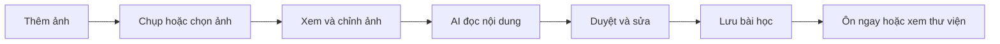

**Bước 1 — chọn ảnh.** Có hai nút rõ: “Chụp ảnh” và “Chọn ảnh từ máy”. Chỉ hỏi quyền camera sau khi bấm chụp. Nếu camera không dùng được, lựa chọn tải ảnh vẫn có sẵn.

**Bước 2 — xem lại.** Người dùng thấy ảnh sẽ gửi đi, có thể cắt, xoay hoặc chụp lại. Tên bài/ngày học là tùy chọn. Khi cần AI đọc ảnh, app giải thích ngắn rằng ảnh được gửi để phân tích; lưu trên máy và gửi ảnh cho AI là hai việc riêng biệt.

**Bước 3 — phân tích.** Hiển thị bước đang thực hiện, có thể hủy/thử lại. Không chạy thanh phần trăm giả. Nếu mất mạng, giữ ảnh nháp để làm tiếp; không xóa công sức vừa chụp.

**Bước 4 — duyệt.** Mặc định mở phần từ vựng. Câu, mẫu câu và ngữ pháp xuất hiện khi ảnh có nội dung tương ứng. Người dùng thấy phần mới, phần đã có, phần cần kiểm tra; có thể sửa và bỏ chọn trước khi bấm “Lưu”. Chữ không rõ được đánh dấu, tránh tạo cảm giác AI luôn đúng.

**Sau khi lưu:** thông báo như “Đã thêm 8 từ mới · 3 từ đã có · 2 mẫu câu”. Nút chính là “Ôn bài này”. App giữ ngày và nguồn học để sau này biết từ đến từ bài nào.

Từ trùng không tạo lại bản ghi, nhưng vẫn ghi nhận rằng người dùng gặp nó trong bài mới. Nếu `bank` xuất hiện với nghĩa “ngân hàng” rồi “bờ sông”, app giữ hai nghĩa thay vì bỏ nghĩa thứ hai. AI chỉ đề xuất; người dùng duyệt nội dung cần sửa.

## 4. Graph flow và đặc tả đủ 16 màn hình

**S01–S16 là mã màn hình để đối chiếu graph, nội dung và ảnh UI.** Người dùng vẫn chỉ thấy ba khu vực chính. S09 gồm danh sách và chi tiết từ; S10 gồm câu/mẫu câu/ngữ pháp; S13 gồm bốn trò. Những biến thể này được ghi trong cùng nhóm màn hình, không bị bỏ sót chỉ vì kế hoạch có 16 mã.

Mũi tên ghi tên hành động hoặc điều kiện. Hộp chữ nhật là trang/trạng thái, hình thoi là điều kiện cần xét. Dữ liệu trong các ảnh sau này là ví dụ minh họa; các graph dưới đây mô tả hành vi cần triển khai.

### 4.0. Bản đồ toàn bộ app

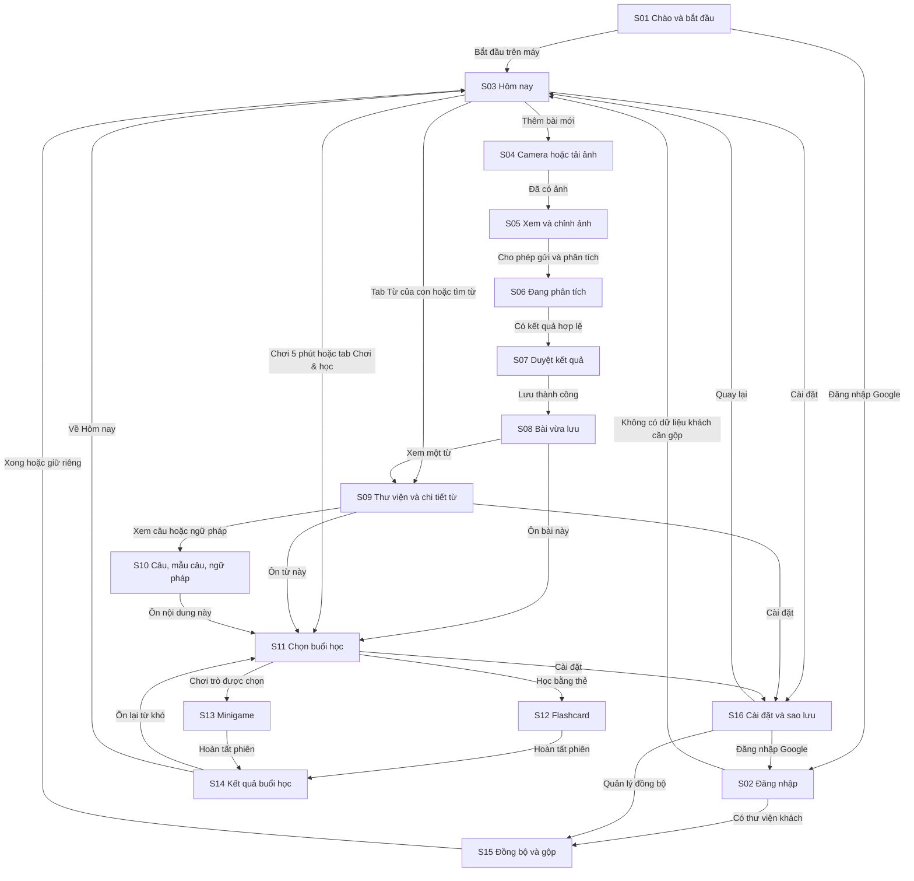

S16 quay lại đúng nơi đã mở nó; mũi tên về S03 ở graph tổng là đường thường gặp. Lỗi/hủy/quay lại chi tiết nằm ở từng graph dưới đây. Khi đang chụp, duyệt hoặc học, thanh ba tab được ẩn để giữ tập trung; thay bằng nút Quay lại/Đóng có bảo toàn công việc. S03, danh sách S09 và S11 là những nơi dùng thanh ba tab thường xuyên.

| Mã | Tên màn hình | Ảnh đại diện dự kiến sau khi nhận xét theme |
|---|---|---|
| S01 | Chào và bắt đầu | Lần đầu dùng, nút Bắt đầu |
| S02 | Đăng nhập Google | Giải thích đồng bộ và lựa chọn khách |
| **S03** | **Hôm nay** | **Có bài học, 8 từ cần ôn — Theme C tạm chốt** |
| S04 | Camera/tải ảnh | Camera đang mở, có nút chọn ảnh thay thế |
| S05 | Xem và chỉnh ảnh | Tờ A4 đã cắt, nút Phân tích ảnh |
| S06 | Đang phân tích | Bước nhận dạng đang chạy, có Hủy |
| S07 | Duyệt kết quả | Danh sách có từ mới/trùng/cần sửa |
| S08 | Bài vừa lưu | Số mục mới/trùng và nút Ôn bài này |
| S09 | Thư viện/chi tiết từ | Chi tiết apple: nghĩa, nghe, ví dụ, note |
| S10 | Câu/mẫu câu/ngữ pháp | Phân tích câu I am reading a book |
| S11 | Chọn buổi học | Buổi ôn 5 phút được gợi ý |
| S12 | Flashcard | Thẻ đã hiện đáp án, hai nút đánh giá đơn giản |
| S13 | Minigame | Nghe/nhìn apple rồi chọn hình hoạt họa, 2–3 lựa chọn |
| S14 | Kết quả | Phiên game hoàn tất, từ cần ôn tiếp |
| S15 | Đồng bộ/gộp thư viện | Xem trước phần mới/trùng trước khi gộp |
| S16 | Cài đặt/sao lưu | Trình độ, chế độ đơn giản, âm thanh, dữ liệu |

**Đã tạo đủ S01–S16 theo các graph bên dưới.** Mở [gallery 16 màn](design/gallery.html) để so toàn bộ ảnh, hoặc [prototype có bài minh họa](design/prototype/index.html?seed=1) để bấm thử. Theme C đã tạm chốt, 9 ảnh được sửa theo phản hồi về minh họa/bố cục; bản cũ giữ để đối chiếu. Câu hỏi và đáp án của S12/S13 sẽ được kiểm trong cả trạng thái trước/sau; một ảnh đại diện không thay toàn bộ flow.

### 4.1. S01 — Chào và bắt đầu

**Mục đích:** hiểu công dụng và dùng ngay. Đi vào khi mở app lần đầu; lần sau có thư viện/phiên hợp lệ thì vào Hôm nay.

**Bố cục hiện hành ADR052:** header Words for Kids và một nút Cài đặt; khu minh họa Cáo/táo/sách/mèo, lời chào ngắn và nút chính **Bắt đầu**. Không strip Nghe từ/Nhìn hình/Chơi và nhớ, link Cài đặt lặp, dòng giải thích demo/storage hay footer Bài mẫu. Bố cục theo chiều cao màn hình, nội dung dài vẫn cuộn bình thường; đăng nhập Google trong Cài đặt/tài khoản.

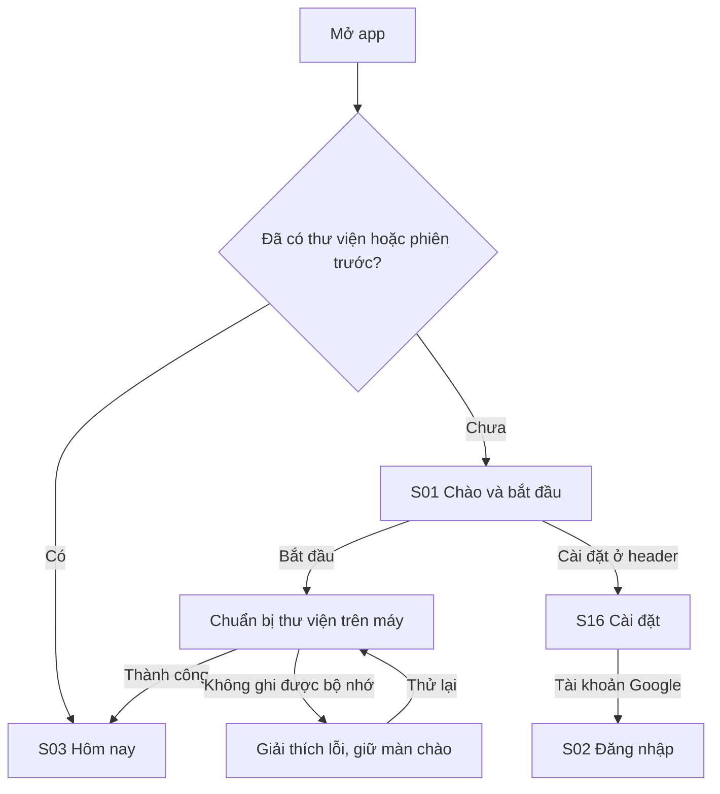

**Trạng thái:** lần đầu, đang chuẩn bị thư viện, trình duyệt không cho lưu, trở lại. Không hỏi ngày sinh/trình độ trước khi dùng; không tự bật camera. Nếu không có bộ nhớ local, không báo đã lưu và không hứa cloud sẽ tự khắc phục.

**Ảnh S01:** trạng thái lần đầu, minh họa nhỏ và một nút chính; màu, chữ và nút kế thừa Theme C tạm chốt, wordmark Words for Kids.

### 4.2. S02 — Đăng nhập Google

**Mục đích:** mở khả năng đồng bộ, không cản người muốn học trên máy. Đi vào từ S01, tài khoản ở S16 hoặc khi cần đăng nhập lại.

**Bố cục:** Quay lại; tiêu đề “Học tiếp trên mọi thiết bị”; giải thích ngắn; nút **Đăng nhập Google**; “Tiếp tục trên thiết bị này”; thông tin thư viện khách sẽ được xem trước khi chuyển. Đăng nhập và chuyển dữ liệu là hai bước khác nhau.

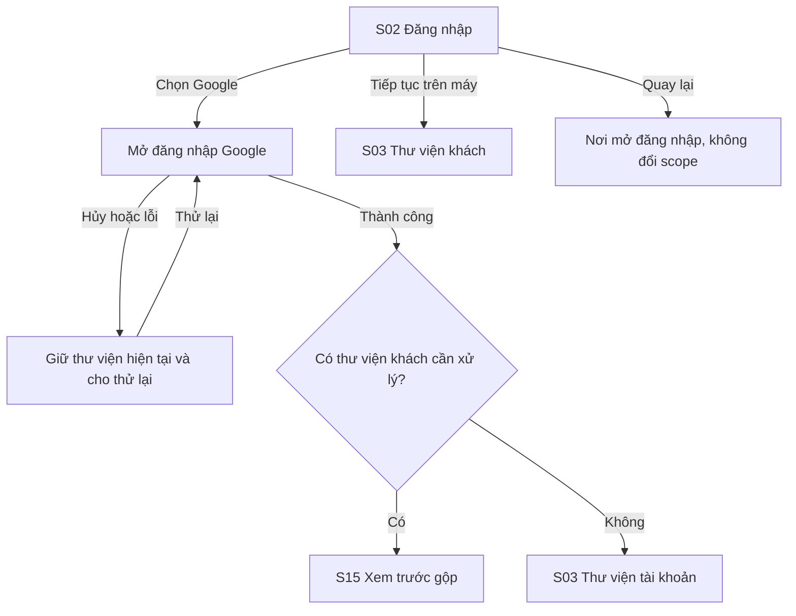

**Trạng thái:** chưa đăng nhập, đang mở Google, hủy, lỗi, hết phiên. Khi phải đăng nhập lại trong lúc sync, giữ việc đang chờ và trở về S15 sau thành công; không tự gộp nhầm với tài khoản khác.

**Ảnh S02:** trước đăng nhập, không có form mật khẩu riêng của app hoặc nhiều lựa chọn nhà cung cấp chưa triển khai.

### 4.3. S03 — Hôm nay, ảnh kiểm theme đầu tiên

**Mục đích:** có một hành động học rõ ngay khi mở. Đi vào sau Bắt đầu/đăng nhập hoặc tab Hôm nay. Trang này quyết định cảm giác thị giác chung của app.

**Bố cục từ trên xuống:** header tên app và nút tài khoản; tiêu đề “Hôm nay”, câu “Cùng ôn lại từ đã học”; vùng ôn vàng sáng, “Cùng ôn 8 từ nhé!”, bé cáo san hô hoạt họa và nút chính **Chơi 5 phút** màu berry; ô “Tìm từ của con...” ; hai bài học với hình hoạt họa cạnh nhau; một từ gần đây với nút Nghe; hàng phụ **Thêm bài** mở trực tiếp; thanh **Hôm nay / Từ của con / Chơi & học** ở dưới.

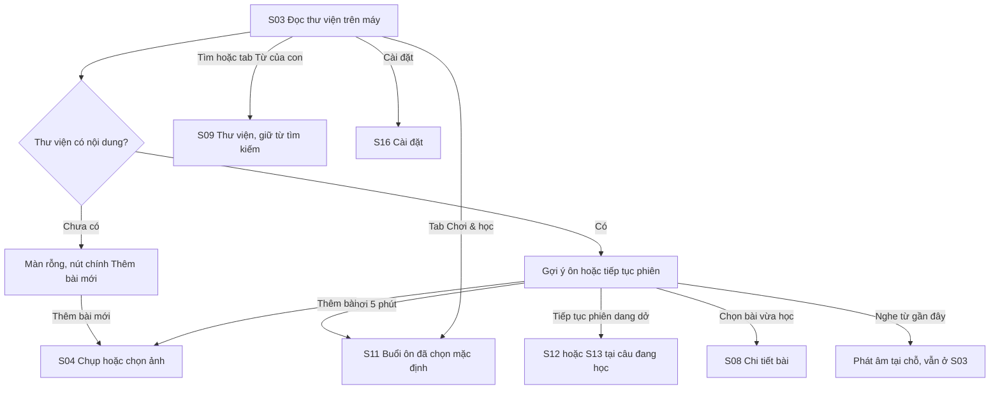

**Trạng thái:** chưa có bài; đã có từ đến hạn; có bài nhưng chưa có từ đến hạn; phiên dang dở; offline; đang chờ đồng bộ. Khi không có từ đến hạn, gợi ý bài vừa thêm thay vì nút ôn bị khóa. Khi offline, tìm/nghe local nếu thiết bị hỗ trợ/học nội dung đã lưu vẫn dùng được.

**Nội dung minh họa cho ảnh S03:** 8 từ cần ôn; bài `At school` có 12 từ, 2 mẫu câu; `Food & drinks` có 8 từ, 1 mẫu câu; từ gần đây `apple — quả táo`. Đây là fixture thiết kế, không phải dữ liệu thật của người dùng. Từ preview mở chi tiết S09 khi chạm phần chữ; nút Nghe chỉ phát âm.

**Lịch sử theme:** A xanh bị từ chối vì tầm thường. B sổ giấy chưa ấn tượng và không hợp ưu tiên trẻ 5–8; giữ lịch sử, không nhân rộng. Brief mới yêu cầu hoạt họa dễ thương như tinh thần Duolingo, nhưng nhân vật và bố cục riêng.

**Theme C tạm chốt — bé cáo san hô học từ:** hình 2D, mảng lớn, nét rõ, mascot có khuôn mặt thân thiện; đồ vật/trái cây giữ hình dạng tự nhiên và không có mặt; nền hồng rất nhạt `#FFF8F8`, chữ `#38213D`, nút berry `#B52F60`, vàng `#FFE49A`, mint `#DEF3E6`, lilac `#ECE3FB`; mascot san hô `#FF925C`. Không dùng cú xanh/nhân vật/đường học/streak của Duolingo. Font tròn có đủ dấu Việt, body trẻ khoảng 18 px; vùng chạm ít nhất 48 px, primary khoảng 56 px. Hình minh họa học là cartoon, ảnh giấy nguồn của phụ huynh vẫn giữ nguyên để kiểm chữ.

**Đối chiếu ảnh với graph:** Chơi 5 phút→S11 (gợi G02 nghe/nhìn từ chọn hình khi đủ asset, nếu thiếu thì thẻ phù hợp); ô tìm/apple→S09; dòng bài→S08; Nghe ở tại chỗ; Cài đặt→S16; Thêm bài→S04, mở trực tiếp theo ADR046. Không yêu cầu trẻ thêm API key hoặc đăng nhập Google.

**Ảnh hiện tại — Words for Kids, Theme C v2 đã sửa minh họa:**

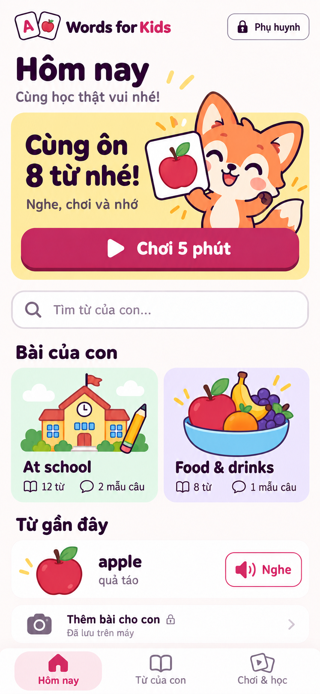

Ảnh S03 gốc đã chốt trước lần đổi tên được giữ trong lịch sử; bản hiện tại dùng Words for Kids và bỏ mặt trên vật thể. Đủ 16 ảnh/prompt và phiên bản cũ nằm trong manifest; [gallery](design/gallery.html) mở ảnh lớn. Prototype là HTML/CSS/JS thật để thử luồng, dùng font Nunito có tiếng Việt, minh họa SVG chuẩn bị sẵn và dữ liệu mẫu. Kết quả AI, camera, Google/cloud, tìm ảnh mạng và lịch SRS chưa được triển khai. Ảnh concept không thay phép thử với trẻ hoặc số đo hiệu năng.

**Founder đã sửa hướng minh họa và UI khi xem prototype:** đồ vật, trái cây và thức ăn không thêm mắt/miệng/má hồng/tay chân. Dễ thương đến từ màu sạch và nét mềm, vẫn phải nhìn ra ngay là cặp, sách hay thước. Cặp phải có quai xách/quai đeo/khóa/ngăn túi. Mascot cáo giữ biểu cảm riêng. Không ép ảnh tìm trên mạng giống một bộ kawaii độc quyền: ưu tiên vector/illustration có sẵn, cùng bộ khi thuận tiện; đồng bộ bằng khung, nền và kích thước hình. Hình không rõ không đưa vào game.

**Bố cục game/kết quả đã sửa:** ba đáp án bằng nhau, cùng một hàng ở màn từ 360 px; màn quá hẹp dùng ba hàng bằng nhau. Không dùng hai thẻ trên và một thẻ rộng phía dưới vì tạo thiên lệch thị giác. Không làm nhạt cả hình sau khi trả lời; feedback ngắn, có icon/chữ. Kết quả gọn trong một nhóm số đúng/sai/bỏ qua dùng mint/pink/lilac. Panel mã màn/checkbox lỗi chỉ là công cụ QA và được ẩn khỏi giao diện mặc định, không thuộc app cho bé.

**Skill đã vận dụng trong vòng prototype trước đây (lịch sử; product-design/ui-animation đã gỡ theo ADR078):** frontend-design tạo mascot/palette/illustration riêng; product-design tách child learning và parent preparation; ui-ux-pro-max được tra và chọn lọc, không áp recommendation landing/blue; bilingual-learning-content giữ đúng nghĩa/ví dụ; motion-design/ui-animation định nghĩa storyboard, thời gian, pause và reduced motion ở mục 8. Hiệu năng dùng catalog/template, không phát video AI hoặc tải mọi asset khi mở app.

### 4.4. S04 — Camera hoặc chọn ảnh

**Mục đích:** lấy ảnh bài học rõ, có đường thay thế khi camera lỗi. Đi vào từ Thêm ảnh ở Hôm nay hoặc Thêm ảnh khác ở một bài.

**Bố cục hiện hành ADR051:** Quay lại, “Thêm ảnh bài học”; hai tab Chọn ảnh / Chụp ảnh, mặc định Chọn ảnh và chỉ hiện panel chọn. Chọn ảnh có picker/kéo thả/dán; Chụp ảnh có nút Mở camera rồi preview/đổi camera/chụp/đóng. Chọn tab không hỏi quyền, rời tab camera dừng tracks và hủy permission đến muộn; danh sách nháp nằm ngoài tab.

```mermaid
flowchart TD
  A["S04 Tab Chọn ảnh mặc định"] -->|Tab Chụp ảnh| K["Chỉ hiện phần camera, chưa hỏi quyền"]
  K -->|Mở camera| P{"Camera có thể dùng?"}
  K -->|Tab Chọn ảnh| A
  C -->|Tab Chọn ảnh, dừng camera| A
  P -->|Cho phép| C["Preview camera"]
  P -->|Từ chối hoặc không hỗ trợ| E["Giải thích và giữ nút chọn ảnh"]
  C -->|Chụp| V["Kiểm ảnh và dừng camera"]
  A -->|Chọn ảnh từ máy| F["Mở chọn file"]
  E -->|Chọn ảnh thay thế| A
  A -->|Dán hoặc kéo thả ảnh| V
  F -->|Chọn ảnh| V
  F -->|Hủy| A
  V -->|Ảnh dùng được| N["S05 Xem và chỉnh"]
  V -->|Sai định dạng hoặc quá lớn| X["Lỗi cụ thể, chọn ảnh khác"]
  X --> A
  A -->|Quay lại| B["Nơi mở thêm ảnh"]
  C -->|Quay lại| B
```

**Trạng thái:** chưa hỏi quyền, quyền được cấp, bị từ chối, thiếu camera, file picker bị hủy, ảnh không phù hợp. Camera dừng khi đổi tab, sang S05, ẩn hoặc rời trang. Quyền camera chỉ được hỏi khi bấm Mở camera, không hỏi khi chọn tab Chụp ảnh.

**Đã triển khai T04 local:** nút `Mở camera` mới hỏi quyền; `Chụp ảnh` trong preview, `Đổi camera`, `Đóng camera` và upload fallback. Dừng tracks khi switch/hidden/leave/capture; late permission không mở lại camera sau hủy. JPEG/PNG/WebP ≤10 MB/20MP, HEIC hướng dẫn chuyển JPEG/chụp mới. Danh sách nháp đúng scope, xác nhận xóa chỉ dọn ảnh nháp đó, nhắc nháp hơn7ngày. QA07 phone thật chưa chạy.

**Ảnh S04:** camera đã được cho phép, tờ A4 trong khung và nút chụp; không vẽ popup quyền của OS như UI do app sở hữu.

### 4.5. S05 — Xem và chỉnh ảnh

**Mục đích:** biết chính xác ảnh sẽ phân tích, sửa trước khi gửi. Đi vào với một ảnh đã chụp/chọn; ảnh và thao tác chỉnh được lưu thành nháp.

**Bố cục:** Quay lại, preview lớn; Cắt/Xoay/Chụp lại; cảnh báo khi ảnh khó đọc; tên bài/ngày tùy chọn; dòng cho phép gửi ảnh này tới dịch vụ AI; nút **Phân tích ảnh**. Công cụ cắt có thao tác nút/điều khiển thay thế kéo bằng tay.

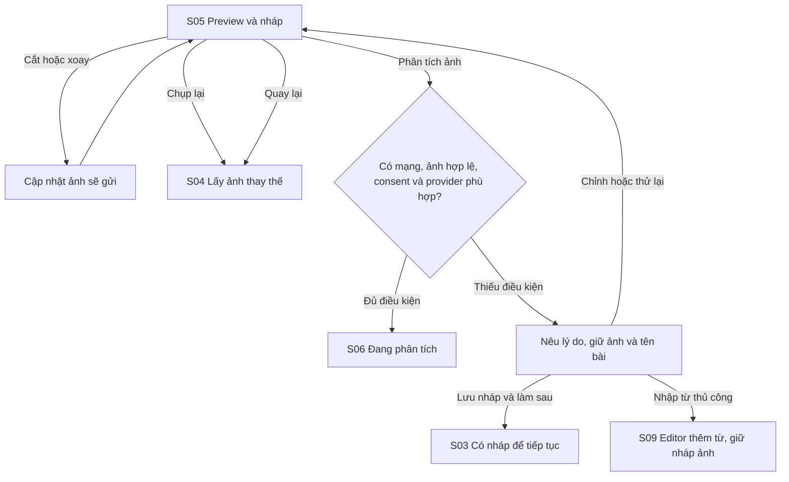

**Trạng thái:** chưa chỉnh, sau chỉnh, ảnh mờ, HEIC cần chuyển đổi/hướng dẫn, ảnh quá lớn, offline, chưa cho phép gửi, bộ nhớ đầy. Giới hạn bản đầu: một ảnh/lượt, tối đa 10 MB và 20 megapixel trước xử lý. Tên/ngày/tags không bắt buộc; các giá trị đã nhập không mất khi lỗi.

**Đã triển khai T04 local:** rotate90°, reset, crop bốn mép theo % với keyboard, mở ảnh để zoom; title/date/tags tùy chọn, consent local không gửi ảnh. Autosave500ms/manual/back, nháp + prepared pixels atomic/versioned scoped, quota/conflict giữ phần đang làm, reload giữ ảnh và fields. Chỉ giữ source JPEG đã normalize/bỏ EXIF≤2200 + prepared đúng preview, không giữ raw/GPS/file name. Today có `Tiếp tục nháp ảnh` mở trực tiếp. `Phân tích ảnh bằng AI` hiện mở màn BYOK theo ADR029; thiếu key có link cài đặt, lỗi/hủy giữnháp; không tự gửi sau restore. Nhập tay/autocomplete thật đã nối.

**Ảnh S05:** A4 đã cắt gọn, preview sắc nét, trạng thái đã cho phép gửi ảnh, nút Phân tích ảnh sẵn sàng. Nhập tay là editor trong nhóm S09, không thêm một màn thứ 17.

### 4.6. S06 — Đang phân tích

**Mục đích:** hiểu app đang làm gì và có thể thoát nếu chờ lâu. Đi vào sau khi đồng ý phân tích một ảnh hợp lệ.

**Bố cục:** thumbnail ảnh, tên bài; các bước Chuẩn bị ảnh/Gửi ảnh/Nhận dạng/Kiểm tra kết quả theo thông tin thật; status text; **Hủy phân tích**; lỗi có Thử lại hoặc Quay lại chỉnh ảnh. Không có phần trăm giả.

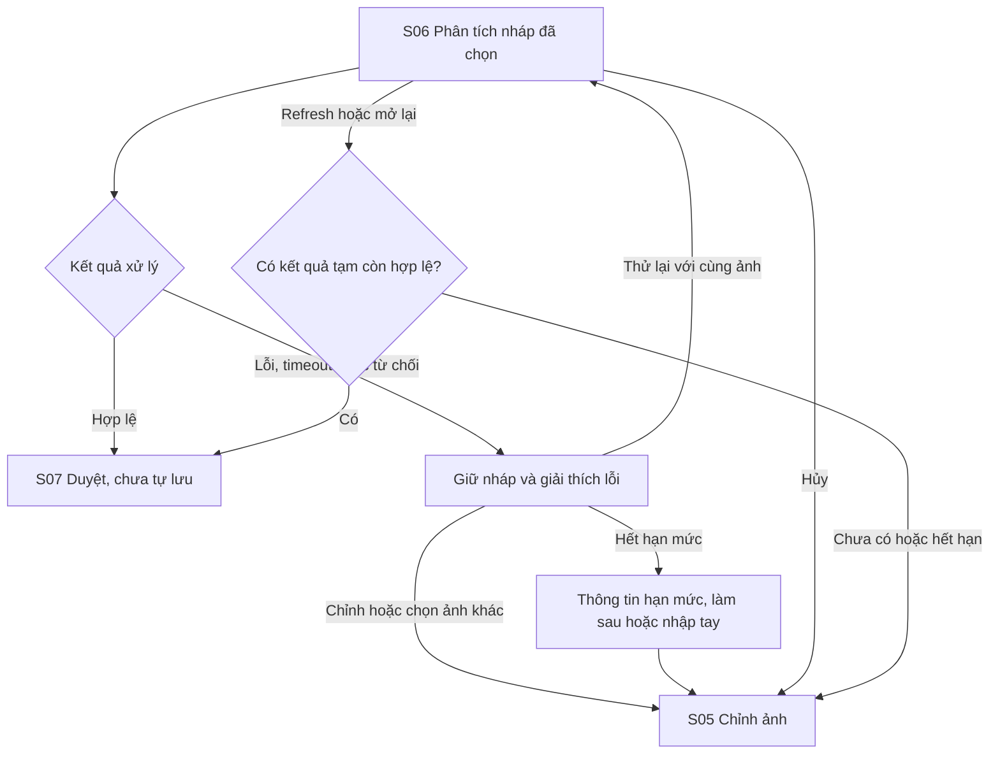

**Trạng thái:** bước đang xử lý, hủy, timeout, kết quả lỗi định dạng, refusal, quota, phục hồi sau refresh. Không gửi lại một cách vô hạn; retry giữ nháp, chống tính lặp theo request của cùng nội dung. Hủy không hứa dịch vụ AI hoàn tiền nếu đã chạy.

**Ảnh S06:** bước Nhận dạng đang chạy, bước trước có check, bước sau chưa hoàn tất; có nút Hủy. Một ảnh tĩnh chỉ minh họa trạng thái, chưa chứng minh animation đã hoạt động.

### 4.7. S07 — Duyệt từ, câu và ngữ pháp

**Mục đích:** sửa những gì AI đọc trước khi đưa vào thư viện. Đi vào với kết quả trích từ ảnh hợp lệ và đối chiếu dữ liệu trong thư viện đang dùng.

**Bố cục:** tên bài, số mục đã chọn; nhóm Từ vựng/Câu/Ngữ pháp, mẫu câu nằm trong nhóm Câu; bộ lọc Mới/Đã có/Cần kiểm tra; dòng nội dung có checkbox, nhãn và Sửa; ảnh nguồn mở thêm trên mobile; thanh **Lưu N mục** ở dưới. Desktop đặt ảnh và kết quả cạnh nhau.

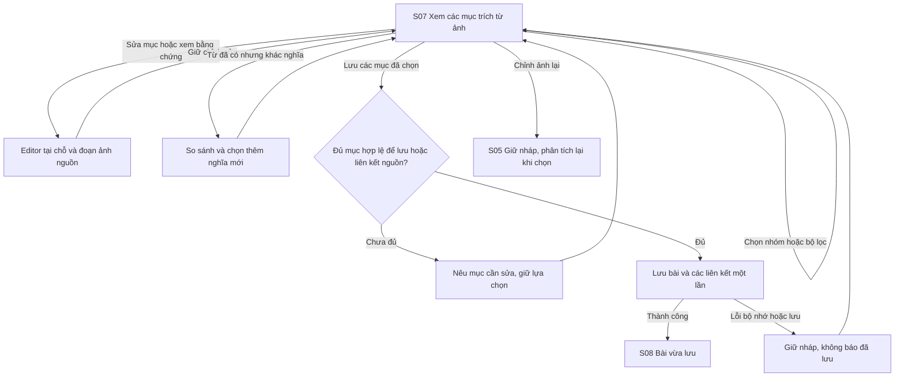

**Trạng thái:** kết quả mới, có mục trùng, nghi chữ không rõ, nghĩa mới, toàn bộ đã có, không có tiếng Anh, thiếu nghĩa/ví dụ, lưu lỗi. Toàn bộ đã có vẫn có thể lưu bài với liên kết nguồn; không tạo lại các từ. Không có mục thì hướng dẫn chọn/chỉnh ảnh hoặc nhập tay.

**Ảnh S07:** bài mới `School objects`, `pencil` mới, `book` đã có, chữ `erqser` cần sửa thành `eraser`; nhãn bằng chữ và icon, không chỉ màu. Từ chưa được bổ sung nghĩa vẫn lưu được; khi đó ghi thiếu nội dung và chưa đưa vào câu hỏi cần nội dung đó.

### 4.8. S08 — Bài vừa lưu và nguồn học

**Mục đích:** biết đã lưu gì, học tiếp ngay, tìm lại nguồn. Đi vào sau lưu thành công hoặc chạm bài trong Hôm nay/Thư viện.

**Bố cục:** tên/ngày bài, trạng thái Đã lưu trên máy/Đang chờ đồng bộ/Đã đồng bộ; số mục mới/đã có/câu/ngữ pháp; nút **Ôn bài này**; danh sách từ và câu; mở ảnh nguồn nếu còn; note/tag và Thêm ảnh khác là phụ.

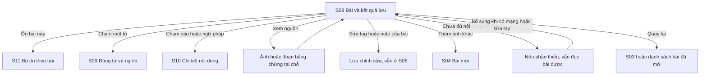

**Trạng thái:** lưu local thành công, sync pending, sync xong, enrichment một phần, ảnh nguồn đã xóa, chưa có mục đủ điều kiện ôn. Không báo đã đồng bộ chỉ vì đã ghi local; ảnh đã xóa vẫn giữ bằng chứng văn bản và ngày học.

**Ảnh S08:** kết quả bài mới `School objects`, 8 từ mới/3 từ đã có/2 mẫu câu; CTA Ôn bài này. Tổng 11 từ được liên kết với bài, trong đó chỉ 8 từ được thêm vào thư viện; không gộp mẫu câu vào số từ. Hai bài `At school`/`Food & drinks` và từ `apple` đã có từ trước trong ảnh S03, giúp chuỗi ảnh nhất quán.

### 4.9. S09 — Từ của con và chi tiết từ

**Thêm từ không cần chụp ảnh — đã chốt 09/10/2026:** phụ huynh bấm `Thêm từ` ở Hôm nay/Từ của con, gõ tiếng Anh và xem autocomplete các từ khớp hoặc liên quan. Gợi ý phân biệt từ đã có và từ mới để thêm; chọn gợi ý hoặc tra nguyên từ đã gõ → xem nghĩa/POS, IPA/cách đọc/ví dụ có nguồn → chọn nghĩa, sửa/duyệt → lưu. Không tự lưu khi chọn autocomplete, không tự đổi thành từ gần giống. Có thể nhập thủ công nếu không tìm thấy, offline hoặc tra lỗi; giữ nháp và báo nội dung còn thiếu. Dùng cùng chống trùng/approval/thư viện với từ từ ảnh. Nguồn tra live chưa chọn, T07 triển khai; editor T03 đã lưu sửa/đề xuất local, chưa tạo/tra/autocomplete T07.

**Phát âm đã chốt:** ngay dưới từ lớn là IPA, phân biệt UK/US khi có dữ liệu; dòng kế là `Cách đọc gần đúng` bằng chữ Việt. Mỗi câu ví dụ cũng có hai dòng tương ứng dưới câu EN và trước bản dịch VI. Nút Nghe/Nghe chậm vẫn đọc tiếng Anh gốc. IPA có nguồn/kiểm xác minh; gợi ý chữ Việt được phụ huynh duyệt, không gọi là IPA chuẩn. Thiếu dữ liệu thì báo phần phát âm chưa đầy đủ ở khu phụ huynh và cho bổ sung; không bịa phiên âm. Các ảnh/mockup cũ giữ lịch sử, bố cục mới chờ T07.

**Mục đích:** tìm được một từ đã học và hiểu đúng nghĩa. Đi vào từ tab Từ của con, tìm ở Hôm nay, một bài hoặc kết quả buổi học; giữ nội dung tìm kiếm/vị trí danh sách khi quay lại.

**Bố cục danh sách:** tiêu đề Từ của con, ô tìm, bộ lọc mở khi cần; từng dòng có từ/nghĩa ngắn/nút Nghe; chuyển sang Câu hoặc Ngữ pháp; tab dưới. **Bố cục chi tiết:** Quay lại; từ lớn và Nghe/Nghe chậm; từ loại và nghĩa đang chọn; nghĩa Anh–Việt/Anh–Anh; một ví dụ; **Ôn từ này**; ví dụ và nội dung học bổ sung. Theo ADR052, không render mục Nguồn và ghi chú/đã học ở đâu; provenance/evidence/notes giữ trong database, attribution hình cần thiết giữ riêng. Desktop dùng danh sách/chi tiết hai cột.

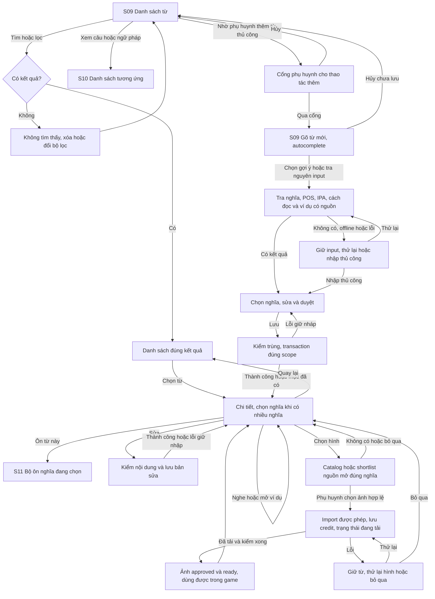

**Trạng thái:** thư viện rỗng có Thêm ảnh; kết quả tìm rỗng có Xóa bộ lọc; 1 hoặc nhiều nghĩa; nội dung chưa hoàn tất; đang sửa; audio thiếu; mục đã xóa; offline. Sửa/note thất bại giữ văn bản để thử lại. Nghĩa khác không bị mất khi chống trùng hoặc cập nhật AI.

**Ảnh S09:** chi tiết `apple`, nghĩa `quả táo`, giải thích Anh–Anh, ví dụ, Nghe và Ôn từ này; không nhét mọi note/ví dụ dài vào một khung nhỏ. Khi ảnh chỉ đại diện chi tiết, graph và bản wireframe vẫn bao phủ danh sách/editor.

### 4.10. S10 — Câu, mẫu câu và ngữ pháp

Câu học và ví dụ của mẫu câu/grammar dùng cùng bố cục phát âm S09: câu EN → IPA đã xác minh → cách đọc gần đúng bằng chữ Việt đã duyệt → nghĩa VI. Phát âm theo toàn câu và accent được chọn; bản sửa câu cần kiểm lại phiên âm/gợi ý, giữ nhãn nguồn câu riêng với nguồn phần phát âm.

**Mục đích:** hiểu cách dùng tiếng Anh, không chỉ nhớ dịch từng từ. Đi vào từ S09 hoặc mục câu/ngữ pháp của một bài.

**Bố cục:** danh sách chia Câu/Mẫu câu/Ngữ pháp; chi tiết có câu gốc và bản dịch; nhãn nguồn; phân tích cụm từ; mẫu câu có chỗ thay và ví dụ; grammar có công thức/cách dùng/lỗi thường gặp. Mẹo nhớ có **Từng bước/Phát/Dừng/Phát lại**, bản chữ đầy đủ và note của tôi; **Ôn nội dung này** là hành động chính.

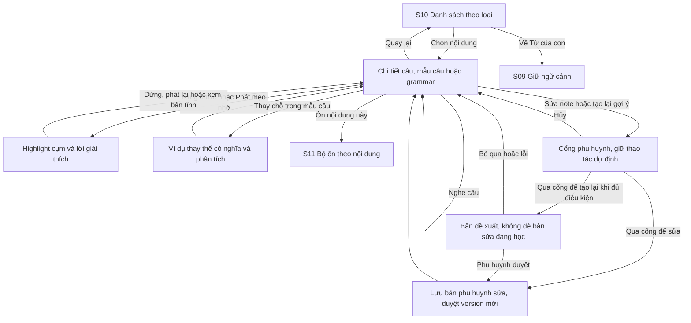

**Trạng thái:** câu nguồn/câu AI; mẫu câu có nhiều chỗ thay; grammar đủ hoặc thiếu ví dụ; audio lỗi; animation chạy/dừng/giảm chuyển động; đang sửa; tạo lại gợi ý offline/lỗi. Giữ toàn câu và giải thích tĩnh ngay cả lúc đang highlight. Không bắt xem hết animation mới học tiếp.

**Ảnh S10:** `I / am reading / a book.` với nhãn chủ ngữ/hành động/tân ngữ, “Tôi đang đọc một quyển sách”, thông tin hiện tại tiếp diễn và nút Từng bước. Câu gốc hay AI được ghi rõ trên bản mockup; không thêm trò chat AI tự do.

### 4.11. S11 — Chọn buổi học

**Mục đích:** bắt đầu đúng bộ từ với ít lựa chọn. Đi vào từ Chơi 5 phút, Ôn bài này, Ôn từ này, Ôn nội dung này hoặc tab Chơi & học; mặc định đã chọn bộ theo nơi đi vào.

**Bố cục:** một buổi được gợi ý, số mục và thời lượng; nút **Bắt đầu học**; “Đổi cách học” mở Flashcard/bốn game; tùy chọn Đến hạn/Bài vừa thêm/Hay quên/Tự chọn; nội dung đủ điều kiện và Resume nếu có phiên. Không hỏi lại người dùng phải chọn bộ từ nào khi họ vừa bấm Ôn bài này.

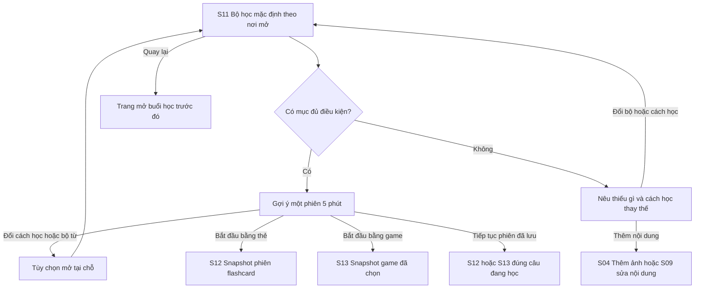

**Trạng thái:** bộ gợi ý, bộ tự chọn, không đủ nghĩa/ảnh, ít đáp án, phiên dang dở, offline. Game hình cần ảnh đúng nghĩa; với ít lựa chọn dùng chế độ hai lựa chọn có nhãn hoặc gợi ý cách khác, không lặp đáp án để giả đủ bốn.

**Ảnh S11:** gợi ý ôn 8 từ trong khoảng 5 phút, Flashcard được chọn; nút Bắt đầu học; một lựa chọn Đổi cách học. Bốn trò vẫn truy cập được dù không dồn cả bốn vào đầu màn.

### 4.12. S12 — Flashcard

**Mục đích:** tự nhớ trước khi xem đáp án, sau đó ghi mức nhớ để hẹn ôn. Đi vào từ một phiên đã chuẩn bị ở S11 hoặc tiếp tục phiên trước.

**Bố cục:** Quay lại/Tạm dừng và vị trí thẻ; một thẻ lớn; nút Nghe nếu chiều hỏi cho phép; **Hiện đáp án**. Sau reveal: nghĩa, ví dụ và hai nút Chưa nhớ/Nhớ rồi trong chế độ đơn giản; “Đánh giá chi tiết” mở Nhớ khó/Rất dễ. Chế độ chuẩn hiển thị đủ bốn mức. Không có bottom nav trong phiên.

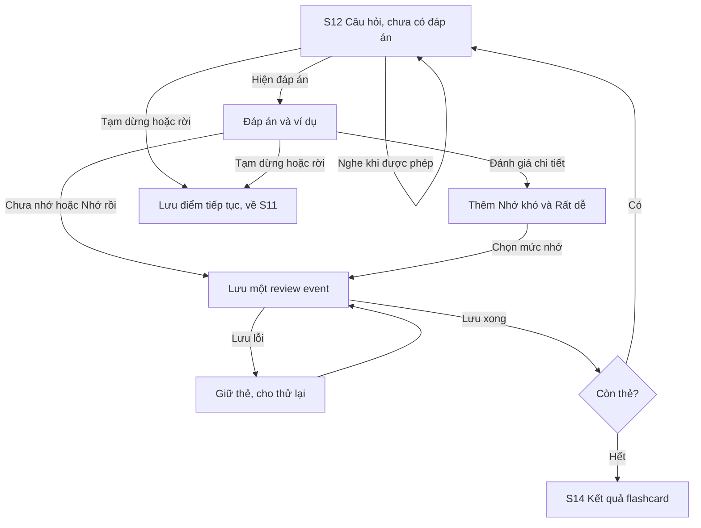

**Trạng thái:** câu hỏi, revealed, đang ghi rating, lỗi lưu, thẻ tiếp theo, cuối phiên, pause/resume, offline. Không cho rating trước reveal. Chưa nhớ→Again; Nhớ rồi→Good; chi tiết còn Hard/Easy. Bấm hai lần hoặc mở lại không tạo hai event, không đổi lịch ôn hai lần. Thẻ VI→EN không có nút nghe tiết lộ EN trước reveal; thẻ EN→nghĩa có thể nghe trước.

**Ảnh S12:** đã hiện đáp án của `apple`, có nghĩa và ví dụ, hai nút đánh giá đơn giản. Graph đã ghi riêng mặt câu hỏi để tránh AI chỉ dựng mặt đáp án.

### 4.13. S13 — Bốn minigame

**Mục đích:** nhớ từ qua hình, lựa chọn và gõ. Đi vào theo mode đã chọn ở S11; trang chọn game nằm trong cùng nhóm S13, hiển thị “Đổi cách chơi”.

**Bố cục chơi:** thoát/tạm dừng, vị trí câu; một câu hỏi; ảnh/từ/ngữ cảnh tùy mode; vùng đáp án; Gợi ý/Nghe nếu mode cho phép; nút **Kiểm tra** cho câu gõ, hoặc chạm lựa chọn để kiểm; feedback và **Tiếp tục** sau đúng/skip. Không autoplay hoặc tự nhảy ngay khi người học chưa đọc giải thích.

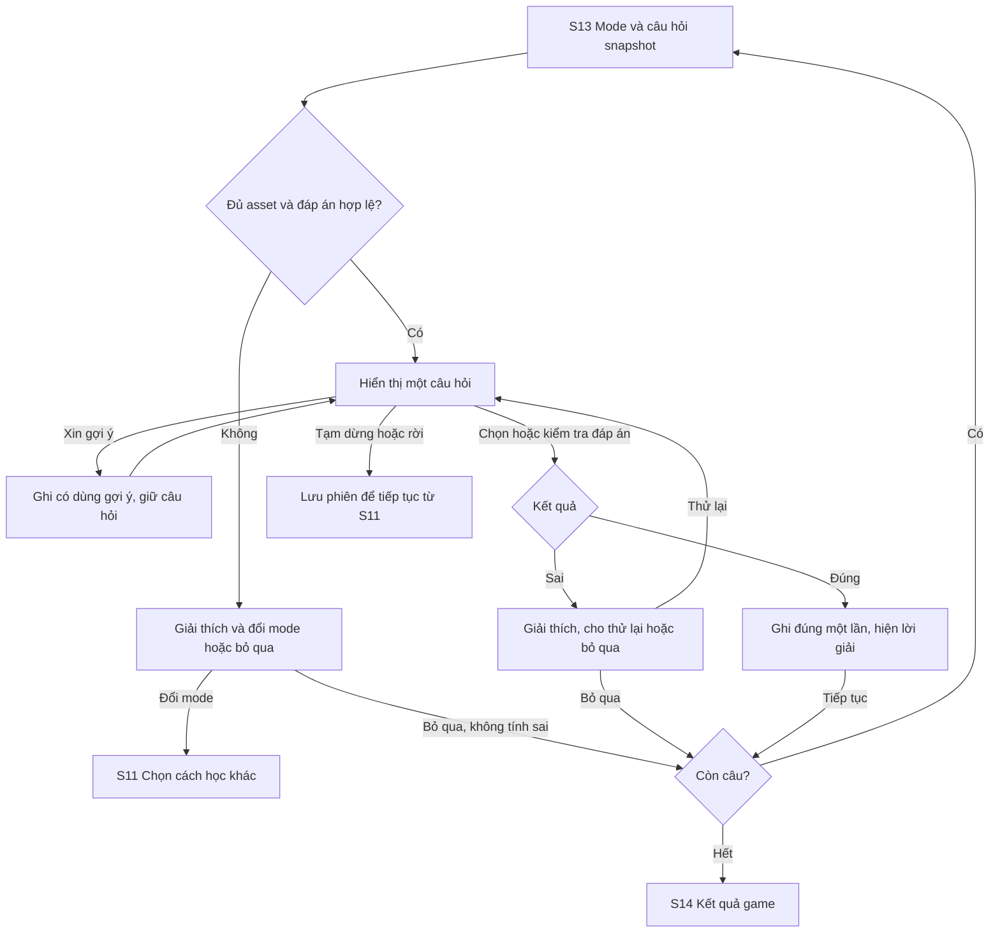

**Bốn biến thể bắt buộc:**

| Mode | Vùng câu hỏi/đáp án | Trạng thái đặc biệt |
|---|---|---|
| G01 Hình→từ | Ảnh quả táo, chọn apple/banana/orange/grape theo bộ hợp lệ | Ảnh lỗi thì bỏ qua/đổi mode; không tính sai người học |
| G02 Từ/nghe→hình | Từ/nghe và ngữ cảnh, 2–3 ảnh rõ ở Beginner, chọn một | Từ nhiều nghĩa phải rõ nghĩa; ảnh không nhập nhằng |
| G03 Chữ thiếu | `a _ p l e`, ô nhập cho ký tự thiếu | Thiếu một chữ ở mức dễ; không cho xóa ký tự gợi ý cố định |
| G04 Gõ cả từ | Nghĩa/ngữ cảnh/ảnh/âm thanh, ô gõ từ | Không hiện word cần đoán; chờ bàn phím nhập xong; chỉ tính variants đã duyệt |

**Trạng thái:** hỏi, hint, sai, đúng, skip, ảnh tải lỗi, mode không đủ mục, keyboard đang nhập, pause/resume, offline với asset có sẵn. Không dùng điểm game làm mức nhớ đã được xác nhận; sau game có thể gợi ý flashcard từ sai.

**Ảnh S13:** G02, nghe/nhìn `apple` rồi chọn một trong 2–3 hình cartoon; phù hợp đường học của trẻ chưa đọc. G01 có ảnh rồi chọn từ; ba mode khác vẫn có spec/flow. Số liệu/ảnh trong mockup chỉ minh họa; asset thật sau này cần nguồn/license và đúng nghĩa. Ba mode khác có cấu trúc riêng trong bảng để không bị quên.

### 4.14. S14 — Kết quả buổi học

**Mục đích:** hiểu vừa ôn gì và nên làm tiếp gì. Đi vào khi hoàn tất S12/S13; phiên chưa xong dùng nhánh Tiếp tục học.

**Bố cục:** lời hoàn thành ngắn; số câu/thẻ và kết quả đúng theo loại phiên; từ cần ôn; nút **Ôn lại từ khó** nếu có, nếu không thì **Về Hôm nay**; mở chi tiết từng từ; nút phụ kết thúc. Không trình bày tự đánh giá flashcard như bài thi đúng/sai.

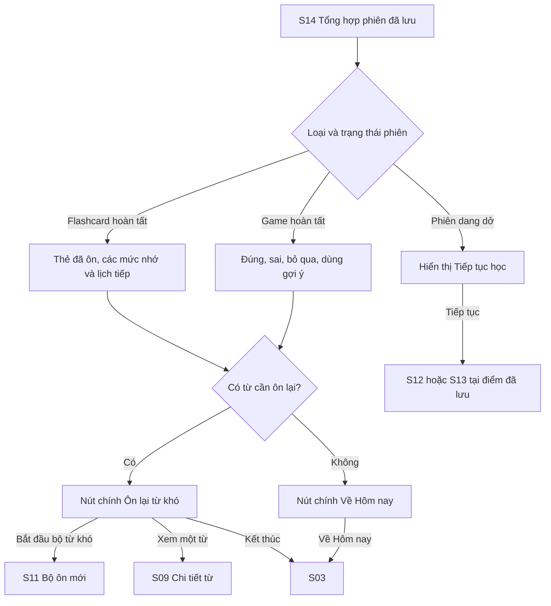

**Trạng thái:** hoàn tất, kết quả một phần, chưa có từ yếu, có từ yếu, pending sync. Dữ liệu phiên lưu một lần; refresh không thưởng thêm. Kết quả game và lịch ôn flashcard tách nhau. Không gắn “thành thạo” sau một lượt.

**Ảnh S14:** phiên game 10 câu: 7 đúng, 2 sai, 1 bỏ qua; dùng gợi ý ở 2 câu là số riêng có thể trùng nhóm đúng/sai. Có hai từ cần ôn và CTA Ôn lại từ khó, không dùng điểm này làm chứng nhận nhớ lâu.

### 4.15. S15 — Đồng bộ và gộp thư viện

**Mục đích:** dữ liệu theo đúng tài khoản, chuyển từ khách mà không mất hoặc trùng. Đi vào sau login khi có dữ liệu khách hoặc từ Quản lý đồng bộ ở S16.

**Bố cục:** tài khoản/thư viện đang dùng; trạng thái sync; xem trước dữ liệu trên máy và cloud; số mới/trùng/nghĩa cần xem; sao lưu; nút **Gộp lên tài khoản này** khi đã xem; lựa chọn Giữ riêng trên máy; tiến độ thật, retry và xử lý xung đột.

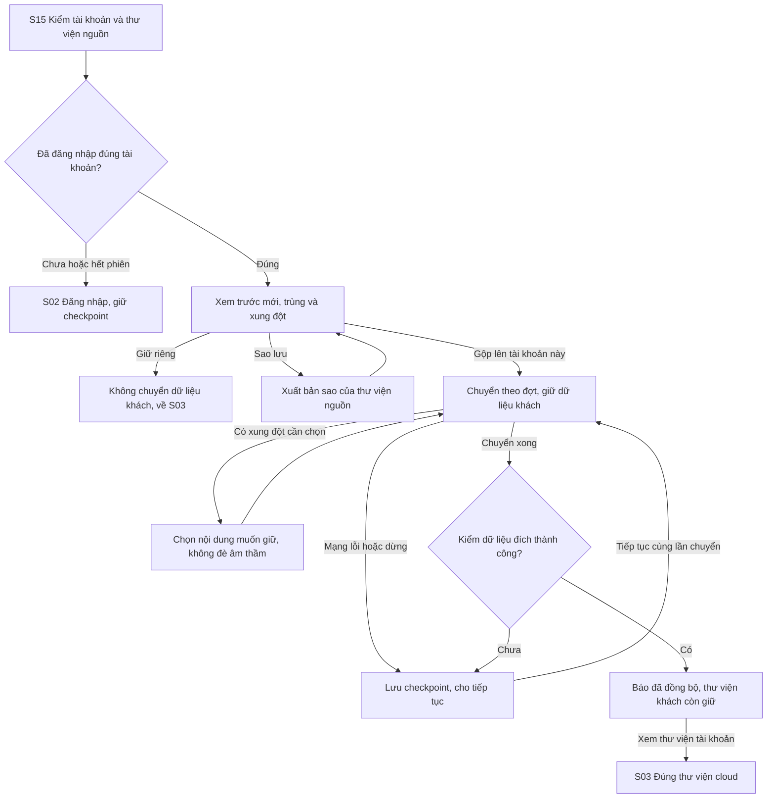

**Trạng thái:** chưa login, không có dữ liệu khách, preview, partial transfer, conflict, kiểm đích, xong, retry, đổi tài khoản. Lần login chỉ xác thực; bấm Gộp mới chuyển. Dừng sau một đợt không tự rollback mọi đợt đã ghi; giải thích phần đã chuyển, phần còn chờ. Đổi account không mang checkpoint của account cũ sang account mới.

**Ảnh S15:** preview 20 từ trên máy, 12 từ mới và 8 đã có trong tài khoản; nút Gộp, lựa chọn Giữ riêng. Đây là số minh họa; nghĩa khác vẫn được xử lý riêng. Không xóa thư viện khách tự động sau chuyển.

### 4.16. S16 — Cài đặt, tài khoản và sao lưu

**Mục đích:** người dùng chỉnh cách học và quản lý nội dung/dữ liệu. Nút Cài đặt ở header mở trực tiếp, không là tab thứ tư hoặc màn thứ 17, không có cảnh báo phân vai theo ADR046. Quay lại giữ công việc. Server vẫn xác thực quyền tài khoản; Gemini trực tiếp theo ADR030/040.

**Bố cục:** Quay lại; tài khoản và nơi lưu; nhóm Học tập (VI/EN, trình độ, chế độ đơn giản); Âm thanh/chuyển động; Dữ liệu (đồng bộ, xuất/nhập sao lưu); AI và hình minh họa (provider đủ điều kiện, quota/key được che, ảnh đang chờ chọn); mục xóa nằm cuối, có tên scope rõ. Đổi thiết lập nhẹ có hiệu lực và được lưu tại chỗ, không thêm một nút Lưu lớn cho toàn trang.

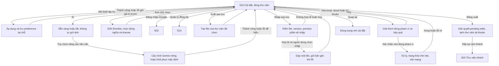

**Trạng thái:** khách/Google, thay preference, import lỗi/version mới, export lỗi, xóa pending, logout với dữ liệu chưa sync, offline. Tắt chuyển động vẫn có bản tĩnh đầy đủ. Xóa cloud cần mạng thì báo chờ, không báo đã xóa. Xóa từng mục có thể recover/Undo theo thiết kế; xóa hẳn thư viện/tài khoản cần nêu hậu quả trước khi xác nhận.

**Ảnh S16:** khu phụ huynh, VI/Beginner/chế độ trẻ em đang bật; AI hiện chưa chọn provider phù hợp, không có key thật. Nhóm học tập/âm thanh/dữ liệu, vùng xóa không cạnh các công tắc hằng ngày. Ghi rõ thư viện lưu trên máy hay tài khoản.

### 4.17. Quy tắc xuyên suốt để graph không bỏ sót

1. Quay lại giữ ảnh nháp, chữ đang sửa, bộ lọc/vị trí đọc và phiên học; rời công việc đang ghi phải có trạng thái rõ.
2. Hành động bấm nhiều lần chỉ ghi dữ liệu/kết quả một lần; refresh không nhân đôi bài hoặc điểm.
3. Một màn có một hành động nổi bật theo trạng thái; các lựa chọn khác vẫn truy cập được.
4. Trạng thái rỗng/lỗi có lý do và đường tiếp tục; thiếu mạng/audio/ảnh không làm cả app vô dụng.
5. Các dòng nguồn/AI/người dùng sửa được phân biệt; điều kiện game và nghĩa đúng không bị hy sinh để đủ ảnh đẹp.
6. Gate sinh một S03 trước đã đạt khi founder tạm chốt C. A rejected, B superseded; hiện đủ 16 ảnh Words for Kids và prototype core. Giữ bản cũ làm lịch sử; cập nhật bản hiện tại theo phản hồi, không hỏi lại approval theme cũ.

## 5. Một trang từ vựng sẽ trông và hoạt động thế nào?

Lấy `apple` làm ví dụ. Phần đầu chỉ cần đủ để hiểu và học ngay:

```text
apple                         [Nghe]
danh từ
quả táo
a round fruit that grows on a tree

I eat an apple every day.      [Nghe câu]
Tôi ăn một quả táo mỗi ngày.

[Ôn từ này]

Ví dụ khác · Mẹo nhớ · Ghi chú của tôi · Đã học ở đâu
```

Những mục phía dưới mở thêm tại chỗ khi cần, không bật nhiều cửa sổ chồng lên nhau. Từ có nhiều nghĩa sẽ chọn nghĩa rõ ràng trước khi học. Mỗi nghĩa được bổ sung có ít nhất hai câu ví dụ và bản dịch phù hợp trình độ.

Phần tiếng Anh giải thích bằng từ dễ hơn từ đang học. Phần tiếng Việt đúng ngữ cảnh. Câu AI gợi ý được gắn nhãn khác câu có trên giấy. Người dùng sửa nghĩa/note thì app giữ bản sửa khi cập nhật nội dung.

**Câu và mẫu câu:** hiển thị câu gốc, nghĩa, những phần có thể thay. Ví dụ `I like [something]` → `I like apples.` / `I like music.`. Người học thấy thay chỗ nào, không chỉ thấy một công thức.

**Ngữ pháp:** giải thích ngắn cách dùng, công thức, ví dụ đúng và lỗi thường gặp. Ví dụ `She likes apples.` và `They like apples.` có highlight chủ ngữ và động từ, giúp hiểu vì sao có/không có `s`.

## 6. Học và chơi

Buổi học mặc định khoảng 5 phút hoặc 10 câu. Người dùng có thể dừng, tiếp tục hoặc học thêm. Thư viện mới chưa đủ nội dung vẫn tìm được, nhưng chỉ đưa vào câu hỏi khi đủ nghĩa/ảnh/đáp án phù hợp.

**Flashcard:** mặt trước là câu hỏi; người học bấm “Hiện đáp án” rồi đánh giá mức nhớ. Mặc định cho trẻ có hai nút trước mắt: **“Chưa nhớ” / “Nhớ rồi”**; tùy chọn chi tiết vẫn mở được. Hai nút này tương ứng mức chưa nhớ/nhớ được của cùng lịch ôn, không tạo một hệ thống tính điểm khác.

App hẹn ôn lại dựa trên lần trả lời, thay vì bắt người học tự nhớ lịch. Lịch đầu tiên cần đơn giản, dễ kiểm tra; chưa tuyên bố là thuật toán tốt nhất.

| Trò chơi | Người học làm gì? | Cách làm dễ hiểu |
|---|---|---|
| Nhìn hình đoán từ | Chọn từ khớp ảnh | Ít lựa chọn khi mới học; ảnh rõ, đúng nghĩa |
| Nghe/nhìn từ đoán hình | Nghe từ, chọn hình khớp | Gợi ý đầu cho bé chưa đọc; 2–3 lựa chọn, ngữ cảnh rõ cho từ nhiều nghĩa |
| Điền chữ thiếu | Điền `a _ p l e` | Bắt đầu thiếu một chữ, có gợi ý |
| Gõ cả từ | Gõ từ từ nghĩa/câu/ảnh/âm thanh | Có kiểm tra và giải thích, không chấm sai vì bàn phím chưa nhập xong |

Màn Chơi & học gợi ý một cách chơi phù hợp trước, những cách khác nằm dưới “Đổi cách chơi”. Đủ bốn trò ở bản phát hành đầu. Từ trừu tượng hoặc chưa có hình đáng tin sẽ học bằng thẻ/điền chữ; app không ép mọi từ vào trò hình ảnh.

Trả lời sai thì giữ câu hỏi, đưa gợi ý và cho thử lại. Trả lời đúng có phản hồi ngắn rồi tiếp tục. Kết quả nêu rõ từ cần ôn; không gọi một lần đoán đúng là đã “thành thạo”. Điểm game không tự thay lịch ôn flashcard.

Âm thanh phát khi bấm nghe; có nghe chậm. Chuyển câu sẽ dừng âm thanh cũ. Nếu thiết bị chưa có giọng tiếng Anh, app báo rõ và vẫn học bằng chữ được. Khả năng nghe offline cần thử trên thiết bị thật.

## 7. Hướng thiết kế và mẫu InspoMCP phù hợp

**Hướng tạm chốt: cartoon 2D cho trẻ 5–8 — Theme C.** Bé cáo san hô riêng cầm thẻ táo; nút berry nổi bật; nền sáng với vàng/mint/lilac; minh họa dễ nhận ra; biểu cảm dành cho mascot/người/con vật, không thêm mặt cho đồ vật hoặc trái cây. A xanh đã bị từ chối, B sổ giấy được thay vì brief ưu tiên trẻ. Mở rộng người lớn sau bằng presentation khác trên cùng dữ liệu, không bắt bản đầu dung hòa hai nhóm.

Tham khảo Duolingo ở tính thân thiện, nút dễ chạm và phản hồi rõ; không sao chép brand/mascot/path-map/streak. Headspace/Daybridge vẫn hữu ích về khoảng trống và phối nhóm màu, nhưng không là hướng sổ giấy cho trẻ. Đây là quyết định của dự án từ reference và skill, còn cần thử trẻ thật.

Đã nghiên cứu bản chụp và dữ liệu thiết kế của bốn mẫu trên InspoMCP. Những lựa chọn áp dụng dưới đây là đánh giá cho Words for Kids, chưa phải kết quả thử người dùng. Bản chụp có ngày riêng, không đại diện cho mọi màn hình của sản phẩm nguồn.

| Mẫu tham khảo | Phần hợp với dự án | Áp dụng vào app |
|---|---|---|
| [Headspace](https://inspomcp.dev/d/headspace-com/DESIGN.md), bản chụp 18/05/2026 | Nền sáng, khoảng trống, khối bo góc và minh họa tạo cảm giác nhẹ nhàng | Cảm giác chung của Hôm nay, thẻ học và phản hồi sau buổi học |
| [Duolingo](https://inspomcp.dev/d/duolingo-com/DESIGN.md), 04/05/2026 | Nút bắt đầu nổi bật, chữ và hình thân thiện, hành động chính dễ thấy | Nút Bắt đầu, lựa chọn đáp án, chế độ đơn giản; giữ thương hiệu riêng |
| [Daybridge](https://inspomcp.dev/d/daybridge-com/DESIGN.md), 10/09/2026 | Màu pastel, thẻ nhẹ và nhịp khoảng cách thoáng | Màu phân nhóm bài/từ/câu, thẻ bài vừa học; hiệu ứng ngắn khi lưu |
| [Bear](https://inspomcp.dev/d/bear-app/DESIGN.md), 18/05/2026 | Trang giới thiệu có preview danh sách ghi chú và vùng nội dung đọc rõ | Thư viện desktop và trang chi tiết tập trung vào từ, nghĩa, ví dụ, note |

Có thể xem ảnh tham khảo: [Headspace](https://0nme3pk5am3urwa9.public.blob.vercel-storage.com/captures/headspace-com/hero.1440.webp?v=1779110007), [Duolingo](https://0nme3pk5am3urwa9.public.blob.vercel-storage.com/captures/duolingo-com/hero.1440.webp?v=1777918957), [Daybridge](https://0nme3pk5am3urwa9.public.blob.vercel-storage.com/captures/daybridge-com/hero.1440.webp?v=1789043657), [Bear](https://0nme3pk5am3urwa9.public.blob.vercel-storage.com/captures/bear-app/hero.1440.webp?v=1779109199). Thiết kế và ảnh gốc thuộc tác giả nguồn.

Các bản tham khảo chủ yếu là trang giới thiệu. Bố cục học thực tế vẫn được thiết kế riêng: một câu hỏi một lần, ba mục điều hướng, nút nghe gần từ, hành động tiếp theo rõ. Không dùng khoảng cách lớn của landing page cho mọi hàng trong thư viện. Hình ảnh trang tham khảo không chứng minh animation, accessibility hoặc performance của app mình.

**Thông số thiết kế khởi điểm:**

- Nền `#FFF8F8`, chữ `#38213D`, nút berry `#B52F60` với chữ trắng; vàng `#FFE49A`, mint `#DEF3E6`, lilac `#ECE3FB` cho surface/minh họa; cáo san hô `#FF925C`. Đo độ tương phản khi code, không suy luận từ screenshot sinh.
- Font **Nunito có đủ dấu Việt**, đã tự host ở T18 và scaffold T01, có nguồn/OFL; T02 child body 18 px, parent/standard 16 px, title 28–40 px, từ 40–48 px; shared tokens đã vào app.
- Vùng chạm tối thiểu 48×48 px; nút chính cao khoảng 56 px. Icon quan trọng có nhãn chữ như “Nghe”, “Quay lại”, “Lưu”.
- Một màn học chỉ có một câu hỏi chính, tránh nhiều bộ đếm và biểu đồ cạnh tranh với câu hỏi.
- Cùng vị trí cho Nghe, Gợi ý và Tiếp tục giữa các màn. Màu đúng/sai luôn kèm chữ/icon.

Trước khi xây rộng, làm bản thiết kế có thể bấm thử cho Hôm nay, Duyệt kết quả, Chi tiết từ, Flashcard và một game. Đánh giá cả thư viện rỗng, dữ liệu thật, chữ dài và lỗi; không chỉ duyệt một ảnh demo đẹp.

## 8. Animation cần có và dùng để làm gì?

| Tình huống | Chuyển động đề xuất | Giá trị cho người học |
|---|---|---|
| Bấm nút | Nhấn nhẹ, phản hồi nhanh | Biết app đã nhận thao tác |
| Lưu từ từ ảnh | Các từ được chọn chuyển nhẹ thành thẻ, kèm số lượng đã lưu | Hiểu từ trên giấy đã vào thư viện |
| Hiện đáp án | Thẻ chuyển mặt trong khoảng 220–280 ms | Nhìn rõ lúc chuyển từ câu hỏi sang đáp án |
| Trả lời game | Check/gợi ý và một nhịp chuyển nhẹ | Biết đúng/sai, tiếp tục nhanh |
| Mẹo nhớ từ | Từ → hình liên tưởng → câu ví dụ | Nối từ với nghĩa và ngữ cảnh |
| Phân tích câu | Highlight từng cụm khi bấm bước tiếp | Thấy cấu trúc câu được chia thế nào |
| Giải thích grammar | Đánh dấu phần thay đổi giữa hai câu | Thấy quy tắc ảnh hưởng đến câu thực tế |

Mẹo nhớ có Phát/Dừng/Từng bước/Phát lại, cùng bản chữ đầy đủ. Các hiệu ứng giao diện thường khoảng 100–320 ms. Hiệu ứng giải thích dài hơn do người học điều khiển. Có chế độ giảm chuyển động; giảm chuyển động vẫn đọc và học đủ nội dung.

Ưu tiên hiệu ứng nhẹ, dùng lại được. Không để chuyển động giữ người học chờ qua màn thưởng; không phát âm thanh nền bất ngờ. Tạm dừng chuyển động khi tab bị ẩn. Khi người dùng bấm liên tục/quay lại giữa hiệu ứng, trạng thái và dữ liệu vẫn đúng.

## 9. Lưu trên máy và lưu cloud

| Lựa chọn | Hành vi | Điều cần giải thích cho người dùng |
|---|---|---|
| Chưa đăng nhập | Thư viện lưu trong IndexedDB trên trình duyệt/thiết bị | Có thể xuất bản sao lưu; xóa dữ liệu trình duyệt có thể làm mất thư viện |
| Đăng nhập Google | Có thư viện cloud, bản lưu trên máy và đồng bộ | Biết dữ liệu đang chờ đồng bộ hay đã đồng bộ; mở trên thiết bị khác |
| Từ khách chuyển sang Google | Xem trước và chọn gộp thư viện | Không tự chuyển ngay sau đăng nhập; kiểm xong mới báo hoàn tất |

Đăng nhập không tự xóa thư viện khách. Khi gộp gặp mất mạng, app có thể làm tiếp mà không nhân đôi. Người dùng có quyền xuất/nhập sao lưu và xóa đúng thư viện mình chọn.

AI từ xa vẫn cần mạng, kể cả khi người dùng không đăng nhập. Ảnh chưa được đồng ý gửi sẽ không tự gửi. Ảnh có thông tin cá nhân nên được cắt trước; app hạn chế giữ ảnh và không đưa nội dung ảnh vào log thông thường.

## 10. Performance: nhanh đến mức nào mới đạt?

“Mượt” phải được kiểm trên điện thoại thật. Mục tiêu khởi điểm, cần ghi tên thiết bị, mạng và dữ liệu khi đo:

| Việc người dùng làm | Mục tiêu | Cách founder hiểu kết quả |
|---|---|---|
| Mở app lần đầu | Nội dung chính xuất hiện trong khoảng ≤2,5 giây ở cấu hình kiểm chuẩn | Báo cáo thời gian thực, không chỉ ảnh chụp màn hình |
| Bấm/chọn/hiện đáp án | Có phản hồi thị giác trong khoảng ≤100 ms trên thiết bị kiểm | Bấm thấy phản hồi, không tưởng app bị đơ |
| Tìm trong 5.000 mục | 95% lần tìm local hoàn tất ≤200 ms trong bài đo đã định nghĩa | Không phải chờ mạng mới tìm được từ đã lưu |
| Đọc ảnh in rõ | 95% lượt tới màn duyệt ≤30 giây trong bài benchmark | Đo riêng tốc độ AI; có hủy/thử lại nếu lâu |
| Duyệt và lưu 10 từ | ≤90 giây trong thử nghiệm người dùng | Ít thao tác thừa, lỗi dễ sửa |
| Bố cục lúc tải | Không nhảy nội dung gây bấm nhầm | Chừa chỗ cho ảnh/font/trạng thái tải |

Chuẩn theo dõi web sau khi có dữ liệu người dùng là LCP ≤2,5 giây, INP ≤200 ms, CLS ≤0,1 tại phân vị 75. Đây là [ngưỡng Core Web Vitals](https://web.dev/articles/vitals). Kiểm phòng thử trước phát hành và đo sử dụng thật sau đó là hai loại bằng chứng khác nhau; chưa có đủ dữ liệu thực thì ghi “chưa đủ mẫu”, không ghi “đã đạt”.

Đội phát triển cần giới hạn tài nguyên tải ban đầu, chỉ tải camera/game/animation nặng khi mở tính năng, tối ưu ảnh và danh sách dài. Thư viện đọc từ dữ liệu local trước; chỉ đồng bộ thay đổi. Không cache dữ liệu riêng lẫn giữa các tài khoản để đổi lấy tốc độ.

## 11. Kiểm tra “con nít nhìn vào cũng biết xài”

Đây là tiêu chí sản phẩm cần thử với người thật. Pilot có ít nhất **5 phụ huynh và 5 trẻ 5–8 tuổi**, gồm ít nhất 2 trẻ chưa đọc vững, ghi nhóm tuổi/trình độ và thiết bị, phụ huynh đồng ý. Voice cue của app là tính năng được phép; moderator không chỉ vị trí nút. Báo riêng kết quả nhóm chưa đọc; không dùng kết quả trẻ đọc tốt để khẳng định mọi trẻ dùng được.

**Bài thử cho trẻ em:** mở buổi ôn được gợi ý, nghe từ, hiện đáp án/chọn ảnh, trả lời, tìm lại một từ và quay về Hôm nay. Người quan sát không chỉ tay hoặc giải thích trước. Từng nhiệm vụ cần ít nhất 4/5 trẻ hoàn tất không được trợ giúp; ghi nơi trẻ dừng, số lần chạm sai và câu hỏi trẻ hỏi.

**Bài thử cho phụ huynh:** thêm ảnh, sửa một từ nhận dạng sai, lưu, tìm lại, ôn và hiểu thư viện đang lưu ở đâu. Từng nhiệm vụ cần ít nhất 4/5 người hoàn tất không trợ giúp. Người lớn/phụ huynh có thể xử lý bước kiểm ảnh và đồng bộ; trẻ vẫn tự học trong cùng thư viện.

Nếu nhiều người không thấy nút Nghe hoặc không biết phải hiện đáp án, sửa vị trí/nhãn/hierarchy rồi thử lại. Thêm một trang hướng dẫn dài không thay việc sửa điểm khó hiểu.

## 12. Skill và công cụ đã bổ sung

Skill là hướng dẫn giúp AI làm việc theo tiêu chuẩn; app đẹp và dễ dùng còn cần thiết kế, đo và sửa. Bộ hiện có **15 skill: 12 từ GitHub + 3 viết riêng cho dự án**.

| Nhóm | Skill/công cụ | Công việc cụ thể |
|---|---|---|
| UX | **ui-ux-pro-max** + Impeccable shape/operate | Sắp hành động, chọn điều khiển, giảm lựa chọn, xử lý lỗi/trạng thái; tra cứu mẫu thiết kế |
| UI | frontend-design + **Impeccable mới theo yêu cầu founder** | Đã dùng distill/layout/colorize/typeset để gọn UI, sửa ba đáp án, màu/feedback/kết quả và font; context/detector đã chạy |
| Animation | LottieFiles motion-design + Impeccable animate | Nguyên lý chuyển động + cách triển khai, reduced motion, kiểm khi bị ngắt |
| Performance | **performance**, **core-web-vitals** — mới; vercel-react-best-practices đã có | Đo tốc độ, tải tài nguyên, thời gian tương tác, render React/Next |
| Dễ tiếp cận | **accessibility** — mới | Nút chạm, độ tương phản, bàn phím, đọc màn hình, zoom |
| Xử lý song song | **node — mới** từ mcollina/skills | Giới hạn I/O, hủy/timeout, cache và tra trùng; demo độ trễ giả lập đã chạy, chưa đo tốc độ app |
| Dữ liệu cloud | supabase-postgres-best-practices | Quan hệ dữ liệu, chống trùng, quyền riêng từng thư viện |
| Đọc ảnh | worksheet-extraction — riêng dự án | Bằng chứng từ ảnh, duyệt và chống trùng xác định |
| Nội dung học | bilingual-learning-content — riêng dự án | Nghĩa EN–EN/EN–VI, ví dụ, grammar, mẹo nhớ |
| Giữ context | filesystem-context, context-compression, vocabulary-delivery | Task, quyết định, trạng thái, bằng chứng và bước tiếp theo cho AI |
| Tham khảo thiết kế | **InspoMCP 0.1.16** — mới | Tìm ảnh/màu/chữ của mẫu thật; đã dùng để nghiên cứu bốn mẫu ở mục 7 |

Nguồn mới: [Impeccable](https://github.com/pbakaus/impeccable), [mcollina/skills](https://github.com/mcollina/skills/tree/main/skills/node), [UI/UX Pro Max](https://github.com/nextlevelbuilder/ui-ux-pro-max-skill), [Addy Osmani: web-quality-skills](https://github.com/addyosmani/web-quality-skills), [InspoMCP](https://github.com/Nutlope/inspo).

InspoMCP đã được cấu hình cho Codex bằng phương thức chạy local, vì CLI Codex hiện có chưa hỗ trợ cách cài remote mặc định của installer. Đã kiểm khởi động và danh sách công cụ; phiên Codex hiện tại có thể cần khởi động lại để tự hiện công cụ mới. Phần nghiên cứu mẫu đã thực hiện trực tiếp qua endpoint đọc của InspoMCP. Antigravity chưa được cấu hình/kiểm kết nối trong lượt này.

## 13. Thứ tự thực hiện và đầu ra từng chặng

Mỗi chặng bàn giao một kết quả có thể xem và kiểm. Đây là thứ tự công việc, chưa phải lời hứa số tuần hoàn thành. Sau khi kiểm ảnh thực và bản mẫu, mới có căn cứ ước lượng nguồn lực/lịch.

| Chặng | Việc làm | Founder được xem/kiểm | Điều kiện để đi tiếp |
|---|---|---|---|
| **1. Thiết kế trải nghiệm** | Chốt ba mục chính, mẫu thị giác, copy; prototype năm màn và luồng cơ bản | Bản có thể bấm; thư viện rỗng/có dữ liệu/lỗi; kịch bản thử trẻ/phụ huynh | Luồng rõ, nội dung thật, không phụ thuộc giải thích miệng của người thiết kế; ghi phần chưa thử người thật |
| **2. Nền tảng app** | Khung app, dữ liệu trên máy, tìm kiếm, design system; chuẩn bị benchmark AI | Mở app, tìm từ mẫu, reload còn dữ liệu; báo cáo so AI khi đủ điều kiện | Các bước cơ bản chạy và có lệnh kiểm; chưa dùng mock để nhận đã OCR thật |
| **3. Ảnh thành thư viện** | Camera/upload, chỉnh ảnh, AI, duyệt, lưu không trùng | Tờ A4 → từ/câu/grammar → sửa → lưu; xử lý ảnh mờ/mất mạng | Có lần đọc ảnh thật; retry không trùng; đúng nguồn; không mất nháp |
| **4. Nội dung học** | Nghĩa/ví dụ/câu/grammar/nghe; tìm ảnh mở theo nghĩa, phụ huynh chọn, credit; ba animation tái sử dụng | Chi tiết từ/câu, nghe; mẹo nhớ có dừng/từng bước/bản tĩnh | Nội dung được kiểm ngôn ngữ; sửa của người dùng được giữ |
| **5. Ôn và chơi** | Flashcard, lịch ôn, bốn game, kết quả/resume | Một buổi học trọn vẹn và từng game; chế độ đơn giản | Có đáp án/ảnh đúng nghĩa; chấm đúng; bấm hai lần không ghi hai kết quả |
| **6. Google và cloud** | Đăng nhập, phân quyền, đồng bộ, gộp khách, backup | Chuyển thiết bị, mất mạng giữa gộp, hai tài khoản độc lập | Không mất dữ liệu, không nhân đôi, không thấy dữ liệu người khác |
| **7. PWA và chất lượng** | Offline, cài lên màn hình chính, đo performance, accessibility, sửa lỗi | Safari/iPhone và Chrome/Android thật; báo cáo tốc độ/flow lỗi | Chạy đủ tính năng cốt lõi, giới hạn offline được giải thích đúng |
| **8. Pilot và phát hành** | Thử 5 phụ huynh + 5 trẻ 5–8, gồm ít nhất 2 trẻ chưa đọc nhãn, sửa vướng mắc, kiểm chi phí/vận hành | Video/ghi chép thử, số liệu, bản chạy hoàn chỉnh | Đạt tiêu chí dùng dễ, có giới hạn chi phí, biết sao lưu/khôi phục; triển khai khi được yêu cầu |

Thiết kế, scaffold và benchmark có phần chuẩn bị độc lập. Đội phát triển có thể sắp lịch phù hợp nhưng không bỏ nghiệm thu dữ liệu/UX để chạy nhanh hơn. AI cập nhật task và bằng chứng sau mỗi chặng; founder đọc mục tình hình trong tài liệu này để nắm tiến độ.

## 14. Phạm vi bản đầu và mở rộng

**Bản đầu phải có:** brand Words for Kids, VI/Beginner/child-friendly, khu phụ huynh và voice cues; catalog/tìm hình hoạt họa có nguồn/license/duyệt; animation template và pipeline song song giới hạn; camera/upload, duyệt/sửa, local và Google/cloud, chống trùng giữ nghĩa khác, tìm kiếm, nghĩa Anh–Anh/Anh–Việt, ví dụ, câu/mẫu câu/grammar, nghe, ghi chú và ba template animation, flashcard/lịch ôn, đủ bốn game, offline cho nội dung đã lưu, sao lưu và chuyển thư viện.

**Làm sau:** nhiều hồ sơ người học riêng, PDF nhiều trang (nhiều ảnh một bài đã làm local theo ADR082), giọng đọc cloud đồng nhất, tìm kiếm ngữ nghĩa nâng cao, thuật toán ôn nâng cao. Những phần này chưa có ở bản đầu thì phải nêu rõ trên sản phẩm.

Giao diện vẫn đơn giản dù chức năng đầy đủ: chức năng nâng cao nằm trong chi tiết hoặc cài đặt, không phải thêm tab cho từng yêu cầu.

## 15. AI đọc bài, tìm ảnh, animation, tốc độ và chi phí

### 15.1. Ảnh tờ A4 thành từ và ví dụ như thế nào?

Phụ huynh cắt ảnh còn nội dung bài học, app kiểm kích thước và gửi tới dịch vụ vision/OCR đủ điều kiện sử dụng cho app trẻ em. Model trả chữ đọc được, từ/câu/mẫu câu và grammar cùng bằng chứng; phần không rõ được đánh dấu. Phụ huynh sửa/chọn trước khi lưu. App tự so từ với thư viện bằng quy tắc xác định, giữ nghĩa khác và liên kết nguồn học mới.

Từ/POS/nghĩa đã xác nhận được bổ sung nghĩa EN–EN/EN–VI, câu ví dụ và giải thích. Câu trên giấy khác câu AI gợi ý; nội dung mới phải được phụ huynh duyệt trước khi bé học. Nếu từ `book` là động từ “đặt chỗ”, không tìm hình quyển sách. Nếu bổ sung thất bại, lưu từ/bằng chứng trước và thử lại phần thiếu; không mất nháp hoặc nhân đôi từ.

### 15.2. Đổi sang tìm ảnh trên mạng: làm được và nên ưu tiên

**Chọn P1: catalog cartoon đã duyệt → tìm nguồn mở khi thiếu → phụ huynh chọn → lưu hình/nguồn/credit → dùng lại.** Không cần API tạo ảnh mỗi từ. AI có thể viết truy vấn và gợi xếp hạng, nhưng search API mới trả kết quả thật; không tin URL model bịa. Có thể dùng query/mapping có sẵn để không cần thêm AI chỉ cho việc tìm hình.

| Ưu tiên | Nguồn | Cách dùng |
|---|---|---|
| 1 | Hình riêng/catalog của Words for Kids | Đã đúng nghĩa và duyệt thì lấy lại ngay, không tìm mỗi lần học |
| 2 | Bộ minh họa mở có phong cách đồng nhất, ví dụ OpenMoji cho một số vật cụ thể | Duyệt subset hợp bé; OpenMoji CC BY-SA 4.0 cần credit và giữ điều kiện bản sửa |
| 3 | Openverse hoặc Wikimedia Commons | Tìm ảnh/vector khi thiếu; xem trang từng file, giấy phép và style trước khi chọn |
| Không có ảnh phù hợp | Phụ huynh thêm hình được quyền dùng, hoặc học bằng thẻ/câu/game khác | Không lấy ảnh sai nghĩa chỉ để đủ trò hình |

Openverse là chỉ mục tìm kiếm; Commons có giấy phép theo từng file. Bản đầu ưu tiên CC0/public-domain có bằng chứng và CC BY; bộ CC BY-SA chỉ dùng với quy trình giữ license/credit rõ. App miễn phí vẫn không có quyền lấy mọi hình từ Google/Pinterest. [Commons: cách dùng lại](https://commons.wikimedia.org/wiki/Commons:Reusing_content_outside_Wikimedia), [OpenMoji: giấy phép](https://github.com/hfg-gmuend/openmoji/blob/master/FAQ.md).

**Thứ tự chọn: đúng nghĩa → dễ nhận ra → illustration đơn giản/nền sạch → hợp Theme C.** Loại ảnh có watermark/chữ đáp án/nội dung không hợp trẻ/nhân vật hoặc thương hiệu không được phép. Từ trừu tượng học bằng câu và animation chữ; không bắt mọi từ có hình. Catalog starter cần chuẩn bị cho các chủ đề School objects, Food, Animals, Actions, Colors; mỗi sense được kiểm thật, không hứa số lượng đã có.

S09 chi tiết từ trong khu phụ huynh có “Chọn hình”: 3–5 kết quả với nguồn/credit, chọn hoặc bỏ qua. S16 có danh sách ảnh còn chờ. Bé chỉ thấy hình đã duyệt và tải được, không thấy trang search, link lạ hay giấy phép dài. Vẫn có nơi xem credit hợp yêu cầu giấy phép. Chỉ tải hình được chọn khi nguồn cho phép, tối ưu và cache để học offline; không tải toàn bộ kết quả hoặc hotlink tùy ý. Credits đi cùng sync/sao lưu.

**Đã thử:** API metadata Openverse trả kết quả cho `apple illustration`, có candidate ghi CC0. Chưa xem/duyệt hình và trang nguồn nên chưa dùng những kết quả đó cho trẻ. Kết quả tìm không bảo đảm toàn bộ hình đều đẹp hoặc hợp theme; tìm kiếm là đầu vào cho bước chọn.

### 15.3. Animation vẫn làm được mà không tạo video AI

AI tạo **dữ liệu giải thích**; app chọn một **mẫu animation viết sẵn** rồi gắn từ/câu/hình vào. Ví dụ:

- `apple`: hình quả táo không có mặt xuất hiện nhẹ, bé bấm Nghe, rồi thấy `I eat an apple.`. Một hình tĩnh đủ cho liên tưởng từ/nghĩa.
- `I / am reading / a book.`: sáng lần lượt các cụm và giải thích ai/làm gì; không bắt có hình mới.
- `She likes apples.` và `They like apples.`: đánh dấu chủ ngữ, động từ và phần `s` thay đổi, kèm lời giải thích đã kiểm.

PNG/JPG có thể xuất hiện, nảy nhẹ, dịch/zoom và ghép với text. Muốn cáo vẫy tay hoặc chân chạy thì phải có SVG/layers/sprite riêng dựng một lần; ảnh phẳng tải về không tự có các bộ phận chuyển động. Không tạo video AI mỗi từ ở P1. Có Play/Pause/Replay, bản tĩnh đầy đủ và reduced motion; animation không bắt bé chờ mới bấm học tiếp. Lần ôn tiếp theo dùng dữ liệu/mẫu đã lưu, không gọi AI lại.

### 15.4. Chạy song song để nhanh hơn

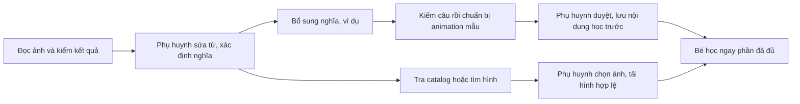

Hai nhánh bổ sung nội dung và tìm hình có thể cùng chạy sau khi biết đúng nghĩa. Animation sentence/grammar đợi ví dụ và token hợp lệ. Không tách thành một lời gọi AI cho từng từ rồi bắn hàng chục request; thường gửi batch nhỏ sẽ tiết kiệm hơn. App hiện phần đã đủ trước, tìm hình chậm không khóa toàn bộ thư viện.

Giới hạn đề xuất để thử: **AI 1 call/người sở hữu cùng lúc, ≤20 mục/batch; tìm metadata 2 request và tải hình đã chọn 2 tác vụ cùng lúc**. Có thêm giới hạn toàn hệ thống theo provider/project, cache và gộp lượt tra trùng; khi 429 thì chờ/thử lại có giới hạn, không tạo nhiều key để né quota. Xử lý crop/resize/OCR nặng có thể dùng Web Worker để màn hình vẫn mượt. Gọi API qua mạng dùng xử lý bất đồng bộ; worker thread hữu ích cho CPU nặng, không tự làm provider sinh câu nhanh hơn. [Node: worker threads](https://nodejs.org/api/worker_threads.html).

Đã chạy demo có độ trễ **giả lập** để kiểm peak concurrency, tra trùng/sense và lỗi một nhánh. Đây không phải số đo tốc độ Gemini, mạng hay app. Chặng triển khai phải so p50/p95 tuần tự và song song trên cùng tập ảnh, ghi quota/cost/cache hit; chưa có cơ sở hứa nhanh gấp mấy lần.

### 15.5. API key và mục tiêu người dùng học miễn phí

| Phần | Có cần key/dịch vụ? |
|---|---|
| Xem/ôn thư viện đã lưu, animation mẫu | Không cần AI key mỗi lần |
| Catalog ảnh bundle/cache đã duyệt | Không cần API tạo ảnh |
| Search ảnh động | Auth/quota tùy API nguồn; kiểm khi tích hợp, không miễn phí vô hạn |
| Nghe bằng giọng thiết bị | Không cần TTS key; voice EN/offline khác nhau theo máy |
| Vision đọc ảnh và bổ sung nội dung | Cần provider đủ điều kiện/key hoặc phương án local/nội dung chuẩn bị sẵn |
| Video/ảnh AI mới | Không thuộc P1; chỉ thêm khi có lý do và ngân sách rõ |

**Gemini Developer API hiện chưa dùng được cho hướng này:** điều khoản không cho API Clients hướng tới hoặc dễ được người dưới 18 truy cập. Key đứng tên phụ huynh không thay điều kiện đó. Free text/vision có quota và điều kiện dữ liệu; các API tạo ảnh được kiểm hiện ghi không có free tier. Thay tạo ảnh bằng search tiết kiệm phần hình, chưa giải quyết eligibility của vision/enrichment. [Điều khoản Gemini](https://ai.google.dev/gemini-api/terms), [bảng giá](https://ai.google.dev/gemini-api/docs/pricing), [quota theo project](https://ai.google.dev/gemini-api/docs/rate-limits).

Ở T00 phải chọn provider phù hợp app trẻ, retention, dữ liệu và quota rồi mới benchmark chất lượng/chi phí. Không tự chuyển sang dịch vụ trả phí hoặc gọi một provider khác là phù hợp khi chưa kiểm. Chưa có key thật trong repo.

Cài AI/key là việc của phụ huynh ở S16. Theo yêu cầu trực tiếp ADR029, OpenAI key ở bộ nhớ phiên hoặc localStorage opt-in; inputche/xóađược, không IndexedDB/backup/cloud/server/env. localStorage khôngmãhóa/ngườidùngchungtrìnhduyệtcóthểđọckey, UI nêu trước khi chọn nhớ. Guest không cầnlogin. Cổng phụ huynh tránh bé mở nhầm; không bảo vệ key trước người dùng chung máy. Server gateway/secretstore là roadmap riêng.

Học thư viện/tra từ điển không cần AIkey. AI đọc ảnh có phíOpenAIaccount; không quảng cáo freevision. Founder đã bỏlocalOCR theo ADR029; zeroAPIspend dùng nhập tay/từ điển/catalog.

### 15.6. Ngân sách và nghiệm thu

Các khoản còn lại: hosting/database/storage/egress, vision đọc bài và bổ sung nội dung, API tìm hình nếu có quota/cost, công chuẩn bị/duyệt catalog và audio tùy dịch vụ. **Người dùng học miễn phí** vẫn có thể có chi phí do founder trả. Học lại bằng cache/templates giảm số call; catalog không tự hoàn thành miễn phí chỉ vì ảnh nguồn mở.

Ngân sách theo **lượt đọc ảnh × chi phí đọc + nghĩa mới/thiếu × chi phí bổ sung + search quota + hosting/media**; tính cả retry. Có daily spend cap/hạn mức rõ, không mất nháp khi hết quota. Chặng nội dung kiểm ảnh đúng sense/style/license, phụ huynh approve và credit/backup; chặng chất lượng kiểm 429/hủy/nhánh media lỗi/response cũ/cache cách ly tài khoản. Provider và quota được chốt sau bằng chứng; Theme C đã tạm chốt, không hỏi lại chỉ vì chưa có code.

## 16. Bảng tình hình và checklist founder

Báo cáo hiện hành ở đầu tài liệu và [bằng chứng local](evaluations/local-end-to-end.md). Các mục 1–15 giữ đặc tả sản phẩm; mục mô tả cloud/AI/search ảnh là đích cần triển khai, không phải claim đã hoàn thành.

1. Nhập hoặc chụp một bài thật, sửa và duyệt lưu.
2. Tìm từ, nghe, xem IPA/gợi ý đọc, kiểm nghĩa/ví dụ/ghi chú.
3. Ôn thẻ, chơi bốn game, dừng rồi tải lại để tiếp tục.
4. Chuyển bài mẫu/thư viện con, xuất/khôi phục backup, mở khi mất mạng.
5. Quan sát con có biết bấm gì, có nghe/chọn hình được không; ghi lỗi thật để sửa sau một lượt.

Bản production local đang mở ở [Words for Kids](http://127.0.0.1:4317/today). Khi cần chạy lại: `nvm use`, `pnpm install --frozen-lockfile`, `pnpm build`, `pnpm start --port 4317`. Dev dùng `pnpm dev`. Cloud code đã nối/kiểm local, chưa có project live; AI BYOK trực tiếp đã triển khai, servergatewayplanned/liveinferencepending. Vercel nativeGit đãnối theo ADR029; cấu hình tại [setup](../SETUP-PROJECT.md), trạng tháiready trongevidencehiệnhành. Prototype T18 tại `design/prototype/index.html` giữ lịch sử thiết kế, dữ liệu sessionStorage khác app IndexedDB.

### Cập nhật10/10 — chờ phân tích ảnh rõ ràng

Theo phản hồi founder, màn đọc ảnh dùng Gemini streaming để hiện dần từ/nghĩa, elapsed và trạng thái từng bước, thanh chờ/nút Dừng/tối đa90giây. Bản tạm chưa lưu; nhận xong/kiểm hợp lệ rồi mới bố mẹ duyệt. Giữ ảnh đối chiếu và drag-drop/camera đã deploy; sửa dòng chờ treo khi lỗi và định dạng JSON REST. Test dùng fixture có nhãn, chưa là AI đọc ảnh thật. Tiến độ/check/deploy ở STATE và capture-review-ui.

### Cập nhật10/10 — Google từ chối phải hiện rõ lý do

Founder yêu cầu thử/fix lỗi Google request. Bản cũ che mất message cụ thể bằng câu cấu hình chung; ADR033 cho thấy HTTP/status/model/thông báo và trường sai đã ẩn key, không log/backup. Kết quả kiểm/request thực và trạng thái deploy được ghi tại STATE/capture-review-ui; không gọi lỗi400 là key sai khi Google chưa nói vậy.

Thử trên founder tab: Google400 INVALID_ARGUMENT, không field cụ thể. Request JSON được đổi dạng tương thích và phần Cài đặt thêm nút kiểm tra key/model không gửi ảnh; không tự đổi model hay bật billing. Kết quả sau sửa ghi STATE/evidence trước bàn giao.

Kiểm tiếp ADR033: Google chấp nhận metadata key/model nhưng request ảnh sau đổi JSON vẫn400/no fields. Thêm nút câu mẫu không gửi ảnh để phân biệt lỗi gọi AI với lỗi ảnh/schema; quota/cost được ghi rõ, không tự đổi model hoặc bật billing. Không báo sửa thành công khi live request còn bị từ chối.

Câu mẫu thật đã thành công cùng key/model3.5FlashLite. Lỗi được thu hẹp về request worksheet, không quy key sai. Đang kiểm JSON mode/schema trong prompt thay schema compiler của Google; kết quả vẫn phải đúng DTO/evidence và phụ huynh duyệt trước lưu.

Đã sửa và kiểm thật trên Vercel581ef67: cùng ảnh/key/model3.5FlashLite nay stream và hoàn tất13 từ, tự điền nghĩa/POS/ví dụ ở màn duyệt. Lỗi400 nằm ở cấu hình request schema; Google không chỉ field sai. Thay backend schema compiler bằng JSON mode + cấu trúc trong prompt, app vẫn kiểm DTO/evidence trước nhận kết quả. Nháp chờ founder kiểm/duyệt, chưa lưu cho con. Check114/full125 browser/docs203links PASS; một ảnh thật không thay benchmark T00.

10/10/2026 ADR036: every future photo submit integrates exact dedup, automatically downloaded/reviewed missing art and original source-pattern excerpts + Vietnamese grammar/3-step reduced-motion teaching. Imported colon-ID detail/edit/notes route fixed after real founder reproduction. Old13-word set completed via hosted parent UI once (6art/2patterns); future imports need no source changes. check125/15/lint/types/build PASS; full137/137browser and full216links docs PASS; deploy evidence to follow in [library evidence](evaluations/library-media-and-date-sets.md). Ledger unchanged; external/device/human gates open.

ADR036 source0c22f0f productionREADY dpl_27FsfRqhma2o2kjekgFnA7F8z9bD, stable words-for-kids.vercel.app. Hosted actual teacher now opens with image/meaning/example; existing13-word set Patterns/Grammar each2approved items,3-step Vietnamese teaching verified. Full local check125/137browser/docs216PASS; remoteCI38043514632 SUCCESS (all check/SQL/browser/docs steps). External/device/human gates unchanged.

### Ôn hôm nay, trạng thái API và nhận diện chia sẻ (10/10/2026)

Đã triển khai nút Ôn N từ hôm nay mở thẳng thẻ đến hạn/tiếp tục phiên, trạng thái bước/thời gian/tiến độ và lỗi tải hình rõ ràng, cùng favicon/thumbnail chia sẻ1200×630/metadata SEO. Chỉ trang giới thiệu công khai cho index; bài của con không đưa vào sitemap. Check128 PASS; 147/147 browser và docs223links PASS; Bản78c791c đã lên Vercel READY và CI38045533305 SUCCESS. Kiểm trên thư viện thật: nút3 từ mở đúng3 thẻ, không ghi điểm ôn khi chỉ mở; trang tìm hình báo hoàn tất cạnh nút, favicon/ảnh chia sẻ/metadata đã trả200 đúng nội dung. Cần founder thử trên điện thoại; cache ảnh chia sẻ của mạng xã hội có thể chưa cập nhật ngay. [Bằng chứng](evaluations/today-feedback-and-seo.md).


10/10/2026: theo yêu cầu sửa tên đã quên lúc tạo, thêm nút Đổi tên ngay tại bài gần đây trên Hôm nay; trang Bộ từ theo ngày mở ô sửa trong chính bộ đang chọn. Lưu/Hủy và thông báo rõ; giữ nguyên từ/lịch ôn. Check128 và toàn bộ147 kiểm thử browser desktop/mobile đã qua; bản9c81821 đã lên Vercel READY. Kiểm trực tiếp ô đổi tên từ trang Hôm nay và Bộ từ theo ngày; không tự đổi tên bài của founder.


10/10/2026: trang Tài khoản phụ huynh được làm rõ theo yêu cầu founder: hiện tên/email/ảnh Google, số từ và bộ bài riêng trên máy so với bản đã lưu trên tài khoản, thư viện đang dùng, nút đưa bài/đồng bộ riêng. Đăng nhập Google thành công chưa đồng nghĩa bài đã tải lên; lỗi giờ có bước/HTTP/nguyên nhân an toàn và nút thử lại. Ảnh gốc và xóa tài khoản ở phần tùy chọn mở thêm. Check132 và toàn bộ153 kiểm thử browser đã qua; full docs225links PASS; source4ba88ad đã lên Vercel READY. Kiểm trang thật ở phiên đăng xuất: 13 từ/1 bộ trên máy còn nguyên, đăng nhập Google bật. Phiên agent đang đăng xuất nên chưa xác minh nguyên nhân lỗi thật trong ảnh.

Checkpoint ADR040/041: source30129b7 nativeGit production READY dpl_6P6SXrqLUuPYzr5KW17MqHhkrka5, stable words-for-kids.vercel.app. RemoteCI38068615704 SUCCESS (check/SQL/full157browser/docs). Founder authenticated live profile/logo/back/newcontrols and13word preview PASS; shared default visible on settings, one metadata GET accepted key/model without photo or inference. Local134check/full157/targeted6/38responsiveviews/docs243PASS. Final settings description clarified shared-or-private AI, no runtime behavior change. Evidence ui-and-hosted-cloud-fixes.

<a id="speaking-review"></a>

## 17. Tập phát âm — nâng cấp đã duyệt14/10, chuẩn bị docs trước code

**Tình trạng15/10 — đã sửa tiếp theo manual test của bạn:** lượt thu xong luôn có điểm; không nghe rõ được0, lỗi dịch vụ có tạm0 và ghi rõ nguyên nhân. Gemini nghe audio độc lập, không còn nhận đáp án để tránh đoán theo từ mẫu; app tự so âm/chấm. Sửa short-word mic chờ10s, chờ im lặng giảm900→550ms, request chấm tối đa6s thay30s. Thử live qua browser kiểm riêng với apple tổng hợp:100, khoảng2.36s từ dừng mic đến hiện điểm. Đây là một phép đo local, không cam kết mọi lượt/mạng đều nhanh hoặc chấm đúng; human/child pilot chưa đạt. [Báo cáo](evaluations/speaking-zero-and-latency.md), [manual checklist](evaluations/speaking-assessment-v2-manual-test.md). Chưa đưa lên website. Giữ Gemini/key hiện có, không thuê server, tải model hoặc mua dịch vụ.

Bản nâng cấp để Gemini nhận âm, còn app tự tính điểm từ số âm đúng/thay gần/thiếu/thừa. Ví dụ cat đủ âm100, thiếu t67, đủ âm nhưng thêm “ờ”75; chưa nghe rõ thì không có điểm. Mỗi lượt chọn một mẹo tiếng Việt dễ luyện, bảng chi tiết vẫn giữ mọi lỗi; không ép trẻ bật hơi mạnh hay suy vị trí lưỡi chỉ từ audio. Bản nghe lại là đúng bản được gửi chấm, IPA/Nghe chậm và nguồn bản thu giữ.

Nghiệm thu hai mốc riêng: **A** code/UI đúng qua test cô lập; **B** pilot100bản thu có nguồn/nhãn hợp lệ, tách người chỉnh và người đánh giá, đo riêng trẻ5–8. Mục tiêu pilot: lỗi báo ra đúng≥90%, chấm oan≤5%, bắt lỗi rõ≥80%, chấm được audio rõ≥90%, p95≤8giây; chi tiết và ngưỡng tầng trẻ ở plan đã duyệt. Tối đa hai prompt ứng viên/300request trong quota được phép; không fallback ngầm hoặc hạ chuẩn sau khi xem kết quả. Thiếu giọng trẻ/người duyệt thì vẫn hoàn tất A và báo B đang chờ, không gọi mock là đã chấm chuẩn. [Plan đầy đủ](ai/SPEAKING-ASSESSMENT-UPGRADE-PLAN.md), [hướng dẫn Codex](ai/SPEAKING-ASSESSMENT-IMPLEMENTATION.md).

**Phần đã có trước nâng cấp, giữ từ12/10:**

Bạn đã đồng ý gửi bản thu để Gemini chấm và yêu cầu bỏ bộ tải355MB. App chỉ dùng **Gemini3.5 Flash-Lite với key hiện có**, không cần tải bộ nhận âm. Key/project Free Tier không billing đã được bạn xác nhận; hết lượt miễn phí thì báo thử sau, không mua thêm hoặc chuyển sang dịch vụ trả phí.

Bé bấm **Nói**, nghe tiếng báo rồi đọc; app tự nhận khi nói xong và báo kết thúc. Trước nâng cấp điểm%/nhận xét lấy từ Gemini; bản local hiện tính điểm và chọn hướng dẫn trong app theo ADR094. Bấm từ có màu để xem chi tiết; icon người để nghe lại. Bấm Nói là mở mic và tự chấm, không thêm popup xác nhận. Tập nói ngay trong trang từ, vẫn có nghĩa/IPA/ví dụ. **Nói cùng Cáo** ở Chơi & học cho một vòng≤5từ đã học.

Phần tải355MB đã bỏ cả UI/runtime/dependency; bộ cũ được dọn khi app cập nhật, bài học giữ nguyên. Không có mạng/hết quota vẫn nghe mẫu, thu và nghe lại được; phần chấm cần Gemini. Bản thu/điểm không lưu thành lịch sử hoặc đồng bộ tài khoản.

Mở app có Cáo + **Đang tải…** trong lúc mở thư viện, kèm ảnh khởi động cho iPhone Home Screen. Đo local mô hình cũ có peak≈1,5GB RAM; đây là nghi vấn mạnh gây crash, chưa có crash log iPhone để khẳng định. Kiểm local và ảnh/kết quả ở [bằng chứng](evaluations/mobile-speaking-startup.md); chưa xuất bản, chưa xác nhận trên iPhone thật/key thật.

## 18. Nghe từng câu ví dụ và phiên âm cả câu — cập nhật 11/10

Đã thêm ở bản code local: dưới câu ví dụ tiếng Anh có IPA của cả câu và nút Nghe đọc chính câu đó, rồi mới đến nghĩa tiếng Việt. Áp dụng cả thẻ ôn, ví dụ bổ sung, mẫu hỏi–đáp, từng bước ngữ pháp và câu lỗi/câu sửa; offline cũng có Nghe câu. Khi AI tạo bài, yêu cầu phiên âm cho từng câu đầy đủ. Sửa câu thì phiên âm cũ bị bỏ để kiểm lại. Nếu chưa có IPA chắc chắn, app nói rõ và vẫn cho nghe; không lấy phiên âm của riêng từ để thế vào.

Kiểm tra local mobile/desktop, dữ liệu lưu/backup/xóa và generation bằng fixture đã qua; chưa kiểm giọng thật trên điện thoại hoặc gọi AI thật. [Bằng chứng và ảnh](evaluations/sentence-ipa-and-listening.md). Mục17 giữ Speaking Gemini không bộ tải/xóa model; ADR094 nâng cấp nhận xét đã code/kiểm local, điểm chuẩn/giọng trẻ chưa nghiệm thu.


## 19. Sửa thư viện tài khoản, ảnh trùng và thêm bài vào nhóm — 11/10

Đã xem browser thật theo quyền bạn cấp: máy tính đang dùng13 từ/1bộ riêng trên máy; tài khoản hiện0từ/0bộ. Đăng nhập không đồng nghĩa đã đưa bài cũ lên cloud. Code mới mở thư viện tài khoản trên thiết bị đăng nhập lần đầu khi chưa chọn thư viện riêng, báo rõ nếu bài còn ở máy và có nút đi thẳng tới xem trước/lưu bài lên tài khoản. Giữ bài gốc; ảnh gốc gửi riêng. Agent chưa đưa13từ thật lên cloud.

Nhóm có nút rõ **Thêm từ, câu, ngữ pháp**, chọn từ/câu/ngữ pháp mới từ toàn bộ thư viện rồi lưu; mục cũ/ngày/tên bài vẫn giữ. Ảnh lặp một từ chỉ chọn một lần mặc định; nghĩa khác vẫn hiện để bạn chọn chủ động, không gộp nghĩa bằng AI hoặc tự xóa bài cũ. [Bằng chứng](evaluations/speaking-app-and-library-fixes.md).


## 20. Báo cáo tải chậm và yêu cầu tự đồng bộ sau đăng nhập — 11/10

Theo yêu cầu “báo cáo trước khi làm”, đã tạo [báo cáo nguyên nhân/cách sửa/skill](BAO-CAO-PERFORMANCE-VA-DONG-BO.md); chưa sửa app hay database. Website trả byte đầu≈242–252ms trong5lượt/route, còn lab mobile chờ thư viện/nút≈3,6giây, auth chậm có thể kéo lên6,6–9,2giây. Ảnh Cáo tải nhỏ nhưng bị tạo lại lúc tự chào làm LCP muộn; chỉ sửa số LCP chưa giải quyết thời gian bấm.

Yêu cầu mới của founder: đã đăng nhập thì mọi bài mới/thêm/sửa/xóa tự vào account, máy khác tự cập nhật; bài khách chỉ hỏi sao chép một lần. Source hiện vẫn có nhánh guest sau đăng nhập và sync3s/30s, chưa đạt yêu cầu. Chốt hướng đề xuất: sửa scope/account trước, hàng đợi chống mất bài + Supabase Realtime; tiếp đó chung request auth, welcome nhẹ/static và giữ node Cáo. Giữ stack hiện tại, không mua gói/AI/server. Chưa tối ưu/deploy hay chuyển bài thật; số đo/boundaries/kiểm tra nghiệm thu ở báo cáo.

<a id="workflow-review"></a>

## 21. Tối ưu flow coding AI — triển khai sau duyệt, 12/10

### Kết luận để founder quyết định

**Nên giảm việc đọc lại và làm lại trước.** Repo đang khiến AI phải đọc quá nhiều lịch sử để biết điều gì còn đúng; một số lượt còn mất công xử lý môi trường kiểm thử hoặc kiểm nhầm bản cũ. Quy tắc kiểm tra Gọn đã có và nhiều task gần đây đã làm theo. Chưa có bằng chứng rằng cắt mạnh test sẽ giải quyết nguyên nhân chính.

Audit ban đầu và preview2 được giữ ở phần dưới. Founder đã duyệt triển khai bằng “ok làm đi”: đường đọc tài liệu và runner đã được sửa và kiểm theo phạm vi; không sửa tính năng sản phẩm hoặc CI. Plan này dành cho **AI viết code**; không đổi cách Gemini phân tích bài trong app.

### Skill GitHub đã chọn và dùng để rà plan

Đã gắn **systematic-debugging** từ [obra/superpowers](https://github.com/obra/superpowers/tree/bb92a77741419a4ab5f06e711a283343f1ada0c3/skills/systematic-debugging), maintainer `obra`/Jesse Vincent, MIT. Snapshot 12/10: repo **297.938 sao /26.615 forks**, vừa release ngày 10/10; có phản hồi cộng đồng dùng riêng skill này. Sao/forks là của cả repo, không phải số người dùng skill. [Bằng chứng chọn nguồn và so ứng viên](skills/WORKFLOW-SKILL-REVIEW.md).

Skill giúp làm theo thứ tự **tái hiện → tìm nguyên nhân → kiểm giả thuyết → sửa và xác nhận**. Đã cài riêng vào project và pin commit; dùng trực tiếp ở lượt này, có thể xuất hiện trong danh sách skill từ lượt sau. Không cài cả bộ Superpowers, hooks hoặc global config. Feature vẫn dùng workflow dự án; chỉ bug/lỗi test mới cần skill này.

Không chọn planning-with-files hoặc workflow execution đầy đủ: chúng thêm bộ kế hoạch/hook/helper và kiểm trùng với repo. Skill mới có phạm vi hẹp để hỗ trợ sửa đúng; không tự chứng minh đã nhanh hơn hay tiết kiệm token.

**Sau khi dùng skill rà, plan bổ sung:**

- Mỗi bug phải có dữ kiện tái hiện và giả thuyết cụ thể; không sửa thử nhiều thứ cùng lúc.
- Phân biệt lỗi code, fixture test, môi trường và bản code cũ; xử lý đúng nguồn lỗi trước khi chạy lại.
- Đo từng nguyên nhân riêng: lượng tài liệu đọc, thời gian dựng môi trường, số lần sửa/chạy lại. Chưa có số thì ghi chưa có.
- Giữ kiểm tra Gọn; skill không ép full test hay test phản chiếu text/button đơn giản.

Phần chi tiết theo bốn pha và điều kiện nghiệm thu ở [plan AI, review lần 2](ai/WORKFLOW-OPTIMIZATION-PLAN.md#workflow-skill-review).

### Vì sao đang chậm và tốn

| Phát hiện trong repo | Nó làm AI tốn công ở đâu? | Đề xuất |
|---|---|---|
| Ba file AI phải đọc lúc bắt đầu có tổng khoảng **130 KiB** | Nạp nhiều thông tin trước khi đụng tới bug; mất context thì đọc lại | Giữ trạng thái hiện tại ngắn, chuyển lịch sử sang nơi tra cứu |
| START-HERE lặp nguyên văn **25 đoạn** với mỗi file STATE/TASKS | Đọc và cập nhật cùng nội dung nhiều lần | Mỗi loại thông tin có một nơi chính; nơi khác dẫn link |
| Hướng dẫn cũ về quyền deploy/Speaking còn ở đường đọc đầu | Phải đối chiếu cũ/mới; có nguy cơ làm theo yêu cầu đã bị thay | Điểm vào chỉ trỏ hướng dẫn hiện hành, giữ lịch sử riêng |
| Có lượt build bị khóa, hoặc test chạy bản snapshot cũ | Phải dựng môi trường lại rồi kiểm lại | Mỗi môi trường có người sở hữu, biết chính xác đang kiểm bản code nào |
| Có 7 cấu hình browser test; bản mặc định chỉ chọn **13/29 file test** | Tốn công tìm đúng lệnh; “full test” có thể bỏ sót test mới | Một cách chạy theo phạm vi dùng chung; kiểm đủ danh sách ở release |
| Một số file có dòng code dài hàng nghìn ký tự | Khó đọc đúng phần lỗi và sửa nhỏ | Chỉnh vùng đang sửa; chỉ tách code nếu có bằng chứng cần |

Các số trên đo từ file repo, **không phải số token thực tế**. Chưa có thống kê token/chi phí/thời gian của các chat trước, nên chưa thể nói nguyên nhân nào chiếm bao nhiêu phần trăm. Bản kỹ thuật ghi nguồn và cách kiểm lại từng kết luận.

### Flow mới đề xuất cho mỗi task

1. **Hiểu việc đang giao:** đọc trạng thái ngắn, đúng yêu cầu hiện hành và đúng phần code liên quan.
2. **Xác định lỗi hoặc kết quả cần đạt:** tái hiện đúng vấn đề, chốt trạng thái chính/lỗi cần kiểm; không mở rộng thành audit toàn app.
3. **Sửa trọn phần được giao:** giữ dữ liệu, quyền và những thay đổi có sẵn.
4. **Kiểm đúng rủi ro:** kiểm trên mobile/desktop khi đổi UI; giữ test lưu/chống trùng/quyền; build bản cuối khi cần theo quy tắc Gọn.
5. **Bàn giao ngắn:** thay gì, đã kiểm gì, còn giới hạn nào; chi tiết để trong một bản evidence, các file khác dẫn link.

Task nhỏ vẫn được làm trọn, không phải dừng vì hết một mức token tự đặt. Khi có lỗi thật hoặc ảnh hưởng rộng, mở rộng kiểm tra có lý do.

### Thứ tự làm sau khi founder duyệt

| Chặng | Founder sẽ nhận được | Cách biết đã đạt |
|---|---|---|
| **1. Dọn tài liệu đầu vào** | AI vào việc bằng bộ current state ngắn; lịch sử vẫn tra được | Không mất yêu cầu/quyền/pending; đọc đúng quyết định mới và việc tiếp theo |
| **2. Chuẩn hóa môi trường và test** | Có cách chạy gọn cho từng task; không phải dựng config tạm liên tục | Kiểm đúng bản code, đúng ca mobile/desktop; test mới không bị bỏ khỏi danh sách release |
| **3. Đo trên 3 task tiếp theo được giao** | Báo cáo thời gian, lượng context, token nếu có, lần làm lại và lỗi | So task cùng mức độ; nêu rõ phần chưa đo, không claim tiết kiệm từ cảm giác |
| **4. Sửa phần code còn gây tốn công** | Chỉ cải thiện module chứng minh là điểm nghẽn | Kiểm hành vi liên quan vẫn pass; không refactor toàn app |

Ưu tiên chặng 1 rồi chặng 2. Chặng 4 chỉ làm nếu đo cho thấy cần. Ngoài một skill đã được yêu cầu và cài ở trên, không tự thêm skill/plugin, đổi model, hooks hay global config. Không tự tạo ba feature để benchmark.

### Mục tiêu và những thứ vẫn phải giữ

Mục tiêu tài liệu: ba file đầu vào từ khoảng 130 KiB xuống **tối đa khoảng 12 KiB** trong trạng thái bình thường, giảm khoảng 91% lượng dữ liệu của riêng ba file. Con số này không bao gồm AGENTS, skill bắt buộc hoặc context do ứng dụng AI chèn; **không có nghĩa giảm 91% tổng token**.

Mục tiêu thử nghiệm trên việc tương đương: nhanh hơn ít nhất **25%**, ít token mỗi task ít nhất **30% nếu đo được**, đồng thời không tăng lỗi phải sửa lại. Đây là mục tiêu cần kiểm chứng, chưa phải kết quả hay cam kết. Ba task đầu chỉ đủ đánh giá bước đầu; việc khác độ khó phải ghi rõ, không so máy móc.

Giữ kiểm tra chống mất dữ liệu, phân quyền, lỗi và lưu thật; giữ lint/typecheck theo phạm vi và full checks trước release. Giữ lịch sử quyết định và bằng chứng. Giữ ba giới hạn founder đã chốt: không push main, không thêm env Vercel, không điều khiển browser thật founder.

**Đã duyệt:** chặng1/2 theo ADR083. Ba file đầu vào hiện khoảng9,7KiB so với130KiB audit ban đầu, lịch sử giữ nguyên riêng. Runner dev/production cô lập, chặn source cũ/port hoặc snapshot đã có owner; release discovery đủ31file hiện tại. Lint/types,7guardtests, dev/production desktop+mobile, no-demo và build cuối PASS. Cloud smoke còn thiếu vì PostgreSQL local không khởi động được (SHMALL); không gọi full E2E/SQL đã pass. [Bàn giao workflow](evaluations/ai-workflow-optimization.md). Chặng3 đo trên task thật tiếp theo; chưa claim giảm actualtokens/thời gian task hoặc tự refactor chặng4. [Chi tiết audit và kế hoạch cho AI](ai/WORKFLOW-OPTIMIZATION-PLAN.md).
