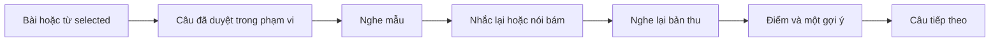

# Kế hoạch Shadowing — Nói theo Cáo

Ngày29/10/2026. **Đã triển khai/deploy và kiểm scoped; founder/device acceptance pending.** [Trạng thái/evidence hiện hành](evaluations/shadowing.md). Các phần dưới giữ thiết kế được duyệt và căn cứ khảo sát; không thay bằng chứng runtime. Production9ovqdkv9z/alias, IDB8/SQL0016;41logic/data+10productionUI/lint/types/build PASS. Chưa chứng minh acoustic accuracy/CEFR hoặc tự chạy backfill toàn tài khoản.

**Founder bổ sung29/10:** có cả Shadowing nâng cao B1/B2 trong cùng game, chỉ hiện/cho chọn khi bật setting **Hiện nội dung B1–B2** đã có. Đây là yêu cầu phạm vi đã chốt. Tiến độ triển khai và giới hạn thật ở [checkpoint](evaluations/shadowing.md).

## 1. Hướng đề xuất

Thêm một ô **Shadowing · Nói theo Cáo** trong Chơi & học, dùng đúng phạm vi bài/nhóm/từ đang selected. Bé nghe câu ngắn, tập nhắc lại hoặc nói bám theo giọng mẫu, nghe lại bản thu rồi nhận một hướng dẫn ngắn.

**Chọn hướng tạo sẵn + tái sử dụng:** câu đã duyệt mở ngay; Gemini bổ sung câu từ dữ liệu đang có và khi thêm/sửa từ. Không gọi tạo câu lại mỗi lần vào game. Một lượt mặc định 5 câu, ưu tiên đổi câu giữa các lượt.

| Cách chuẩn bị câu | Điểm được | Đổi lại | Đề xuất |
|---|---|---|---|
| Gọi Gemini mỗi lần mở | Có câu mới theo selection lúc đó | Chờ mạng/quota, có thể khác khi mở lại, chưa review | Không dùng làm đường mở game mặc định |
| Tạo sẵn toàn bộ | Mở nhanh, review được, ổn định | Cần backfill và làm mới khi nguồn đổi | Dùng cho nội dung bổ sung |
| Kết hợp câu sẵn có + kho tạo trước | Chơi ngay từ examples đã duyệt; thiếu mới bổ sung | Phải quản lý nguồn/version/pending | **Khuyến nghị** |

“Mở ngay” nghĩa là **hiện câu và thao tác mà không chờ AI sinh nội dung**. Âm thanh Emma vẫn phụ thuộc mạng hoặc giọng thiết bị; autoplay vẫn theo quyền của browser. Không hứa tất cả audio đã tải sẵn hoặc chấm offline.

## 2. Đã kiểm tra gì trong eng-vocabulary

Source khảo sát: checkout sạch tại `../eng-vocabulary`, commit `0a9080353c238a86ee763cd48ff7e8ce7cee6546`. Đây là khảo sát code và đọc tests; không phải kết quả chạy app, tests hoặc benchmark giọng thật của project đó.

| Phần | Code tham chiếu trong eng-vocabulary | Hành vi đọc được |
|---|---|---|
| Các bước luyện | `src/components/shadowing/ShadowLessonView.tsx`, `src/lib/shadowing/types.ts` | Nghe → nhắc lại → nói bám → so sánh; replay mẫu/bản thu, đổi tốc độ, nhiều takes |
| Tạo/mở bài | `src/components/shadowing/ShadowWorkspace.tsx`, `src/hooks/useShadowLesson.ts` | Bài theo chủ đề/mức, bài biên soạn hoặc media/phụ đề; dùng content đã lưu trước khi sinh mới |
| Nhận nội dung độc lập | `src/lib/shadowing/assess.server.ts:13` | Lần đầu gửi audio **không kèm câu mẫu**, trả transcript/ngôn ngữ/số giọng/khả năng nghe |
| Đối chiếu từ | `src/lib/dictation/grading.ts` | Chuẩn hóa dấu câu/contraction rồi align bằng edit distance; giữ từ thiếu/sai/thừa |
| Rubric | `src/lib/speaking-assessment/rubrics.ts:7`, `scoring.ts:3` | Đúng nội dung 25%, phát âm 25%, trọng âm/ngữ điệu 25%, trôi chảy 25%; app tính tổng |
| Chặn điểm cao sai nội dung | `src/lib/shadowing/assess.server.ts:25` | Tính tỷ lệ token khớp trên toàn alignment, gồm thiếu/sai/thừa; dưới 80% chặn tối đa 79, từ 80% trở lên chặn theo tỷ lệ đó |
| Điểm cuối | `src/lib/shadowing/assess.server.ts:38` | Bản structured assessment lấy min của tổng rubric và practiceScore đã qua content guard; nói khác nội dung/khác ngôn ngữ có nhánh 0 |
| Lượt thu bị lẫn mẫu | `src/lib/shadowing/capture-policy.ts:13`, `reference-capture.ts:11` | Phân solo/headphones/speaker; loa ngoài dùng DSP/Worker/AudioWorklet riêng và kiểm độ tương quan với mẫu |
| Chống gửi lặp/kết quả muộn | `src/hooks/useShadowGrading.ts:10` | Một request đang chạy, gắn take/session/scope, không gửi lại vì rerender; có retry chủ động |

**Những phần cần điều chỉnh khi đưa sang Words for Kids:**

- Luồng tạo bài theo topic/CEFR của project kia chưa phải luồng lấy đúng word/sense selected. Phải dựng nguồn câu riêng theo selection ở đây.
- Code chấm thường có 2 lượt gọi Gemini, nhưng nhánh structured assessment có thể gọi thêm để cứu schema/quality. Không coi đây là contract “luôn đúng 2 request”.
- Project kia cho `null` khi không chấm được và giữ nhiều bản thu local/backup. Words for Kids hiện theo ADR095: lượt đã thu có 0 hoặc tạm 0 có lý do, audio/điểm không lưu bền. Không copy nguyên storage/error policy.
- Nhãn headphones và signal gate không xác minh danh tính người nói. Chống tiếng mẫu lọt mic cần kiểm chứng thiết bị; không suy từ một checkbox.
- Rubric nghe độ rõ/trọng âm/ngữ điệu trong audio, **không so chính xác nhịp với bản mẫu** vì request chấm hiện không có reference audio. Không gọi điểm này là phần trăm phát âm chuẩn hay giống giọng mẫu.
- Không mang nguyên stack DSP/WASM và màn cấu hình nhiều mục sang giao diện bé. Tái dùng ý tưởng/contract, viết phần tích hợp theo stack hiện tại; asset hoặc dependency bên thứ ba phải giữ license nếu thực sự dùng.

## 3. Câu lấy từ đâu, bám selection thế nào

Thứ tự tìm câu cơ bản khi mở game (B1/B2 dùng liên kết exact sentence bên dưới):

1. **Primary example đã duyệt** của đúng sense/từ trong selection, khớp câu gốc dùng chuẩn bị family. Additional examples không trộn vào lượt family v2 vì chưa có liên kết nâng cấp riêng.
2. **Câu Shadowing tạo trước đã duyệt**, còn khớp source hash/version của sense selected.
3. Khi không có primary từ phù hợp, dùng examples/forms ngữ pháp đã duyệt trong selection, có dấu kết câu và phù hợp nhiệm vụ. Khi có cả words và grammar, ưu tiên câu dùng được từ selected; không ép kết hợp hai nội dung không tương thích.
4. Không có câu hợp lệ: mở **bộ mẫu biên soạn** để chơi ngay. Nguồn mẫu ghi trong “Đổi bài chơi”; không gán bộ mẫu là câu của bài selected hoặc cộng coverage của bài.

Nếu chỉ có một câu phù hợp thì chơi một câu, không âm thầm kéo câu ngoài selection để đủ 5. Nếu lỗi đọc DB/quyền thì báo lỗi + Thử lại; không giả thành “thiếu câu” rồi dùng mẫu.

Selection tái dùng `practiceFilter`/`PracticeSelection`: từ, bài, nhóm/bộ con, tất cả; giữ library/account/shared scope. Không đọc toàn kho rồi lọc chỉ theo chữ hiển thị. Hai nghĩa của `bank`, hai POS của `book` giữ ID riêng; một câu trùng chữ có thể có nhiều source refs, không mất liên kết nghĩa/bài.

**Nội dung mặc định cho trẻ 5–8:** câu khoảng 3–8 từ, một ý, dễ nói; câu 9–12 từ chỉ khi phù hợp và có cách nghe từng cụm. Đây là mục tiêu biên soạn, không cắt câu gốc để ép độ dài. Dùng đúng nghĩa/POS; có thể có từ chức năng hoặc từ quen thuộc ngoài selection, nhưng mỗi câu tạo cho một sense phải thực sự dùng sense đó. Không bắt tất cả từ selected xuất hiện trong một câu.

### Shadowing nâng cao B1/B2 — dùng setting hiện có

Trong cùng game có ba mức **Cơ bản / B1 / B2**. Theo founder29/10, B1/B2 phải nâng cấp **đúng câu cơ bản đang chọn**, giữ chủ thể/người/sự vật, ý chính, thì và phủ định; không chỉ cùng một từ selected. Đổi mức giữ cùng family và vị trí câu cơ bản.

| Mức luyện | Hướng nội dung |
|---|---|
| Cơ bản | Câu ngắn theo mặc định trẻ5–8 ở trên |
| B1 | Diễn đạt theo ngữ cảnh, kể việc, nêu lý do hoặc so sánh; luyện nói thành cụm |
| B2 | Diễn đạt có sắc thái, nhượng bộ/điều kiện hoặc cấu trúc phức phù hợp nguồn; luyện nhấn ý/ngắt cụm |

B1/B2 là **mục tiêu luyện tập**, không chỉ tăng số từ và không suy trình độ người học từ điểm. Câu AI chưa được đối chiếu mức giữ nhãn gợi ý như phần B1/B2 hiện có; duyệt nội dung không tự xác minh CEFR/IPA. Câu dài có nghe từng cụm, nhưng không cắt/sửa câu nguồn hoặc nâng giới hạn thu/request âm thầm; câu vượt khả năng thu trọn trong cap hiện tại không vào pool chấm v1.

- Tái dùng `useExtensionVisibility(scope)` trong `src/lib/learning/extension-visibility.ts` và đúng công tắc **Hiện nội dung B1–B2**; không tạo setting Shadowing riêng. Mặc định ẩn, theo browser/thư viện, không sync lựa chọn bật sang máy khác.
- **Tắt:** game cơ bản vẫn chơi; ẩn phần nâng cao và không đưa câu B1/B2 vào pool, tự phát hay lượt chơi lại. URL/deep link/state cũ ghi B1/B2 không được vượt gate. Trong lúc chưa đọc được setting, dùng trạng thái ẩn để không lóe nội dung nâng cao.
- **Bật:** hiện mục **Shadowing nâng cao B1–B2** thu gọn trong “Đổi bài chơi”; người dùng bung rồi chủ động chọn B1 hoặc B2. Bật setting không tự chuyển lượt cơ bản sang nâng cao; mở/reload/bật lại vẫn thu gọn và bắt đầu ở cơ bản.
- Tắt setting khi đang luyện nâng cao: dừng mẫu/mic/request chấm, bỏ response muộn và trở về cơ bản. Đổi mức cũng hủy take đang xử lý; không gán điểm/take của mức cũ sang mức mới. Nội dung đã lưu và job chuẩn bị câu độc lập vẫn được giữ.
- **Nguồn nâng cao:** chỉ dùng câu Shadowing đã duyệt, promptVersion2, đúng family/source hash và `baseText` bằng chính câu cơ bản đang chọn. Không dùng examples B1/B2 độc lập hoặc bundle v1 để lấp chỗ. Thiếu bản nâng cấp thì hiện câu gốc và nút về cơ bản; không đổi sang câu mẫu khác chủ đề. Chỉ khi đầu vào cơ bản không có dữ liệu mới mở family mẫu có liên kết riêng. Pending/rejected/stale không vào game.
- Setting chỉ điều khiển hiển thị/sử dụng nâng cao. Chuẩn bị câu B1/B2 vẫn độc lập với Ẩn/Hiện như ADR110; bật/tắt không gọi AI lại, tự duyệt, xóa nội dung hoặc dừng job chuẩn bị. Nếu tận dụng nguyên example đã duyệt thì giữ nguyên source ref; câu sửa/biến thể mới cần review riêng.

Ví dụ minh họa, chưa phải nội dung đã tạo từ thư viện founder:

| Selected | Câu có thể chuẩn bị | Lưu ý |
|---|---|---|
| apple; red | I have a red apple. / The apple is red. | Dùng chung khi đúng nguồn/nghĩa, không chỉ thay noun trong bộ đáp án cố định |
| jump (động từ) | I can jump. / Jump over the line. | Tách lời kể và mệnh lệnh; dịch đúng câu |
| bank (bờ sông) | We sit on the river bank. | Không đổi sang nghĩa ngân hàng |

Mỗi câu có English, nghĩa Việt, target refs, nguồn và version. IPA/hint phải gắn **đúng toàn câu**; thiếu thì có thể chưa hiện, không ghép IPA từng từ rồi ghi verified. Sửa câu xóa IPA/hint cũ. Hình chỉ lấy approved/ready đúng sense; câu không có hình phù hợp dùng Cáo dẫn nhiệm vụ, không gắn hình một đồ vật để khẳng định cả cảnh/quan hệ đã đúng.

## 4. Chuẩn bị kho cũ và từ thêm mới

**Kho cũ:** kiểm kê chỉ đọc theo owner scope → tái dùng examples phù hợp → tạo pilot tối đa 20 senses còn thiếu câu hoặc cần thêm biến thể → rà nội dung → xử lý phần còn lại theo cùng contract sau khi hướng được founder duyệt. Không gọi AI lại cho mọi example đã dùng được. Giai đoạn triển khai sẽ báo số nguồn/câu thực tế; không dùng count B1/B2 cũ làm số câu Shadowing hiện có.

**Từ mới/thay đổi:** Save từ/ảnh vẫn hoàn tất độc lập; enqueue công việc bổ sung, không giữ nút Save chờ Shadowing. Tái dùng câu cơ bản phù hợp; generation v2 tạo một family gồm đúng một câu cơ bản và một bản nâng cấp cho mỗi mức B1/B2. Nếu example gốc hợp lệ thì giữ nguyên exact text làm basic và `baseText` của hai mức nâng cao. Không tái dùng câu nâng cao độc lập chỉ vì cùng sense. Dùng nghĩa/POS/definition/example/selected grammar phù hợp làm dữ liệu, không chỉ headword. B1/B2 pending không tự được duyệt; nội dung nâng cao dù đã duyệt vẫn không vào pool cơ bản hoặc vượt setting đang tắt.

- Một batch tối đa4đơn vị nguồn+mức, tối đa8câu bổ sung, tuần tự qua quota/lock AI chung; không đua với photo enrichment/B1/B2/speaking. Một call/batch, lỗi cho retry chủ động, không vòng repair/provider fallback. Tạo phần thiếu độc lập setting; không gọi lại nếu đã đủ câu hoặc nguồn không có gợi ý phù hợp.
- Cache/checkpoint theo source hash + mức luyện + prompt version + model snapshot, resume đúng phần thiếu. Dedup theo nguồn/sense và câu chuẩn hóa; giữ phủ định, không semantic merge; không đổi nhãn mức chỉ để lấp pool hoặc nhân bản câu sang B1/B2. Ref learning extension phải giữ ID/mức/suggestion/example và version/quyết định duyệt nguồn.
- Gợi ý lưu **pending**, có sửa/duyệt/bỏ từng câu; không tự ghi đè examples, câu user đã sửa hoặc quyết định từ chối. Trong khi pending bé vẫn chơi bằng examples đã duyệt hoặc mẫu.
- Chọn “Câu khác” trước hết rút câu sẵn khác; “Tạo thêm câu” nằm trong phần thu gọn và là thao tác chủ động. Không tự sinh liên tục sau mỗi lượt hoặc mỗi lần vào trang.
- Backfill chỉ ghi kho Shadowing mới, không sửa từ/ngữ pháp/learning/SRS gốc. Có job ID, số đã xong/lỗi/stale và dọn đúng dữ liệu mẫu của task.

## 5. Cách chơi và thu âm

Một ô game mới trong nhóm nghe/nói, không thêm nav chính hoặc game riêng trùng cơ chế cho B1/B2. Route đề xuất `/practice/shadowing`, kế thừa filter và nút quay lại hub; phần chọn nâng cao chỉ hiện theo setting ở mục3. Mỗi lượt tối đa5câu cùng mức, không trộn cơ bản/B1/B2.

**Nghe → nhắc lại** là bước tập dễ mặc định: phát mẫu xong, bé chạm mic để nói; không mở mic trong lúc phát mẫu. Có nghe cả câu/từng cụm, tốc độ 1.0/0.6 theo AudioControl hiện có.

**Nói bám mẫu** là chế độ Shadowing thực: bé chạm bắt đầu, nói cùng hoặc ngay sau giọng mẫu. Có trong cùng game, không gọi phần nghe–nhắc lại là toàn bộ Shadowing. Cần lifecycle playback + capture riêng để tiếng mẫu/khoảng ngắt không kích end-of-speech sai.

- Với tai nghe: có thể thu khi mẫu đang phát; vẫn kiểm audio/multiple voices, không coi tai nghe là chứng nhận nguồn giọng.
- Với loa ngoài trong đợt đầu: vẫn luyện bám và nghe lại, nhưng phần chấm dùng **một bản đọc lại khi mẫu đã dừng**. UI ghi rõ “Nói lại để chấm”; điểm gắn bản đọc lại, không gán là điểm của take luyện bám. Chỉ gửi bản chấm đến Gemini.
- Chấm trực tiếp take bám với loa ngoài là mở rộng sau, cần DSP/reference capture và gate thiết bị riêng; không copy hệ DSP của project kia mặc định.

Recorder câu hiện có là nền tảng: cap 15 giây, WAV mono16kHz, decode guard 20 giây; không đem profile từng từ 10 giây sang nguyên trạng. Nhắc lại có thể tái dùng sentence end-of-speech. Nói bám cần dừng theo playback end + khoảng nói hết câu hoặc nút Dừng, có hard cap; kiểm câu ở tốc độ chậm không vượt cap, không cắt âm cuối âm thầm.

Mic chỉ mở sau tap. Nghe mẫu và mic phải phối hợp để tránh `wfk-audio-stop` vô tình tắt mẫu trong chế độ bám; các nguồn audio khác dừng. Hide/unmount/đổi câu/scope/logout dừng tracks/player và abort, bỏ response muộn. Replay đúng WAV đã gửi; cues ngoài clip. Không tự bật lại mic ở câu tiếp.

Màn bé thấy câu/hình phù hợp, tiến độ, Nghe/mic/Dừng/Nghe lại/Tiếp. Sau chấm hiện điểm + một gợi ý ngắn; nghĩa Việt, rubric, sources, selection và diagnostics thu gọn. Điều khiển tối thiểu 44 CSS px, cách nhau khoảng 8 px, có label/focus/text trạng thái; reduced motion/static. FoxLoading/DatabaseLoading cho trạng thái chờ, lỗi tại thao tác, không toast hay popup xin đồng ý lại. Nghe lại/thu lại/đi tiếp vẫn dùng được khi chấm lỗi.

## 6. Cách chấm đề xuất

### 6.1 Hai bước có giới hạn

**Đây là thay đổi đề xuất riêng cho Shadowing:** tối đa **2 call Gemini/take chấm**, khác Speaking từng từ đang giới hạn 1. Model/key dùng cấu hình Speaking hiện tại (`gemini-3.5-flash-lite` trong source khảo sát), không đổi model hoặc thêm provider/env. Cần kiểm lại khả năng model/API khi triển khai; chưa gọi live trong lượt lập plan.

1. Audio-only → transcript, ngôn ngữ, khả năng nghe, một/nhiều giọng; không gửi target/câu mẫu ở call này. Transcript là evidence có thể sai, không phải ground truth.
2. Audio gốc + câu mục tiêu + transcript độc lập → nhận xét âm thanh theo 4 tiêu chí. Chỉ bước này biết target. App validate schema/IDs, tự tính tổng/áp guard; không lấy một overallScore tự do do model trả.

Call 1 không nghe được hoặc phát hiện lẫn mẫu/nhiều giọng thì dừng sớm. Không tự repair/retry hay gọi model khác. Deadline đề xuất: tối đa 12 giây/call, toàn pipeline tối đa 25 giây kể từ khi WAV sẵn sàng; đây là cap kỹ thuật cần đo, không phải latency đã đạt. Một lượt 5 câu chấm đủ dùng tối đa 10 call audio, chưa gồm tạo câu/TTS. Bấm chấm lại chủ động là một lượt request mới và phải đo riêng.

### 6.2 Rubric học từ eng-vocabulary

| Tiêu chí | Trọng số | Đánh giá |
|---|---:|---|
| Đúng và đủ câu | 25% | Từ/ý đúng câu mục tiêu, không bỏ hoặc thêm làm đổi nội dung |
| Phát âm dễ hiểu | 25% | Độ rõ của lời nói thực trong audio, chấp nhận accent; không suy từ transcript |
| Trọng âm/ngữ điệu | 25% | Nghe được trọng âm/ngữ điệu phù hợp câu, không claim đo chính xác so mẫu |
| Độ trôi chảy | 25% | Nói thành cụm, khoảng dừng hợp lý; không lấy nói nhanh hoặc timer làm fluency |

Điểm cơ sở = làm tròn trung bình có trọng số. Khi tất cả tiêu chí đánh giá được, áp content guard như project tham chiếu: tỷ lệ token khớp <80% thì tối đa79; từ80% trở lên thì tối đa tỷ lệ token khớp. Không biến tỷ lệ transcript thành điểm phát âm. Ví dụ câu 6 token, nghe thiếu1 và không có lỗi khác: token match khoảng83%, tổng90 sẽ còn tối đa83.

B1/B2 dùng cùng rubric và giới hạn2call/take, đánh giá đúng câu của mức đã chọn. Điểm được trình bày theo từng lượt/mức, không dùng để chứng nhận đạt B1/B2 hoặc gộp thành điểm tiến bộ giữa các mức. Pilot phải có câu B1/B2 với trọng âm/ngắt cụm, không chỉ câu cơ bản.

Nhận sai hoàn toàn/ngôn ngữ khác có bằng chứng đủ rõ →0. Nếu audio thể hiện nỗ lực đúng câu nhưng ASR khác thì không tự cho0 chỉ vì text lệch; dùng review audio ở bước2, giữ trần79 khi evidence còn mâu thuẫn. Guard này có thể chặn oan hoặc vẫn cho điểm quá cao, cần calibration; không coi ngưỡng80/79 là chân lý đã benchmark.

Schema thiếu/sai criterion, số ngoài0–100, stale take/text/version hoặc có tiêu chí chưa đánh giá được → không tạo rubric hoàn chỉnh giả. Chỉ highlight từ/cụm có evidence, không bịa lỗi từng phoneme/timestamp/IPA hoặc lời khuyên “chuẩn native”. Hiện một điểm cần tập chính; tối đa3 chi tiết có evidence khi bung.

### 6.3 Giữ quy tắc 0/tạm0 hiện hành

| Trạng thái | Hiển thị | Cách hiểu |
|---|---|---|
| Chấm được lời nói | 0–100 | Điểm luyện tập do AI ước lượng |
| Thu xong nhưng không có lời nói rõ | 0 + “Máy chưa nghe rõ…” | Không bịa lỗi phát âm |
| Quota/mạng/schema/timeout hoặc nghi thu tiếng mẫu | **Tạm0**, màu trung tính, lý do + Thử lại | Chưa có kết luận về khả năng của bé; criterion chưa đo để trống |
| Từ chối mic/hủy trước bản thu | Không tạo lượt chấm | Có thể nghe/tập tiếp |

Điểm vòng trong RAM; nếu còn tạm0 thì tổng cũng ghi rõ trạng thái tạm, không báo đã đánh giá đầy đủ hoặc dùng số đó để chứng minh chất lượng. Không sửa SRS, không lưu audio/transcript/score vào IDB/cloud/backup/analytics. Đây là phần chủ động khác policy null/storage của project tham chiếu.

## 7. Phần tái dùng và dữ liệu cần bổ sung

Source Words for Kids đã đọc ở commit `e65526740cbe874be74314df662d052d975389ba`, working tree sạch lúc bắt đầu.

| Có thể tái dùng | Điều chỉnh cần làm khi triển khai |
|---|---|
| `src/lib/learning/practice-filter.ts`, `src/data/local/practice-selection.ts` | Giữ filter qua route/reload, đúng scope |
| `PracticeRepository.speakingWords()` | Lấy approved senses; thêm pool examples/grammar riêng cho Shadowing |
| `PracticeRepository.gameInputs()` | Không dùng nguyên làm pool câu: hiện lọc words qua ảnh ready, sẽ loại mất từ có câu hợp lệ nhưng thiếu hình |
| `src/lib/speaking/client.ts`, `end-of-speech.ts` | Reuse decode/WAV/cues/cleanup; bổ sung profile phối hợp playback/capture cho nói bám |
| `src/lib/speaking/dialogue-answer.ts` | Tái dùng mẫu audio-only/bounded response; không dùng exact-choice matching làm điểm câu |
| AudioControl/SentencePronunciation, Fox loading | Câu exact, source thật, tốc độ/replay, cache RAM hiện có |
| `src/data/local/extensions.ts` | Học pattern source hash/checkpoint/CAS/owner guard; không nhét Shadowing vào payload B1/B2 |
| `src/lib/learning/extension-visibility.ts`, approved `learningExtensions` | Dùng chung setting và examples nâng cao đã duyệt; kiểm mức/source version/decisions trước lấy câu |

Kho câu tạo trước đề xuất riêng `shadowingContent`, theo envelope version/tombstone/scope hiện tại. Payload gồm parent refs + revisions/hash, mức Cơ bản/B1/B2 và provenance mức, English/Vi/chunks, source/model/promptVersion, quyết định pending/approved/rejected từng câu và dấu user-edited. Câu lấy nguyên từ learning extensions dùng ref/version/decision nguồn, không copy thành nội dung đã duyệt độc lập để né thu hồi. Text/chunks render như dữ liệu, không HTML/JS. Không thêm private key vào payload/job/log.

Khi triển khai cần schema local additive + migration cloud tương ứng, unique deterministic theo owner/parent identity/câu để chống duplicate, owner RLS/grants/RPC allowlist và kiểm source còn tồn tại. Nối đầy đủ sync/archive/backup/transfer/import/copy; người xem thư viện shared chỉ đọc nguồn đã duyệt, không enqueue tạo hoặc sửa thư viện chủ. Không coi cache trong một browser là nội dung đã có trên mọi máy.

Lượt5câu/điểm/bản thu giữ RAM theo hướng Speaking hiện tại; rời/reload bắt đầu lượt mới, không hứa resume hoặc coverage cả bộ. Câu dùng luân phiên từ toàn pool hợp lệ, không luôn lấy5đầu; chơi lại có thể giữ bộ vừa chơi, lượt mới đổi thứ tự/câu khi đủ. Lịch sử điểm và tiến độ Shadowing bền là scope riêng nếu founder muốn sau này.

## 8. Thứ tự triển khai sau khi founder chốt

| Đợt | Kết quả bàn giao | Điều kiện nghiệm thu |
|---|---|---|
| S1 — Nguồn câu + game mở ngay | Ô game/route, selection, examples approved + sample fallback, cơ bản và B1/B2 dùng chung setting, nghe cả câu/cụm, thu/replay RAM | Dữ liệu riêng ngoài sample chứng minh đúng sense/bài/mức; tắt ẩn nâng cao, bật chỉ hiện phần thu gọn; lỗi đọc không fallback giả; mobile/desktop main + mic errors |
| S2 — Kho câu tạo trước | Storage/cloud/backup/share, review, queue sau Save cho3mức, tái dùng extensions, pilot20 rồi backfill phần thiếu | Không overwrite nguồn/edit/decision; cancel/resume/dedup/CAS; owner/shared isolation; generation độc lập visibility; câu pending chưa vào game |
| S3 — Nói bám + chấm | Playback/capture, tai nghe/loa ngoài đọc lại, pipeline2call, rubric/guards/0/tạm0, cancel/retry | Không chấm nhầm take; tối đa2call; replay đúngWAV; không âm mẫu thành điểm người học; không lưu audio/score bền |
| S4 — Chất lượng + phát hành | Scoped checks, build cuối, QA thiết bị và benchmark có nhãn | Tách logic/mock/live/physical; ghi latency/quota thật, chưa đạt phải ghi giới hạn trước phát hành |

S1 là checkpoint để xem luồng, chưa được gọi là hoàn tất tính năng có chấm Shadowing. Founder đã giao triển khai; làm đủ nguồn câu/storage/capture/chấm/QA trước phát hành. Cập nhật spec08/spec15, quyết định kiến trúc và hướng dẫn founder theo phạm vi đã chốt.

## 9. Kiểm chứng cần có

- **Selection/content:** custom words ngoài mẫu; homonym/POS; bài/nhóm/set/từ/all; không ảnh vẫn có câu; nguồn sửa/xóa/thu hồi; grammar-only; câu dài; zero eligible → sample; permission/DB error → retry. Pending/B1B2hidden không lọt pool.
- **B1/B2 và setting:** dùng đúng công tắc/hook hiện có; mặc định ẩn, bật chỉ hiện phần thu gọn và không tự đổi mức; chọn B1/B2 đúng sources/approval; reload/scope/máy khác; URL/state/replay không vượt setting; không lóe nâng cao khi đang đọc setting. Tắt giữa playback/mic/chấm phải dừng và bỏ response muộn về cơ bản; không xóa content/dừng job/tái sinh câu. Rà độc lập generation khi ẩn, pending/stale, mẫu đúng mức và câu dài trong cap.
- **Data:** lặp backfill/Save không duplicate; interrupted job resume; stale hash/CAS; edits/rejected không bị overwrite; backup roundtrip + sync hai owner/foreign denial + shared read-only và revoke. Audio/transcript/score không lọt bất kỳ archive/outbox/log nào.
- **Scoring:** đúng câu; thiếu/thừa/thay từ; phủ định; đọc câu khác/tiếng Việt; ASR sai nhưng người đọc đúng; silence/clipping/multiple voices; chỉ tiếng mẫu; schema/quota/timeout; không thể100 nếu còn mismatch đã xác nhận; không gửi lại vì rerender; giữtake khi retry.
- **UI/audio:** 360/1280, permission denied/late permission/cancel/Next/hide/logout/scope change; autoplay bị chặn; TTS lỗi/device fallback; recording giới hạn/chậm0.6 không cắt; đúngclip replay; tạm0 neutral; nút tiến tiếp không bị kẹt. iPhone/PWA/loa ngoài/tai nghe thật là nghiệm thu riêng.
- **Pilot âm thanh:** đề xuất40clip có quyền sử dụng và nhãn người rà, gồm đúng/khác câu/sai từ/ASR khó + tiếng mẫu/ồn; có câu cơ bản/B1/B2 và câu dài hơn. Clip trẻ em chỉ khi có đầu vào được phép, không thay bằng TTS rồi gọi đã kiểm giọng trẻ. Mỗi clip tối đa2call, budget≤80call cho một pass; rerun phải báo thêm. Mục tiêu sơ bộ: không có clip chỉ tiếng mẫu hoặc đọc câu khác rõ ràng đạt≥80; báo riêng tỷ lệ câu đúng bị chặn<80, quality coverage và p50/p95 theo mức luyện. Bộ nhỏ này là pilot, không thay gate100clip Speaking đã có hoặc chứng minh độ chính xác cho mọi giọng trẻ.
- **Lệnh triển khai:** lint/typecheck, logic/data tests đúng phần đổi; `pnpm test:ui -- --list <spec>` trước vài main/error cases mobile/desktop cô lập; SQL đúng boundary khi thêm kho câu; build cuối khi đổi route/API/schema/config. Lượt lập plan chỉ chạy docs/diff checks, không lấy các lệnh dự kiến làm bằng chứng đã pass.

## 10. Nguồn và giới hạn nghiên cứu

Code local trong mục2 là căn cứ cho mô tả chức năng project tham chiếu; các tests đọc được dùng mocks/fixtures ở những phần được xem, không chứng minh live accuracy. Chưa kiểm browser thật, giọng trẻ, quota, latency hoặc nội dung thư viện founder trong task này.

[Gemini audio documentation](https://ai.google.dev/gemini-api/docs/audio) xác nhận khả năng xử lý/transcribe audio và input inline. [Structured outputs](https://ai.google.dev/gemini-api/docs/structured-output) mô tả đầu ra theo JSON Schema. Hai tài liệu này hỗ trợ lựa chọn giao tiếp audio/JSON; **không phải chứng cứ calibration của rubric Shadowing**. Đã tra29/10/2026; ví dụ model/API mới trên docs không tự thay baseline model/runtime của app.

**Founder đã chốt bổ sung:** có Shadowing B1/B2 trong cùng game, chỉ hiện/cho chọn khi bật setting B1–B2 đã có. **Các đề xuất còn trong plan:** tạo sẵn+tái dùng;5câu cùng mức/lượt;tối đa2câu bổ sung/sense/mức khi thiếu; hai cách tập; tối đa2call/take chấm; loa ngoài chấm bằng take đọc lại ở đợt đầu; điểm/audio RAM; nội dung mới phải review. Các lựa chọn kỹ thuật và game chưa được triển khai.

### Kiểm tra tài liệu của lượt lập plan

- `git diff --check` và kiểm format file mới: PASS.
- `pnpm docs:check`: wrapper không chạy validator vì shell Node23.11.0, repo yêu cầu24.14.1. Không cài/chỉnh runtime cho task docs.
- Chạy đúng script bên dưới bằng `python3 scripts/validate_docs.py`: FAIL ở3link result tạm trong `docs/evaluations/body-part-photo-analysis-fix.md` và inventory `ui-ux-pro-max`. Đã đối chiếu3link có sẵn trong HEAD; inventory dư3file `__pycache__` có mtime25/10, trước lượt này. Giữ nguyên các artifact cũ, không sửa khóa skill hoặc tạo evidence giả để đạt PASS.
- Kiểm links riêng5file docs của task và diff là gate scoped; toàn bộ docs suite chưa PASS. Không chạy app tests/build hoặc live provider cho thay đổi chỉ có tài liệu.
- Follow-up B1/B2: kiểm format/links riêng7file docs liên quan cùng `git diff --check`; không rerun toàn suite đã có lỗi ngoài phạm vi. Chỉ bổ sung plan/spec/decision, chưa có kiểm chứng runtime B1/B2 trong game.

## Implementation notes29/10

Thực tế queue một source/sense mỗi call; contract v2 trả một family3câu liên kết theo exact basic; serial qua lock chung. Save chỉ enqueue, generation độc lập visibility. Kho cũ dùng approved examples/forms ngay, công cụ Bổ sung/tiếp tục tạo pending supplements phần thiếu; không autoapprove. IDB8/SQL0016, backup/cloud/share/copy/transfer đã nối. Nói bám dùng mẫu≤12s và recorder cap15s; loa ngoài thu lại solo để chấm. Các gate100clip/physical/human không được thay bằng fixture. [Evidence đầy đủ](evaluations/shadowing.md).

29/10 founder correction: contract v2 liên kết exact basic→B1→B2 thay nguồn nâng cao độc lập của bản triển khai đầu. Review hiển thị câu gốc; thiếu upgrade có trạng thái rõ. Bundle v1 có quyết định/edited giữ nguyên, không tự duyệt hoặc viết lại. [Evidence](evaluations/shadowing.md).

29/10 actual-flow correction: bản đã tạo nhưng pending được xem/nghe/giải thích và duyệt ngay ở màn chọn mức; nút Duyệt và dùng câu này chỉ duyệt một level:index, vẫn dùng existing CAS và không autoapprove. Shared chờ owner duyệt. Có nút mở chuẩn bị khi thiếu thật và retry khi lỗi đọc.

29/10 full-bank recovery: game entry for account retrieves all existing prepared families through an owner/RLS-only100row paged snapshot independent of incremental cursor. Missing panel includes “Tải lại tất cả câu đã tạo”; preserve edited/reviewed/tombstoned rows and newer baselines. Source/family/approval checks still apply after download. Audit current249families and actual214basic/428upgrades found0missing, so no duplicate regeneration. Founder browser cache not accessed or diagnosed as proven.
