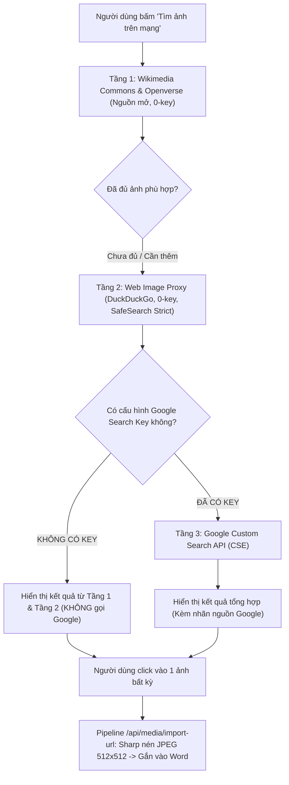

# Kế hoạch kỹ thuật: Kết hợp 3 Phương án Tìm & Gắn ảnh (Ưu tiên Miễn phí -> Google Key cuối)

> **Mục tiêu:** Xây dựng hệ thống tìm kiếm ảnh đa tầng (Multi-tier Image Pipeline) kết hợp cả 3 nguồn. **Ưu tiên tuyệt đối 2 nguồn hoàn toàn miễn phí không cần key trước** (Wikimedia Commons & Web Proxy). **Chỉ kích hoạt Google Custom Search (CSE) ở tầng cuối cùng KHI VÀ CHỈ KHI người dùng đã nhập key; không có key thì tuyệt đối không gọi.** Khi bấm chọn ảnh bất kỳ -> **1-Click tự động tải, tối ưu và gắn thẳng vào từ vựng.**

---

## 1. Thứ tự ưu tiên & Cơ chế kích hoạt 3 Nguồn ảnh

### Bảng phân cấp 3 Tầng nguồn ảnh

| Tầng | Tên nguồn | Chi phí & Key | Vai trò trong hệ thống | Điều kiện kích hoạt |
| :--- | :--- | :--- | :--- | :--- |
| **Tầng 1** *(Ưu tiên 1)* | **Wikimedia Commons & Openverse** | **100% Miễn phí, KHÔNG CẦN KEY** | Nguồn ảnh giáo dục mở, vector, tranh vẽ clipart có bản quyền sạch (CC0, CC-BY). | Luôn luôn chạy đầu tiên. |
| **Tầng 2** *(Ưu tiên 2)* | **Web Image Proxy (DuckDuckGo / Web)** | **100% Miễn phí, KHÔNG CẦN KEY** | Tìm ảnh rộng khắp internet, lọc ảnh hoạt hình/clipart với `SafeSearch: Strict`. | Luôn luôn chạy song song / bổ trợ để đảm bảo từ nào cũng có ảnh. |
| **Tầng 3** *(Ưu tiên cuối)* | **Google Custom Search API (CSE)** | **Miễn phí 100 lượt/ngày (CẦN KEY)** | Nguồn ảnh chính xác cao từ Google Index. | **CHỈ GỌI KHI CÓ KEY.** Nếu chưa cấu hình key trong Cài đặt -> **BỎ QUA HOÀN TOÀN, KHÔNG SEARCH.** |

---

## 2. Thiết kế chi tiết cho từng tầng

### Tầng 1: Nguồn mở (Wikimedia Commons + Openverse API)
* Tận dụng logic Wikimedia Commons sẵn có tại [src/server/media/commons.ts](file:///Users/trunglk/Documents/trung-github/VocabularyNotes/src/server/media/commons.ts).
* Tự động bổ sung tiền tố/hậu tố tìm tranh vẽ: `${word} illustration`, `${word} clipart`, `${word} cartoon`.
* Lọc bỏ ảnh tài liệu lịch sử, chính trị, tranh thô không phù hợp trẻ em.
* Nhãn nguồn trên UI: `Thư viện mở` / `Commons`.

### Tầng 2: Web Image Proxy (Zero-Key Web Search)
* Route trung gian: `POST /api/media/web-search`.
* Truy vấn qua DuckDuckGo Image / Open search endpoint từ server Next.js (tránh bị lỗi CORS ở trình duyệt).
* Ép buộc tham số an toàn: `safeSearch=strict`, lọc các kết quả định dạng ảnh thông dụng (JPG, PNG, WebP).
* Nhãn nguồn trên UI: `Ảnh Web`.

### Tầng 3: Google Custom Search (Chỉ chạy khi có Key)
* **Cơ chế lưu trữ Key (BYOK - Bring Your Own Key):**
  * Thêm ô cấu hình trong màn hình *Cài đặt phụ huynh*:
    - `Google Search API Key`
    - `Google Search Engine ID (CX)`
  * Lưu vào `localStorage` của trình duyệt (hoàn toàn phía client, **không thêm biến môi trường nào lên Vercel**).
* **Quy tắc kích hoạt chặt chẽ:**
  * Client kiểm tra: nếu `googleApiKey` hoặc `googleCx` rỗng -> Request gửi lên server sẽ có cờ `includeGoogle: false` (hoặc server bỏ qua Google CSE).
  * Chỉ khi cả 2 giá trị này hợp lệ -> Gửi cờ `includeGoogle: true` để lấy thêm kết quả chất lượng cao từ Google CSE.
  * Hạn mức miễn phí: 100 queries/ngày/tài khoản Google của phụ huynh.
  * Nhãn nguồn trên UI: `Google Search`.

---

## 3. Trải nghiệm người dùng (UI/UX) — Click là Gắn ngay

1. **Vị trí nút bấm tại thẻ từ vựng ([word-picture-search.tsx](file:///Users/trunglk/Documents/trung-github/VocabularyNotes/src/components/features/word-picture-search.tsx)):**
   * Thay nút `Mở Google tìm ảnh` hiện tại bằng nút **"Tìm ảnh trên mạng"** (Kèm icon Internet/Google).
2. **Khu vực hiển thị kết quả:**
   * Mở rộng ngay dưới từ vựng một lưới ảnh gồm 6 – 9 ảnh xem trước rõ nét.
   * Mỗi ảnh có nhãn nguồn nhỏ góc dưới (`Nguồn mở`, `Web`, `Google`).
   * Thanh công cụ lọc nhanh:
     - Tag: `Tất cả` | `Tranh vẽ/Clipart` | `Hoạt hình` | `Ảnh thật`.
     - Ô tìm kiếm tùy chỉnh: cho phép sửa nhanh từ khóa (ví dụ: `bank` -> `piggy bank` để tránh nhầm sang ngân hàng).
3. **Thao tác 1-Click (One-Click Attach):**
   * Người dùng bấm vào bất kỳ ảnh nào trong lưới:
     - Thẻ ảnh đó xoay vòng tròn loading (`Đang lưu...`).
     - Server gọi `POST /api/media/import-url`, tải ảnh về, kiểm tra an toàn SSRF.
     - Dùng Sharp nén và resize về đúng chuẩn `512x512 JPEG`, dung lượng < 300KB.
     - Lưu vào bảng IndexedDB `media` và gán trường `art` cho từ vựng.
     - Hiện trạng thái thành công và cập nhật ngay hình ảnh của từ vựng trên màn hình.
4. **Trường hợp chưa cấu hình Google Key:**
   * Dưới chân lưới ảnh có 1 dòng ghi chú nhẹ nhàng:
     > *"Đang hiển thị ảnh miễn phí từ Thư viện mở & Web. Bạn có thể thêm Google API Key (miễn phí 100 lượt/ngày) trong phần Cài đặt để bổ sung kết quả từ Google."*

---

## 4. Kế hoạch triển khai mã nguồn chi tiết

| Bước | File cần chỉnh sửa / Tạo mới | Chi tiết công việc |
| :--- | :--- | :--- |
| **Bước 1** | `src/app/api/media/web-search/route.ts` `src/server/media/web-search.ts` | Tạo endpoint tìm kiếm tổng hợp: Tầng 1 (Commons/Openverse) + Tầng 2 (Web Proxy). Nhận thêm optional Google Key từ client để kích hoạt Tầng 3 (nếu có key). |
| **Bước 2** | `src/app/api/media/import/route.ts` `src/server/media/commons.ts` | Bổ sung hàm `importUrl(url)`: Fetch ảnh về an toàn (chống SSRF, timeout 8s, max 5MB), Sharp convert thành JPEG 512x512, tạo receipt SHA-256. |
| **Bước 3** | `src/lib/preferences.ts` `src/components/features/settings-form.tsx` (hoặc profile/settings) | Thêm 2 trường cấu hình tùy chọn: `googleSearchKey` và `googleSearchCx` trong local preferences của phụ huynh. |
| **Bước 4** | `src/components/features/word-picture-search.tsx` | Nâng cấp component: Chuyển nút Google thành trigger tìm kiếm trong app, hiển thị lưới ảnh phân loại nguồn, xử lý sự kiện click là gắn ngay. |
| **Bước 5** | `tests/unit/` & Scoped checks | Chạy kiểm thử tự động, lint, typecheck, verify an toàn SafeSearch và xử lý lỗi mạng khi mất kết nối. |

---

## 5. Cam kết tuân thủ quy định dự án
* ✅ **100% Miễn phí:** Hai tầng chính hoàn toàn miễn phí không cần thẻ/tài khoản. Tầng 3 dùng quota miễn phí 100 req/ngày của Google.
* ✅ **Không thêm env Vercel:** Google Key (nếu có) được lưu ở client của phụ huynh (BYOK), không đẩy lên biến môi trường Vercel.
* ✅ **An toàn cho trẻ 5–8 tuổi:** Bắt buộc SafeSearch Strict và các bộ lọc từ khóa phản cảm trên toàn bộ các tầng tìm kiếm.
* ✅ **Không push main, không mở browser founder.**

---

## 6. Hướng dẫn Comment & Phản hồi Review cho Founder

> 📝 **Cách comment vào file này:**
> - Nếu bạn đang xem file này trong trình soạn thảo VS Code / Cursor: Bạn có thể **gõ trực tiếp ý kiến hoặc sửa văn bản ngay tại đây**.
> - Bạn cũng có thể ghi nhận xét vào bảng dưới đây hoặc trả lời trực tiếp trong chat:

### Bảng Check-in Review của Founder:

- [ ] **Thứ tự ưu tiên (Tầng 1 Commons -> Tầng 2 Web -> Tầng 3 Google nếu có key):** *(Đồng ý / Cần chỉnh: ....................)*
- [ ] **Quy tắc Google Key (Không có key thì tuyệt đối không gọi):** *(Đồng ý / Cần chỉnh: ....................)*
- [ ] **Trải nghiệm 1-Click (Bấm ảnh là tự resize 512x512 và gắn luôn):** *(Đồng ý / Cần chỉnh: ....................)*
- [ ] **Góp ý khác:** *(Ghi chú thêm tại đây)*
