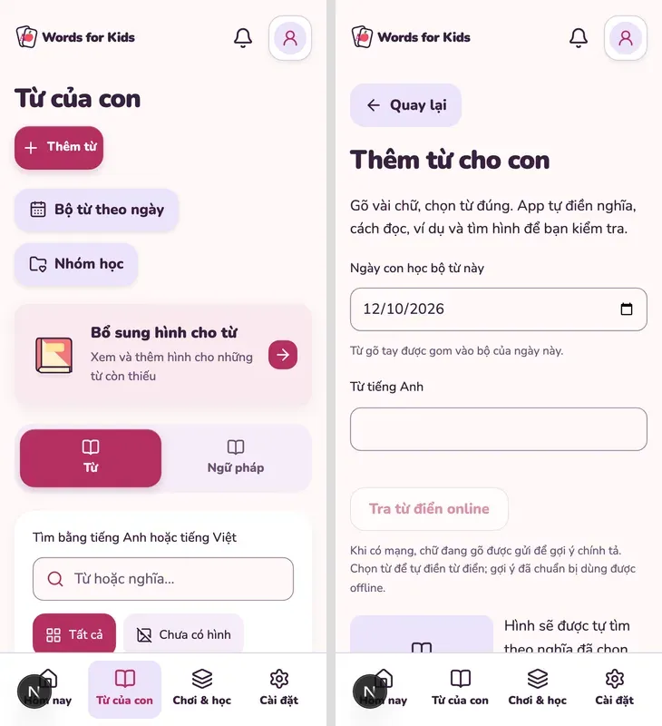

⚠️ DEGRADED: single-context (project AGENTS forbids sub-agents; supporting Impeccable review was not an independent dual-agent critique).

# UX/UI review evidence — 12/10/2026

Deliverable: [founder proposal](../DE-XUAT-UX-UI.md), [AI implementation plan](../ai/UX-UI-IMPLEMENTATION-PLAN.md). Status **review complete / proposal awaiting approval**; application not changed by this task.

## Method and boundaries

Read START-HERE/STATE/TASKS, relevant current screen/motion/UX rules, route inventory, feature components and shared audio/motion/preferences. Used explicitly requested UI/UX Pro Max; supporting Impeccable context+detector, Motion Design and Systematic Debugging for mute root-cause probe. No agents/plugins/hooks/packages installed. No new PRODUCT/DESIGN system or implementation. Current four main nav destinations supersede historical three-nav specs.

Isolated Playwright Chromium via workflow runner, own snapshots/port4347, synthetic demo library and photo, mocked auth/status and network/provider responses. Mobile360×800 (device scale3) / desktop1280×1000; archived images rescaled to logical viewport width and compressed WebP. No founder browser, data, cookies or real credentials; service workers blocked. No live Google/Commons/Gemini/OAuth/account writes/deploy. Actual microphone failure fixture only; not real hardware/audio-quality proof.

Source: commit `bc2983a`; app source remained unchanged throughout audit; test harness revised per capture phase, therefore each run has its own **full** source fingerprint. Initial dirty media fallback work preserved. Evidence sources include current code, new screenshots and selected behavior probes; historical screenshots not used as current visual truth.

## Concrete observed findings

- **Mute reset reproduced at both viewports:** `/settings` sound switch off → `/practice` → `/settings` switch on. Assertions succeeded before later capture-harness failure. Root cause in `PracticePreview` effect (`practice.tsx:29`) forcibly setting sound true; cue unlock/play also uses literal true (`59–60`). Existing `AudioControl` correctly gates requested speech on preference. Proposal changes source of preference handling, not symptom styling.
- **Library hierarchy:** mobile search input starts ~614px, words below first viewport. Management destinations and missing-picture action are above reading tabs/search. No claim of slow runtime from this geometry.
- **Long input forms:** Add has16 initial inputs, save top~2380px, document2556px; editor document2251px in collapsed initial state. Propose hiding secondary edit controls behind explicit sections while preserving every field/value and shared save.
- **Rating discoverability:** revealed flashcard1116px at360×800, long explanations/pronunciation place rating below the first screen. Preserve exact-sentence speech/IPA and four SRS ratings; prioritize the two child-friendly choices.
- **Review discoverability:** `.review-word > summary` renders headword/art only; VI meaning and selected checkbox are inside expanded detail. Propose visible meaning + explicit selection without nested interactive summary controls.
- **Selection scopes:** group has global word+grammar select, active-category select-all and page select. All capabilities are useful; distinguish scopes rather than deleting whole-result selection.
- **Image actions:** internal catalog search, external Google and internal fallback search have similar current labels. Preserve founder's always-accessible external search button and pre-existing fallback changes.
- **Source-only candidates:** app reduced-motion + GrammarSteps timer mismatch needs targeted probe; replay visible label; grammar/speaking empty CTAs; settings level label/behavior explanation; older review recovery copy. Not classified as live/provider/device defects.

## Commands and truthful outcomes

Node default shell was23.11.0; default-shell pnpm invocations rejected engine. Used existing24.14.1 via PATH, pnpm11.25.0; no installation. Every execution used prior `--list` discovery with nonzero selection. Dev snapshots, no build (plan-only task).

| Run | Fingerprint prefix | Selected | Result / reason |
|---|---|---:|---|
| `kJRyC2` phase1 inventory | `359b4c41ca9f` | 2 | **FAIL** after33 captures per viewport and completed mute/search/game probes: helper incorrectly required h1 in legacy empty review. Did not patch app |
| `uP4oyV` phase2 initial | `9a548f8d5124` | 2 | **FAIL**: fresh capture file input used before enabled/hydrated; fixture lacked readiness wait |
| `MAGJDF` phase2 corrected readiness | `e89d35ab001a` | 2 | **FAIL** after photo/batch/expanded review/mic captures: helper looked for button English, actual Radix control is radio |
| `ug0tU3` supplemental | `3f24cbb34033` | 4 | **3 PASS / 1 FAIL**: desktop settled-grammar scenario exceeded90s during cold dev navigation; mobile counterpart and game/result probes passed |
| `0YKWRY` targeted desktop retry | same `3f24cbb34033` | 1 | **PASS43.3s**, same owned snapshot+fingerprint after cold compilation. No source/app patch |

Commands: `pnpm test:ui -- --list ux-plan-audit.spec.ts`; `pnpm test:ui -- ux-plan-audit.spec.ts --port 4347`; final retry `pnpm test:ui -- --snapshot <owned-idYrEH> ux-plan-audit.spec.ts --grep 'settled grammar' --project desktop-chromium --port 4347`.

Do not describe initial failed capture sessions or the combined work as a full E2E PASS. Coverage is **100 current captures / 50 screen-state names / two viewports**, plus completed selected probes; final supplemental scenario covered both viewports through targeted retry. Zero horizontal document overflow in these captured fixtures; not a proof for all content or keyboard widths.

[Capture manifest](ux-review-2026-10-12/manifest.json) contains exact metadata, route/viewport/height/overflow and run ownership. Each `run-*.json` preserves full fingerprint/commit/commands/duration/status. Browser logs and capture scripts from three phases archived beside images; failed attempts retained in run evidence. Stale first grammar-detail screenshot (actually previous list route) excluded/replaced by settled detail capture. First speaking loading capture explicitly named `speaking-loading`, not treated as ready UI. Next dev indicator/focus skip-link in early captures are harness/dev observations, not product defects.

UI/UX Pro Max searches: `audio feedback reduced motion --domain ux` matched Reduced Motion and Excessive Motion; `loading error feedback --stack nextjs` matched loading/error handling, used only as supporting stack guidance. `progressive disclosure children forms` was off-topic; one retry `progressive disclosure` again matched heading balance, so **not** used as verified progressive-disclosure guidance. Form simplification is reviewer judgment based on measured UI/source and skill's general forms/navigation priorities.

Impeccable detector scanned `src/components/features src/components/app` once: **one advisory** `bounce-easing` in pull-to-refresh.tsx:209. Theme's playful intent takes priority; no automatic fix. Detector cannot detect long form decision burden/mute reset, and does not establish WCAG/contrast/child-usability PASS. No browser overlay injected; no native founder browser opened. Runner-managed preview processes ended; temporary test removed after archival. Snapshot directories retained as owned diagnostic evidence; no shared server/lock touched.

## Visual comparison and coverage

Current mobile library on the left; current Add on the right. These are **before** screenshots, not proposed mockups.

The gallery below lists every retained capture. “Source-only” gaps: authenticated cloud transfer/delete/reconciliation branches; selected-group detail and lesson-editor dialogs; notification sync/copy branches; unknown-item legacy redirect; real offline service-worker/install/update and camera/clipboard permissions; live speaking feedback/calibration/phoneme sheet and voice availability. Components/current behavior reviewed in source, no new live acceptance claimed. Main/app screens, all seven learning modes, photo stages and selected error/reduced/locale states have captures; account route is fixture configured=false.

## Metrics / limitations

Risk class: docs+review; no learning/schema/auth mutation. Input discovery and custom capture fixture had avoidable helper errors documented above. Scoped retry only addressed missing/failed evidence; no release suite, app lint/types or production build required for docs-only output. Runtime preparation/browser timings in run JSON; token usage unavailable. Image composition fallback: system Python lacked PIL and ImageMagick label font delegate; existing Sharp used, no packages installed. Those failures did not affect app behavior.

Human approval questions are in the founder proposal. Actual child usability, physical phone keyboard/safe-area/touch/audio and live provider quality remain external validation. Plans do not promise measured improvement or test passing after future edits.

Final docs verification: `pnpm docs:check` PASS (992links,16skills/329resources,156JSON; schema validation not requested), `git diff --check` PASS. First docs check detected skill-cache files generated by Python search; removed only the three generated `.pyc` files, restored pinned resource inventory, then rechecked. App/source pre-existing diff counts unchanged.

## Captures

| Screen/state | Mobile360 | Desktop1280 |
|---|---|---|
| 404 | [Ảnh](ux-review-2026-10-12/mobile-404.webp) | [Ảnh](ux-review-2026-10-12/desktop-404.webp) |
| account | [Ảnh](ux-review-2026-10-12/mobile-account.webp) | [Ảnh](ux-review-2026-10-12/desktop-account.webp) |
| add | [Ảnh](ux-review-2026-10-12/mobile-add.webp) | [Ảnh](ux-review-2026-10-12/desktop-add.webp) |
| batch | [Ảnh](ux-review-2026-10-12/mobile-batch.webp) | [Ảnh](ux-review-2026-10-12/desktop-batch.webp) |
| batch-review | [Ảnh](ux-review-2026-10-12/mobile-batch-review.webp) | [Ảnh](ux-review-2026-10-12/desktop-batch-review.webp) |
| batch-review-expanded | [Ảnh](ux-review-2026-10-12/mobile-batch-review-expanded.webp) | [Ảnh](ux-review-2026-10-12/desktop-batch-review-expanded.webp) |
| capture | [Ảnh](ux-review-2026-10-12/mobile-capture.webp) | [Ảnh](ux-review-2026-10-12/desktop-capture.webp) |
| deck-editor | [Ảnh](ux-review-2026-10-12/mobile-deck-editor.webp) | [Ảnh](ux-review-2026-10-12/desktop-deck-editor.webp) |
| demo | [Ảnh](ux-review-2026-10-12/mobile-demo.webp) | [Ảnh](ux-review-2026-10-12/desktop-demo.webp) |
| flashcard | [Ảnh](ux-review-2026-10-12/mobile-flashcard.webp) | [Ảnh](ux-review-2026-10-12/desktop-flashcard.webp) |
| flashcard-revealed | [Ảnh](ux-review-2026-10-12/mobile-flashcard-revealed.webp) | [Ảnh](ux-review-2026-10-12/desktop-flashcard-revealed.webp) |
| grammar-detail | [Ảnh](ux-review-2026-10-12/mobile-grammar-detail.webp) | [Ảnh](ux-review-2026-10-12/desktop-grammar-detail.webp) |
| grammar-game | [Ảnh](ux-review-2026-10-12/mobile-grammar-game.webp) | [Ảnh](ux-review-2026-10-12/desktop-grammar-game.webp) |
| grammar-list | [Ảnh](ux-review-2026-10-12/mobile-grammar-list.webp) | [Ảnh](ux-review-2026-10-12/desktop-grammar-list.webp) |
| group-editor | [Ảnh](ux-review-2026-10-12/mobile-group-editor.webp) | [Ảnh](ux-review-2026-10-12/desktop-group-editor.webp) |
| group-review | [Ảnh](ux-review-2026-10-12/mobile-group-review.webp) | [Ảnh](ux-review-2026-10-12/desktop-group-review.webp) |
| groups | [Ảnh](ux-review-2026-10-12/mobile-groups.webp) | [Ảnh](ux-review-2026-10-12/desktop-groups.webp) |
| legacy-review | [Ảnh](ux-review-2026-10-12/mobile-legacy-review.webp) | [Ảnh](ux-review-2026-10-12/desktop-legacy-review.webp) |
| lessons | [Ảnh](ux-review-2026-10-12/mobile-lessons.webp) | [Ảnh](ux-review-2026-10-12/desktop-lessons.webp) |
| letters | [Ảnh](ux-review-2026-10-12/mobile-letters.webp) | [Ảnh](ux-review-2026-10-12/desktop-letters.webp) |
| library | [Ảnh](ux-review-2026-10-12/mobile-library.webp) | [Ảnh](ux-review-2026-10-12/desktop-library.webp) |
| library-en | [Ảnh](ux-review-2026-10-12/mobile-library-en.webp) | [Ảnh](ux-review-2026-10-12/desktop-library-en.webp) |
| mic-error | [Ảnh](ux-review-2026-10-12/mobile-mic-error.webp) | [Ảnh](ux-review-2026-10-12/desktop-mic-error.webp) |
| notes | [Ảnh](ux-review-2026-10-12/mobile-notes.webp) | [Ảnh](ux-review-2026-10-12/desktop-notes.webp) |
| notification-draft | [Ảnh](ux-review-2026-10-12/mobile-notification-draft.webp) | [Ảnh](ux-review-2026-10-12/desktop-notification-draft.webp) |
| paused | [Ảnh](ux-review-2026-10-12/mobile-paused.webp) | [Ảnh](ux-review-2026-10-12/desktop-paused.webp) |
| photo-editor | [Ảnh](ux-review-2026-10-12/mobile-photo-editor.webp) | [Ảnh](ux-review-2026-10-12/desktop-photo-editor.webp) |
| photo-extract | [Ảnh](ux-review-2026-10-12/mobile-photo-extract.webp) | [Ảnh](ux-review-2026-10-12/desktop-photo-extract.webp) |
| picture-feedback | [Ảnh](ux-review-2026-10-12/mobile-picture-feedback.webp) | [Ảnh](ux-review-2026-10-12/desktop-picture-feedback.webp) |
| picture-game | [Ảnh](ux-review-2026-10-12/mobile-picture-game.webp) | [Ảnh](ux-review-2026-10-12/desktop-picture-game.webp) |
| play | [Ảnh](ux-review-2026-10-12/mobile-play.webp) | [Ảnh](ux-review-2026-10-12/desktop-play.webp) |
| prepare | [Ảnh](ux-review-2026-10-12/mobile-prepare.webp) | [Ảnh](ux-review-2026-10-12/desktop-prepare.webp) |
| profile | [Ảnh](ux-review-2026-10-12/mobile-profile.webp) | [Ảnh](ux-review-2026-10-12/desktop-profile.webp) |
| restore-error | [Ảnh](ux-review-2026-10-12/mobile-restore-error.webp) | [Ảnh](ux-review-2026-10-12/desktop-restore-error.webp) |
| review-results | [Ảnh](ux-review-2026-10-12/mobile-review-results.webp) | [Ảnh](ux-review-2026-10-12/desktop-review-results.webp) |
| search-empty | [Ảnh](ux-review-2026-10-12/mobile-search-empty.webp) | [Ảnh](ux-review-2026-10-12/desktop-search-empty.webp) |
| settings | [Ảnh](ux-review-2026-10-12/mobile-settings.webp) | [Ảnh](ux-review-2026-10-12/desktop-settings.webp) |
| sound-reenabled | [Ảnh](ux-review-2026-10-12/mobile-sound-reenabled.webp) | [Ảnh](ux-review-2026-10-12/desktop-sound-reenabled.webp) |
| speaking-game | [Ảnh](ux-review-2026-10-12/mobile-speaking-game.webp) | [Ảnh](ux-review-2026-10-12/desktop-speaking-game.webp) |
| speaking-loading | [Ảnh](ux-review-2026-10-12/mobile-speaking-loading.webp) | [Ảnh](ux-review-2026-10-12/desktop-speaking-loading.webp) |
| speaking-ready | [Ảnh](ux-review-2026-10-12/mobile-speaking-ready.webp) | [Ảnh](ux-review-2026-10-12/desktop-speaking-ready.webp) |
| speaking-results | [Ảnh](ux-review-2026-10-12/mobile-speaking-results.webp) | [Ảnh](ux-review-2026-10-12/desktop-speaking-results.webp) |
| spelling | [Ảnh](ux-review-2026-10-12/mobile-spelling.webp) | [Ảnh](ux-review-2026-10-12/desktop-spelling.webp) |
| today | [Ảnh](ux-review-2026-10-12/mobile-today.webp) | [Ảnh](ux-review-2026-10-12/desktop-today.webp) |
| welcome | [Ảnh](ux-review-2026-10-12/mobile-welcome.webp) | [Ảnh](ux-review-2026-10-12/desktop-welcome.webp) |
| welcome-app-reduced | [Ảnh](ux-review-2026-10-12/mobile-welcome-app-reduced.webp) | [Ảnh](ux-review-2026-10-12/desktop-welcome-app-reduced.webp) |
| welcome-os-reduced | [Ảnh](ux-review-2026-10-12/mobile-welcome-os-reduced.webp) | [Ảnh](ux-review-2026-10-12/desktop-welcome-os-reduced.webp) |
| word | [Ảnh](ux-review-2026-10-12/mobile-word.webp) | [Ảnh](ux-review-2026-10-12/desktop-word.webp) |
| word-editor | [Ảnh](ux-review-2026-10-12/mobile-word-editor.webp) | [Ảnh](ux-review-2026-10-12/desktop-word-editor.webp) |
| word-picture | [Ảnh](ux-review-2026-10-12/mobile-word-picture.webp) | [Ảnh](ux-review-2026-10-12/desktop-word-picture.webp) |
