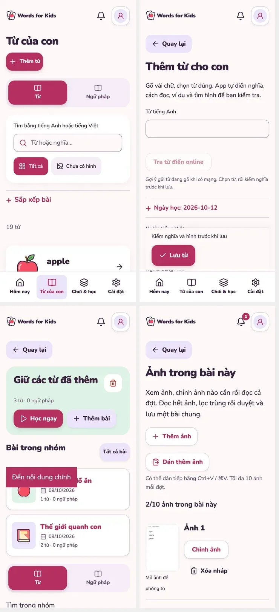

# UX/UI implementation —12/10/2026

Founder explicitly authorized all four phases of [proposal](../DE-XUAT-UX-UI.md) and two additional group bugs. **Implemented_local / scoped verified**. All four phases and both group fixes delivered; founder/child/physical-device/live acceptance remains separate.

## Acceptance / risk

Reading/actions become easier to find; collapsed controls retain all values; one common save retains data/media/grammar and reports pending/error/success; review/analysis preserve ADR082; game mute persists independently of requested voice; OS/app reduced motion supports manual controls. Group pending selections must never remove saved membership, and filters display one headword row while preserving senses/POS/source IDs.

Risk: hidden-field validation, staged-media loss, changing source group sets or dedup semantics, stale writes, overclaiming live/physical-device UX. Preserve initial media-source dirty diff and founder data. No founder browser, new Vercel env or pushmain.

## Root causes and implementation

Mute: reproduced by previous audit; PracticePreview auto-enabled preference and passed true to all cues. Removed mutation, cue unlock/play gates actual per-device SFX, mute/pause/route/hide stops; retained account `sound` for requested speech. New `wfk.game-sound.v1` tiny setting migrates legacy mute and remains device-only with truthful label; no cloud SQL field.

Group selection: current array included saved+pending IDs; clearing filtered/page/global lists removed baseline IDs. `selectNewMembers` excludes protected IDs; successful save protects all saved IDs. Group transaction `preserveExisting` unions retained words/sentences/grammar before validation and preserves sets; stale version fails. Old unavailable references are not silently cleaned. Existing general callers keep replacement behavior.

Duplicate names: group picker and reading lists projected every sense separately. Reused deterministic `groupLibraryWords` for headword+caseMode; filter before projection, then paginate. Each word row exposes its senses; bulk selections apply only new senses. Saved sense controls locked. No data merged/deleted; POS/sense separation survives save/reload.

## Verification checkpoints

- Initial `pnpm lint`: found React ref write during render; moved latest sound flag update into effect. Corrected lint/typecheck subsequently PASS before first UI run.
- `pnpm exec vitest run tests/unit/group-selection.test.ts tests/unit/game-sounds.test.ts tests/integration/groups.test.ts`:17 PASS (includes saved member/source-set retention, unchanged replay, CAS).
- `pnpm exec vitest run tests/integration/word-edit.test.ts tests/integration/library-search.test.ts tests/unit/library-search.test.ts tests/integration/worksheet-batch.test.ts tests/unit/worksheet-review.test.ts`:28 PASS.
- One repeated unit command accidentally selected nonexistent group-sets/edit-word paths; Vitest still selected three existing files/17tests. Not additional coverage; corrected filenames in the28-case command. No new dependencies required/added.
- First UI run: `pnpm test:ui -- --list ux-refinement.spec.ts search-batch.spec.ts` selected32tests; execution owned snapshot+fixture at4347. Later completed26PASS/6FAIL; failure accounting below. First cold dev batch navigation took beyond test's5s even though drafts had saved, candidate environmental compilation latency; no app patch on that evidence alone.

No current production/device/live/provider claim. Full metadata and final results to be appended when verification completes. App/network/camera/audio/cloud use synthetic fixtures and isolated contexts, not founder libraries/accounts.

## Final results — current source

- **46 unit/integration tests PASS**,8files:groups,word-edit,library-search,group-selection,game-sounds,worksheet-batch,worksheet-review. Added regression also preserves multiple already-saved legacy sense IDs. Initial legacy fixture attempted duplicate identity within the same entry and correctly hit the unique constraint; corrected fixture to use a separate legacy entry, preserving the actual constraint. No schema change/constraint relaxation.
- **Lint + typecheck PASS** after final source edits.
- **Production build PASS27.3s** on owned snapshot `pu9Qcx`; commit `bc2983a`, current full source fingerprint in [run JSON](ux-ui-implementation/run-q2Krgx.json), prefix `e1770284c08b`.
- **60 UI tests PASS /2 explicitly skipped** (live-media opt-in) from62discovered cases at360/1280. Suites:ux-refinement,search-batch,speaking-refresh,media-source-errors,word-picture-intake,compact-home,free-picture-sources. [Final UI run](ux-ui-implementation/run-q2Krgx.json),64.5s. Live-media skip is intentional, not evidence of network media success.
- **6 additional scoped production UI tests PASS**,same owned build/source fingerprint,7.7s: shared edit field failure/staged picture/success/footer; partial legacy grammar added to existing group without loss; grammar animation/reset + reduced/manual steps. [Additional run](ux-ui-implementation/run-REd8Q7.json). No rebuild/repeated wide suite for this scope.
- **66 executed UI cases passed in final source** (60+6), with own demo/photo/network/permission fixtures. Real upload/import signing boundary used for photo staging tests; no founder media or data.
- **74 final screenshots archived** (mobile+desktop), [manifest](ux-ui-implementation/manifest.json). Current ready library/search, add/edit, Today, groups, decks, seven learning modes via existing+new tests, speaking response/errors, image stages, VI/EN, reduce-motion and recovery covered. Selected authenticated boundaries are mocked; no new hosted OAuth/SQL/cloud smoke.

Earlier runs are retained honestly: `3q578U`26PASS/6FAIL (cold dev navigation and new-test selector/whitespace issues); `YND2iM`42productionPASS before last group canonicalization/legacy-fixture fix; `NEeS7M`57PASS/3FAIL/2SKIP (older exact accessible-name selectors and a hidden non-main duplicate during hydration). Corrected test selectors to match complete accessible names and scope the visible main. Final `q2Krgx`60PASS/2SKIP replaces these failed runs. No app behavior patched to suppress those fixture failures. Production rebuilt only after source/data-protection changes and the batched form styling fix.

Earlier image tests wrote to historic evidence paths from the caller cwd despite snapshot app isolation. Restored only the8tracked images that were clean at task start and generated by these runs; changed those test screenshots to testInfo.outputPath. Current images go to owned run output, then explicit archive. No pre-existing media/source/doc diff overwritten.

## Delivered screen changes

| Phase | Delivered behavior |
|---|---|
|1|Today compact hero and due-review primary; library search/list before collapsed management; Add word first/default day collapsible, secondary pronunciation/metadata/extra-example editing; WordEditor basic content + current/staged art then disclosures and one common Save; rating buttons before longer card examples; game mute retained|
|2|Device-specific photo intake wording; three photo steps; compact full photo preview list +2/10count; meaning/POS + selection outside each review summary; pattern sentence/VI preview; stable save summary; distinct catalog/Google/internal fallback names; upload controls collapsed unless fallback requested, arbitrary user images/source retained|
|3|Group filters project one headword+caseMode before pagination; per-sense controls/links preserved; saved membership locked and pending-only bulk controls; source sets/CAS/unchanged-save preserved; scoped select wording and mobile save bars for group/deck; resume before new games; beginner flashcard guidance; date manager and library wording consistent|
|4|Requested voice vs per-device game SFX controls; legacy mute migration/retry; visible replay label and recording-feedback note; OS/app reduce-motion shared hook for grammar/notes; manual grammar steps; finite selected-row/sentence-token feedback; word examples/grammar detail disclosure; recovery for empty grammar/speaking/group review and old photo route; profile sections reordered; global error copy follows locale|

Welcome, notifications, deletion confirmation, license attribution and offline/PWA behavior are retained as proposed. No new music, global click sounds, background loops, nav destination, parent gate, AI/provider auto-call, data merge or paid fallback.

## Visual QA / limits

Compared mobile+desktop captures in a batched inspection; final confirmation includes safe-area save/footer and rating reachability, search + word in first mobile viewport, wrapped controls, no document overflow for selected VI/EN fixtures, native checkbox labels and supported disclosure focus. The save bar becomes static when a text/select control has focus to avoid covering the keyboard editing area; real software keyboard and browser chrome remain physical-phone checks.

Impeccable detector once:one **existing advisory** (pull-to-refresh easing), no new severe findings. Playful incumbent style wins over generic bounce advice. Detector not WCAG/human UX proof. No founder browser opened; Playwright contexts were isolated/headless. Test-only preview servers cleaned up by runner; no other service killed. No pushmain/newVercelenv/deploy or database migration. Tokens unavailable; run durations/fingerprints archived. Current terminal/runtime is Node24.14.1/pnpm11.25.0; no dependency/lock changes.

## Founder review

Refresh the local app. Open an existing group: saved checkboxes remain checked/locked; select-all then clear new items, Save and reload—the previous words stay. Search bank/they or another multi-sense word:one row, open its meanings to verify each sense is intact. Try manual Add→edit+picture→oneSave, two-photo review, flashcard ratings, and separate sound controls. Physical camera/clipboard/mic/Safari/PWA and child observation still require real-device/human review; local fixtures do not establish provider accuracy/eligibility or calibrated pronunciation score.

Final docs validation: `pnpm docs:check` PASS (1007local links,16skills/329resources,163JSON; schema validation not requested) and `git diff --check` PASS.

## Group search highlight follow-up

Founder screenshot showed query `a` filtering words without visible highlighting. Root cause: both group word lists rendered plain text instead of the library's shared `SearchHighlight`. Reused it for headword, Vietnamese meaning and sense labels in reading/picker; matching rules, saved membership and data identity unchanged. `ngan` highlights original accented `ngân`; clearing/reload removes highlights.

Regression reproduced on mobile/desktop before patch (no `mark`, run ryrf5O). First patched run V5EzCT reached correct English/Vietnamese highlights but failed an invalid test expectation: filtering `ngan` leaves only one matching bank sense, so there is no expanded multi-sense list. Corrected that assertion, no app change for the fixture failure. Final scoped run: **2/2 PASS**, commit bc2983a + fingerprint 0fd83f0bc8b9; [metadata](ux-ui-implementation/highlight-result.json), [log](ux-ui-implementation/highlight-browser.log), [mobile](ux-ui-implementation/highlight-mobile.png), [desktop](ux-ui-implementation/highlight-desktop.png). Includes protected bulk selection/save/reload and single-headword checks. `pnpm lint`, `pnpm typecheck`, library-search unit **4 PASS**, diff check PASS. Dev owned snapshot only; no new build/deploy/device claim.
